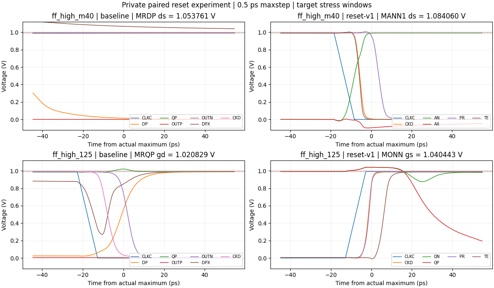
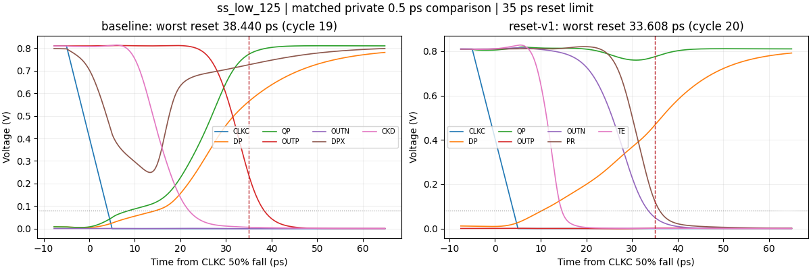

# RESET-V1: one controlled reset-network experiment

This is an independent **private diagnostic**, not the candidate selected by the official view. The canonical `adc_comp.scs`, its schematic and all 92 official records remain frozen. The baseline circuit is the one simulated from clean source `424d10a78ce75a1ef45d121575a9eac07a1ebd93`; its electrical SHA-256 is `150dd81755a64d66f582a84fd734462f5ad2c8b31ce4399b6507481d30372119`. This experiment does not replace the standard-step v0.7.0 evidence or establish qualification.

[Frozen experiment source with complete RNL](RESET-V1.txt) · [schematic](https://raw.githubusercontent.com/many-question/ADC-12b-100M/e45f2ad7bea3b45f5822eae18549b326c19fc727/design/xtor/adc_comp/many-question-strongarm/reset-v1.png).

## Evidence motivating the change

The original private 0.5 ps / traponly waveforms were re-read before defining the variant. Their job-local electrical circuit matches the canonical baseline. Their historical enclosing worktree was dirty, so these old runs are not relabeled as clean-source runs. Original waveforms, source metadata and archive hashes are retained privately. The old energy window differs from v0.7.0 and is not used as the matched energy control.

| Corner | Observed stage and terminals | Actual sampled peak | Worst reset |
|---|---|---:|---:|
| ff_high_m40 | Evaluation, CLKC rise +91.995 ps; DPX=1.067415 V, DP=0.013654 V | MRDP \|Vds\|=1.053761 V | 21.185679 ps |
| ff_high_125 | Reset, CLKC fall +17.749 ps; QP=1.020829 V, CLKC=0 | MRQP \|Vgd\|=1.020829 V | 24.030597 ps |
| ss_low_125 | DPX charge redistribution precedes the late DP/Q refill | MRQP \|Vgd\|=0.836633 V | 38.439852 ps |

The cold DPX excursion persists into evaluation. At hot fast conditions, the highest stress instead occurs during Q refill. The delayed series precharge and associated charge redistribution are a hypothesis for the reset bottleneck; temporal association alone does not prove causality.

## Frozen change and falsifiable prediction

- Replace each two-device input-drain precharge branch with one 2.4 um / 30 nm PMOS, three 0.8 um fingers, connected directly from AVDD to DP or DN. DPX/DNX and MPDP/MPDN disappear. The chosen width approximates the nominal series conductance of the previous 4 um and 6 um devices; it is a single fixed choice, not a sweep.
- Generate `PR = CLKC OR CKD` with a transistor NOR and inverter; drive MRDP/MRDN from PR. Generate `TE = CLKC AND CKD` with a transistor NAND and inverter; drive the existing 3 um tail from TE. This intends to separate input precharge and tail conduction; actual analog transition separation must be measured.
- Merge each Q-node's 2 um direct and 4 um delayed precharge devices into one 6 um PMOS controlled by CLKC. The stronger early path is intended to constrain the refill overshoot and shorten reset.
- Keep the input pair, latch, RTZ output inverters, four MOM devices, ports and external 10 fF loads unchanged. The existing two-inverter CKD generator is retained, although its changed load affects its delay.

The 12 added logic MOS have 1 um / 30 nm front devices (one finger) and N2/P4 um output inverters. All new or resized geometries passed device callbacks with no warnings; ordered inputs, outputs, package provenance and SHA verification are retained privately. Total: **31 MOS and four MOM**, versus 23 MOS and four MOM in the baseline. Complete RNL was checked using a byte-identical `.scs` validation copy and visually inspected.

The prediction is lower MRDP ds and MRQP gd stress and shorter SS reset while preserving zero CMP-15 violations. Any remaining or newly introduced terminal overvoltage is a failure of the stress-repair hypothesis. Record added delay, AVDD energy and CLKC charge even if functional validity passes. Added controls may change regeneration timing, kickback, input-referred noise and offset; baseline noise/MC evidence does not transfer to this variant.

## Bounded comparison protocol

Only `tt_nom_27`, `ff_high_m40`, `ff_high_125` and `ss_low_125`: matched baseline and this one variant, eight serial jobs with at most one Spectre process. Use the current official delay stimulus and validity implementation, with private numeric overrides maxstep=0.5 ps, method=traponly, reltol=1e-6 and vabstol=1e-8. AVDD energy uses the current 100 ps..14.5 ns meter, 36 complete mixed-amplitude cycles.

Save every MOS terminal for all gs/gd/ds checks: 69 baseline pairs and 93 variant pairs, including every new logic device. Preserve failed checks and stop on simulation input/solver errors. Saving VCK's branch current adds no circuit element: integrate current delivered by the ideal clock source and apply the existing rising-edge charge window to report effective CLKC capacitance over the 36 mixed-input cycles. This is a private clock-load comparison, not a replacement for official CMP-14 kickback-bench evidence.

If the variant improves the targeted behavior, repeat only its worst stress corner at 0.25 ps. Do not launch another variant, sizing sweep, 45-corner campaign, noise or MC in this experiment. This candidate stays draft/WIP; Miyahara remains frozen.

## Results: reject this implementation

The four-corner experiment preserves zero CMP-15 violations and shortens reset, but **does not repair device stress**. The worst overvoltage moves to a new control-logic device, rises to 1.08406 V and persists at 0.25 ps. TT 30 mV delay becomes 60.770260 ps, above the 50 ps CMP-06 limit. AVDD energy and CLKC charge increase. RESET-V1 remains an independent rejected diagnostic; the canonical baseline and its failures remain unchanged.

Actual clean source for all nine physical jobs: `e12e1557c2ed8fa0a165777e93b02fa5fe7189da`. Variant electrical SHA-256: `2e19cf609abc92224f1dac209d3d7502dec114fc1829dc40060e923ec980aa92`. There was exactly one variant, four baseline controls, four matched variant jobs, and one worst-corner sensitivity repeat. Each planned job ran once; local analysis recovery did not rerun a simulator job. No other corner, sizing, noise or MC campaign was launched.

### Matched 0.5 ps results

Each cell below is **baseline -> RESET-V1**; these are private fine-step results, not the standard-step official values. All eight jobs have 36 decided cycles, zero CMP-09 wrong decisions, zero CMP-15 violations, zero undecided cycles and no both-50% cycles. Across the four variant corners: 0/144 validity violations. The largest losing peak is **19.697539% VDD**, `ff_high_125`, cycle 35, vd=+10 uV, OUTN, CLKC 50% rise +60.792 ps. Every saved evaluate sample was included.

| Corner | 1 mV delay (ps) | 30 mV delay (ps) | Reset (ps) | Losing peak (% VDD) |
| --- | --- | --- | --- | --- |
| tt_nom_27 | 58.122 -> 73.797 | 44.994 -> 60.770 | 27.898 -> 24.345 | 16.932 -> 17.096 |
| ff_high_m40 | 44.030 -> 55.412 | 34.365 -> 45.840 | 21.186 -> 18.842 | 18.388 -> 18.608 |
| ff_high_125 | 43.635 -> 56.546 | 33.402 -> 46.330 | 24.031 -> 21.801 | 19.503 -> 19.698 |
| ss_low_125 | 75.631 -> 97.789 | 57.971 -> 80.235 | 38.440 -> 33.608 | 15.814 -> 15.965 |

SS reset improves by 4.831718 ps (12.57%), from 38.439852 to 33.608134 ps. This fixes that one sampled corner in the diagnostic; it does not clear the baseline's four official reset failures or establish all-corner coverage. TT 1 mV delay increases by 15.675016 ps; TT 30 mV delay increases by 15.775917 ps and fails CMP-06.

| Corner | AVDD energy (fJ/cycle) | CLKC rising charge / swing (fF) | CLK charge-energy estimate (fJ) |
| --- | --- | --- | --- |
| tt_nom_27 | 190.686419 -> 207.809519 | 15.132433 -> 15.498313 | 12.257271 -> 12.553634 |
| ff_high_m40 | 219.043395 -> 243.029158 | 15.912202 -> 16.276913 | 15.595549 -> 15.953002 |
| ff_high_125 | 353.729050 -> 418.762588 | 16.738304 -> 16.853471 | 16.405212 -> 16.518087 |
| ss_low_125 | 174.688850 -> 189.889251 | 14.408687 -> 14.851408 | 9.453539 -> 9.744009 |

AVDD energy uses only the official 100 ps..14.5 ns, 36-cycle meter. TT increases by **17.123100 fJ (+8.98%)**, and hot-fast energy by **65.033538 fJ (+18.39%)**. Energy is reported-only. CLKC effective capacitance increases at every tested corner; TT increases by 0.365881 fF (+2.42%). The clock charge-energy estimate is Ceff x VDD^2, separate from AVDD. It estimates a conventional driver charging cost and is not a measured clock-generator supply energy.

The private source-current probe integrates `-I(VCK:p)` using the existing `edge_cin` rising-edge windows over the same 36 mixed-input cycles. Its stimulus and number of cycles differ from the official 8-cycle kickback bench, so neither the nominal 16 fF budget nor the non-TT numbers here create an official CMP-14 verdict. The ideal voltage-source net energy integral is also retained privately; returned charge can reduce that net integral, so it is not treated as real driver energy or used to claim a power improvement.

### Stress: the failure was moved

| Corner | MRDP ds (V) | MRQP gd (V) | Largest pair (V) | Failing pairs, baseline /69 -> variant /93 |
| --- | --- | --- | --- | --- |
| tt_nom_27 | 0.94815 -> 0.89993 | 0.93970 -> 0.91068 | 0.94816 -> 0.98092 | 0 -> 0 |
| ff_high_m40 | 1.05376 -> 0.99109 | 1.03820 -> 1.00010 | 1.05376 -> 1.08406 | 21 -> 37 |
| ff_high_125 | 0.87238 -> 0.96404 | 1.02083 -> 0.99095 | 1.02083 -> 1.04044 | 8 -> 7 |
| ss_low_125 | 0.79701 -> 0.80110 | 0.83663 -> 0.81910 | 0.84050 -> 0.86342 | 0 -> 0 |

- Cold-fast: removing DPX/DNX reduces MRDP |Vds| from 1.05376 to 0.99109 V, but MANN1 |Vds| becomes **1.08406 V**. At the actual sampled maximum, CLKC fall +13.336 ps, AN=0.988259 V and AX=-0.095801 V. The two NAND NMOS are off after CKD falls, leaving their intermediate AX negatively charged; the new control network has introduced a different floating-node stress problem. MRQP/MRQN gd also retain small 1.00010 V violations. Those are not rounded down to passes.
- Hot-fast: MRQP gd falls from 1.02083 to 0.99095 V, but the output inverter MONN gs reaches **1.04044 V**. At the actual maximum, CLKC rise +7.773 ps, QN=1.040443 V and TE=-0.006207 V: the tail is still off. This is consistent with clock-coupled Q overshoot during the added evaluation delay; this single combined change does not isolate each coupling contribution. MANN1 ds also exceeds the limit, at 1.00478 V.
- Every old and new MOS gs/gd/ds pair was checked over the full transient, including initialization, evaluation and reset. All 93 variant pairs are represented; no newly failing device was excluded. The standard SOA table reports the earliest point within 100 uV of the peak, whereas the event timestamps above are the actual sampled argmax. These timestamps use different stated conventions.

The following table covers **each of the 12 new devices**. Cells give maxima in **gs / gd / ds order, volts**. The limit is 1.0 V for every pair. Full 93-pair tables, signs, time above limit and local time steps are in the archived private summaries.

| New device | tt_nom_27 | ff_high_m40 | ff_high_125 | ss_low_125 |
| --- | --- | --- | --- | --- |
| MANP1 | 0.90000 / 0.90000 / 0.91988 | 0.99000 / 0.99000 / 1.00767 | 0.99000 / 0.98983 / 0.99121 | 0.81000 / 0.80996 / 0.82927 |
| MANP2 | 0.92188 / 0.91955 / 0.91988 | 1.00970 / 1.00997 / 1.00767 | 0.99191 / 0.99618 / 0.99121 | 0.83052 / 0.82866 / 0.82927 |
| MANN1 | 0.89988 / 0.90000 / 0.98092 | 0.98993 / 0.99000 / 1.08406 | 0.98473 / 0.98983 / 1.00478 | 0.80944 / 0.80996 / 0.86342 |
| MANN2 | 0.91286 / 0.91782 / 0.61020 | 1.00085 / 1.00412 / 0.64806 | 0.99297 / 0.99530 / 0.68965 | 0.82379 / 0.82768 / 0.56203 |
| MTEP | 0.91988 / 0.91950 / 0.92188 | 1.00767 / 1.00736 / 1.01340 | 0.99121 / 0.99432 / 0.99832 | 0.82927 / 0.82859 / 0.82728 |
| MTEN | 0.91803 / 0.91950 / 0.91529 | 1.00822 / 1.00736 / 1.00210 | 0.99808 / 0.99432 / 0.99375 | 0.82303 / 0.82859 / 0.82781 |
| MORP1 | 0.90000 / 0.89982 / 0.35374 | 0.99000 / 0.98994 / 0.35381 | 0.99000 / 0.98405 / 0.35729 | 0.81000 / 0.80898 / 0.33556 |
| MORP2 | 0.91207 / 0.91835 / 0.90350 | 1.00026 / 1.00648 / 0.99379 | 0.98860 / 0.99989 / 0.98474 | 0.82235 / 0.82877 / 0.81163 |
| MORN1 | 0.90000 / 0.90010 / 0.90861 | 0.99000 / 0.99014 / 0.99852 | 0.99000 / 0.99014 / 0.98215 | 0.81000 / 0.81008 / 0.81601 |
| MORN2 | 0.91286 / 0.91835 / 0.90861 | 1.00085 / 1.00648 / 0.99852 | 0.99297 / 0.99989 / 0.98215 | 0.82379 / 0.82877 / 0.81601 |
| MPRP | 0.91689 / 0.91793 / 0.91645 | 1.00692 / 1.00815 / 1.00387 | 0.99760 / 0.99782 / 0.98910 | 0.82395 / 0.82473 / 0.82573 |
| MPRN | 0.90861 / 0.91793 / 0.91319 | 0.99852 / 1.00815 / 1.00418 | 0.98215 / 0.99782 / 0.99833 | 0.81601 / 0.82473 / 0.82057 |

For completeness, the failing variant pairs are:

- `tt_nom_27`: none.
- `ff_high_m40`: MTAIL gs; MRDP gs,gd; MRDN gs,gd; MRQP gd; MRQN gd; MOPN gs,gd; MOPP gd; MONN gs,gd; MONP gd; MCK2N ds; MCK2P ds; MANP1 ds; MANP2 gs,gd,ds; MANN1 ds; MANN2 gs,gd; MTEP gs,gd,ds; MTEN gs,gd,ds; MORP2 gs,gd; MORN2 gs,gd; MPRP gs,gd,ds; MPRN gd,ds.
- `ff_high_125`: MOPN gs,gd; MOPP gd; MONN gs,gd; MONP gd; MANN1 ds.
- `ss_low_125`: none.

### Measured control phases and reset

The threshold-based control separation is positive for every measured cycle. There are zero saved points simultaneously satisfying TE > 70% VDD and PR < 30% VDD. This is a voltage timing diagnostic, not proof of zero subthreshold or analog overlap current. It also does not constrain the internal AX node; the stress failure occurs despite the positive control separation.

| Corner | PR 50% rise -> TE 50% rise (ps) | TE 50% fall -> PR 50% fall (ps) |
| --- | --- | --- |
| tt_nom_27 | 9.080 .. 9.087 | 13.199 .. 13.202 |
| ff_high_m40 | 6.386 .. 6.390 | 9.643 .. 9.646 |
| ff_high_125 | 7.331 .. 7.332 | 11.946 .. 11.948 |
| ss_low_125 | 13.130 .. 13.137 | 19.213 .. 19.215 |

### The one 0.25 ps repeat

| ff_high_m40 RESET-V1 metric | 0.5 ps | 0.25 ps |
| --- | --- | --- |
| Largest terminal stress (V) | 1.084060 | 1.084060 |
| Failing pairs of 93 | 37.000000 | 37.000000 |
| 1 mV delay (ps) | 55.412467 | 55.413698 |
| 30 mV delay (ps) | 45.840392 | 45.840314 |
| Reset (ps) | 18.842422 | 18.855397 |
| Losing peak (% VDD) | 18.607561 | 18.617950 |
| AVDD energy (fJ) | 243.029158 | 243.041418 |
| CLKC charge / swing (fF) | 16.276913 | 16.277050 |

CMP-15 remains 0/36 in the repeat. Both settings report MANN1 ds=1.08406 V and 37 failing pairs; the failure survives the only finer-step check. The largest saved step is 0.25 ps, confirmed in the simulator log, with traponly, reltol=1e-6 and vabstol=1e-8. This is a sensitivity check at one corner, not a convergence or full-corner qualification claim.

### Disposition, risks and retained evidence

Reject this implementation as the next canonical source. The reset improvement supports further study of the precharge timing, but adding this NAND/NOR network does not give all of its internal nodes bounded voltage. The stronger early Q reset and delayed evaluation also need examination together because the largest Q stress shifts to the rising edge. A next authorized experiment should first address bounded control-node voltage and Q edge coupling with less delay; it should not start a broad corner or noise campaign around RESET-V1.

The changed tail timing and drain/Q trajectories can change effective preamplification, input-referred noise, kickback and offset. No new noise, MC, input-capacitance, common-mode-range or mixed-top evidence was generated, and the baseline's TT noise/offset numbers do not transfer. The extra eight MOS and clock charge also need layout and driver assessment if any later revision is considered. No layout area advantage or total-system power improvement is claimed.

All nine simulator returns were zero. A private local plotting helper initially used the wrong API name (`soa.fig_soa` instead of `soa.figure`) after all eight paired simulations had finished and their raw data had been retrieved. The error is logged in the archive; only local measurement resumed, with no simulator rerun. No simulator input/solver error occurred.

- `20261030-195400-strongarm-reset-v1-paired`: 112 remote input/output files matched SHA-256 before exact-owned removal and absence confirmation. 152 archive entries passed CRC/SHA readback; ZIP SHA-256 `abf613b9118237f83e0afccb1819046cb92d82465ef8213734a1edd083ea7378`.
- `20261030-200224-strongarm-reset-v1-sensitivity`: 56 remote input/output files matched SHA-256 before exact-owned removal and absence confirmation. 67 archive entries passed CRC/SHA readback; ZIP SHA-256 `90dc13c586627233134f0abbc1a3d5d3bd9d054d774ff84fe2676de26fab9ed5`.

Private archives retain actual deck/testbench/netlist/raw/logs, per-job source and hashes, effective numerical settings, every device-pair result and all failed evidence. Callback inputs/results and the original baseline audit remain in the separate experiment audit bundle. No private host, model, environment or provider data are published.

All **92 official records and 274 official JSON/PNG files are byte-identical** to the pre-experiment snapshot. The canonical source and schematic are unchanged. The candidate remains draft/WIP and unselected. Explicit RNL validation reports 0 errors, 0 warnings and 0 hints; all three new figures were visually inspected. Candidate scope/author, hygiene and full local project checks passed with zero errors; the four expected warnings are the unchanged official reset failures. No shared code changed, so the prior 439-test baseline suite was not rerun for this bounded diagnostic report.
