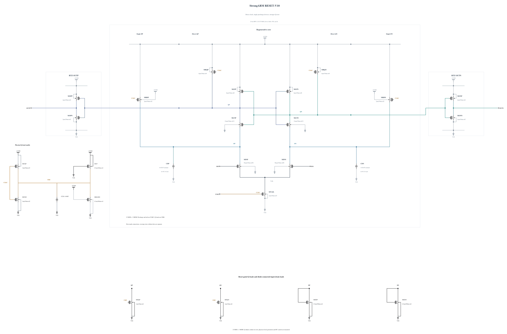

# RESET-V10: advance reset-load turn-on and bound the clock low level

V9 shows that increasing Q shunt conductance alone leaves an early cold-FF peak and violates slow-corner reset. This experiment starts from V8 with the lighter N1 Q shunts. The CKB pull-up becomes P3 instead of P2 to turn the shunts on earlier. Direct input precharge becomes P2 instead of P2.4 to offset the external clock-capacitance increase. Input diode loads remain and their recharge time is rechecked.

The faster clock pull-up can increase the negative clock-edge excursion. A weak P0.5 um / 100 nm from AVDD to CKB, with its gate at VSS, provides a small physical low-level pull-up; the existing weak NMOS clock load remains. The resulting clock voltage range, low-level leakage into the Q loads, reset overlap and DC energy are all measured. This is not an ideal clamp or an extra bias supply. Both new PMOS geometries have successful zero-warning callbacks.

The [independent source](RESET-V10.txt) contains 23 MOS and three MOM capacitors. Electrical SHA-256: `a6834ef58286ccc4676a5f400d1c8a1c9abf53b05f5b7341cbf2809551ee0cb3`. Full RNL on its byte-identical Spectre mirror passes core 0.5.2 with 0 errors, 0 warnings and 0 hints.

The first four key corners check all 69 MOS terminal pairs throughout the trace, correct decisions and CMP-15, delay/reset and exact AVDD energy. The clock-charge diagnostic does not replace official CMP-14. No inherited performance pass is claimed.
