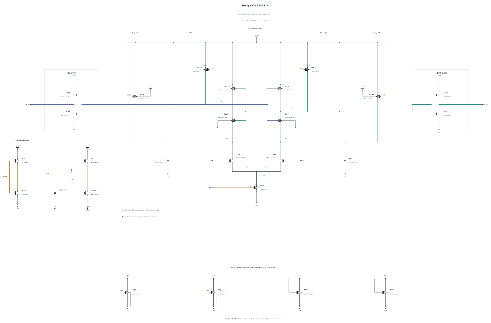

# RESET-V11: slightly stronger input precharge

V10 passes all-device stress and physical output validity at four key corners, but its SS low/hot reset takes 35.044926 ps against a 35 ps limit. This experiment changes only MRDP/MRDN from P2 to P2.2 um, with two fingers and L=30 nm. A new successful zero-warning callback supplies all geometry and parasitics. The lighter reset-gated Q loads, physical clock circuit and weak clock-floor load remain unchanged.

The [independent source](RESET-V11.txt) has 23 MOS and three MOM capacitors. Electrical SHA-256: `d04b9edb8a3d5b781494660d243866fb975b56be53a8d4c22da030ca694e2f5f`. Full RNL on its byte-identical Spectre mirror passes core 0.5.2 with 0 errors, 0 warnings and 0 hints; the rendered schematic was inspected.

The four-key-corner screen checks all 69 MOS terminal pairs over the entire trace, actual decisions, CMP-15, delay/reset and AVDD energy. More input precharge also increases external clock load, so the clock-charge diagnostic remains under review and does not replace official CMP-14. No previous source performance is inherited.
