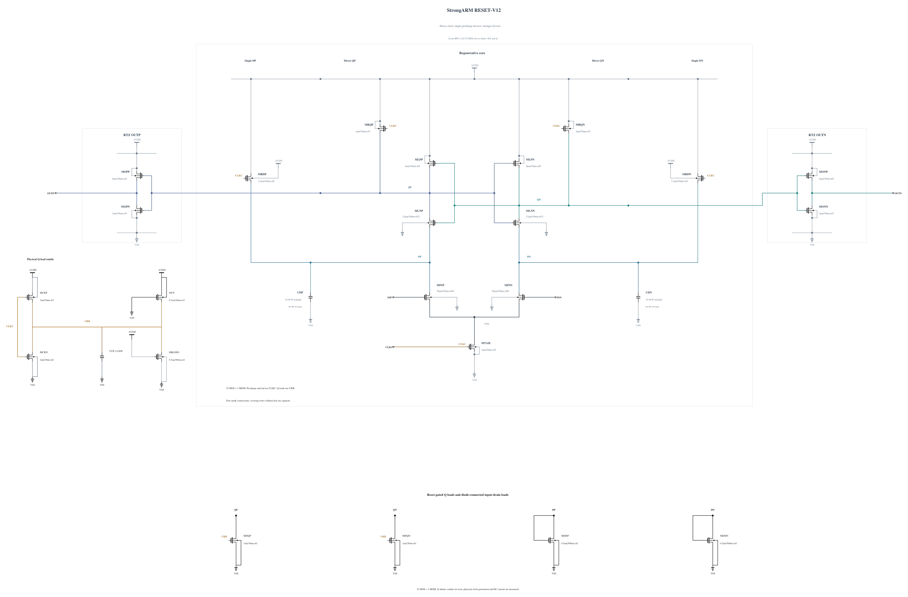

# RESET-V12: reduce Q reset slew and lower the output trip point

V11 fails SF low/cold physical output validity while the two Q nodes are still regenerating, and its SF high/27 Q peak occurs 5.46 ps after the falling clock edge. This experiment strengthens each output NMOS from N2 to N3 to keep the losing output low through the common-mode dip. It also weakens each direct Q precharge from P4 to P3 to slow the measured reset coupling. The lower output trip point may offset the slower Q recharge in the external reset metric; this is a hypothesis, not an inherited pass. Q shunts and the physical clock remain unchanged. Both complete geometries reuse successful validated parameters.

The [independent source](RESET-V12.txt) has electrical SHA-256 `fbec8c61b7accb7fdf85ccff4c17f53b68589be849236a1558ba70628a46d846`. Full RNL on its byte-identical Spectre mirror passes core 0.5.2 with 0 errors, 0 warnings and 0 hints; the schematic was inspected.

Six key corners now include both limiting SF cases and SS low/hot, together with TT and FF high/cold/hot. Every MOS terminal pair, all physical decisions, output validity, delay/reset and AVDD energy are checked over the entire trace. The next necessary simulations also save AVDD and device branch currents so reset/evaluation energy and persistent load current can be measured. See [energy comparison](ENERGY-COMPARISON.md); no prior qualification or topology-only efficiency advantage is claimed.
