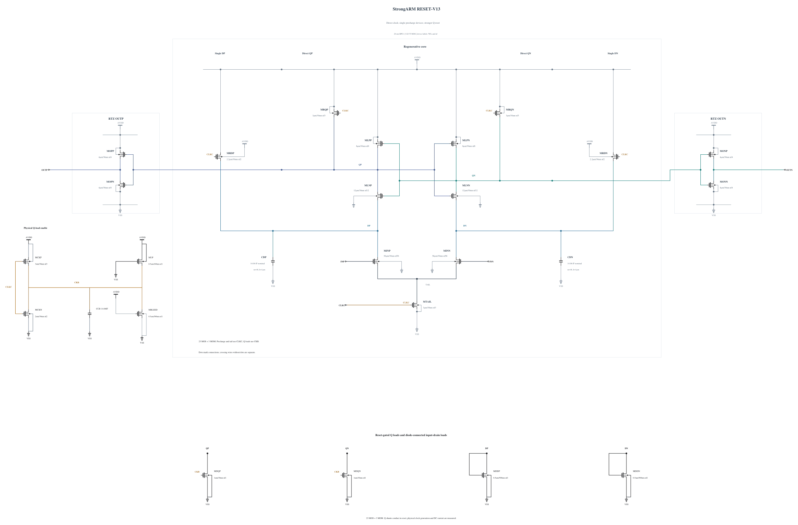

# RESET-V13: strengthen only the external output pull-down

Current disposition: rejected for expansion after the additional cold high-voltage corners. See the final completed-screen section below.

V12 passes six-corner output validity but retains a 1.00002 V SF Q peak and 35.861626 ps SS reset. This experiment changes only MOPN and MONN from N3 to N4 um, L=30 nm, with 4 fingers. Complete geometry and parasitics are copied from an identical previously validated canonical device. Stronger output discharge and a lower inverter trip point may improve the physical reset metric; the added gate load also changes the upstream waveform, so delay, output validity and all-device stress must be measured again. No Q-shunt or weak pull-up is strengthened.

The [independent source](RESET-V13.txt) has electrical SHA-256 `7b82aa1b9cb951e5dce10db119d62ba9403dbf7905f742b385479bbbe4abfa96`. Full RNL on a byte-identical Spectre mirror passes core 0.5.2 with 0 errors, 0 warnings and 0 hints; the rendered schematic was inspected.

The six-key-corner screen retains the same complete transient checks and current probes. Any passing revision proceeds to further qualification; failed revisions retain their evidence and stop their own expansion. [Energy comparison](ENERGY-COMPARISON.md) reports the measured persistent-current costs of the preceding implementations; no new performance or efficiency pass is assumed.

## Completed screen 20261031-045046-strongarm-reset-v13-screen

All six initial key corners pass full-trace terminal stress, actual polarity, output validity, delay/reset and regeneration time. Each corner has 36 correct decisions including 10 uV and 36 recorded resets. SS low/hot reset is 33.535468 ps and TT 30 mV delay 48.177506 ps. SF high/27 maximum stress is 0.99994 V, so the small margin requires additional SF temperature-endpoint/FS corners and targeted numerical convergence before qualification. Those are distinct new cases; no full-corner, noise, mismatch or capacitance pass is claimed.

Actual clean source commit: `36209f7fb9ef3664cd9a02aa63cffdef6db0bf0e`. Electrical SHA-256: `7b82aa1b9cb951e5dce10db119d62ba9403dbf7905f742b385479bbbe4abfa96`. The canonical netlist and 274 official result/figure files are unchanged.

| Corner | 1 mV / 30 mV delay (ps) | Reset (ps) | AVDD (fJ/cycle) | Decided / cycles | Wrong | CMP-15 | Max stress (V) | Failed pairs |
|---|---:|---:|---:|---:|---:|---:|---:|---:|
| ff_high_125 | 46.586775 / 35.998001 | 21.338033 | 916.418023 | 36 / 36 | 0 | 0 | 0.99011 | 0 / 69 |
| ff_high_m40 | 45.265642 / 36.620431 | 18.678425 | 830.382002 | 36 / 36 | 0 | 0 | 0.99754 | 0 / 69 |
| sf_high_27 | 60.362573 / 47.930561 | 20.998289 | 734.249806 | 36 / 36 | 0 | 0 | 0.99994 | 0 / 69 |
| sf_low_m40 | 86.230687 / 70.329442 | 23.855398 | 400.298146 | 36 / 36 | 0 | 0 | 0.82452 | 0 / 69 |
| ss_low_125 | 79.867177 / 62.760176 | 33.535468 | 406.710085 | 36 / 36 | 0 | 0 | 0.82143 | 0 / 69 |
| tt_nom_27 | 60.192675 / 48.177506 | 24.154538 | 577.098910 | 36 / 36 | 0 | 0 | 0.91070 | 0 / 69 |

The entire trace, including clock edges and reset, is checked for every MOS |Vgs|, |Vgd| and |Vds|. Each job uses +aps, no explicit +mt, traponly, maxstep=0.5 ps, reltol=1e-6 and vabstol=1e-8. The observed batch peak is 3 concurrent jobs; logs report effective single-thread simulation. All raw/deck hashes were verified, and the exact owned remote run was removed with absence confirmed.

Per-device maximum over all three terminal pairs (V):

| Device | ff_high_125 | ff_high_m40 | sf_high_27 | sf_low_m40 | ss_low_125 | tt_nom_27 |
|---|---:|---:|---:|---:|---:|---:|
| MINP | 0.56602 | 0.68322 | 0.70903 | 0.58959 | 0.53599 | 0.59347 |
| MINN | 0.56612 | 0.68330 | 0.70913 | 0.58970 | 0.53598 | 0.59352 |
| MTAIL | 0.99000 | 0.99000 | 0.99000 | 0.81000 | 0.81000 | 0.90000 |
| MRDP | 0.99000 | 0.99217 | 0.99000 | 0.81168 | 0.81000 | 0.90140 |
| MRDN | 0.99000 | 0.99217 | 0.99000 | 0.81318 | 0.81069 | 0.90139 |
| MLNP | 0.96000 | 0.99014 | 0.98795 | 0.80974 | 0.80201 | 0.89899 |
| MLNN | 0.96000 | 0.99014 | 0.98795 | 0.80974 | 0.80200 | 0.89899 |
| MLPP | 0.96550 | 0.99236 | 0.99000 | 0.81194 | 0.80546 | 0.90156 |
| MLPN | 0.96550 | 0.99236 | 0.99000 | 0.81194 | 0.80546 | 0.90156 |
| MRQP | 0.99000 | 0.99236 | 0.99980 | 0.82452 | 0.82143 | 0.91070 |
| MRQN | 0.99000 | 0.99236 | 0.99980 | 0.82452 | 0.82143 | 0.91070 |
| MOPN | 0.99011 | 0.99754 | 0.99994 | 0.82452 | 0.82143 | 0.91070 |
| MOPP | 0.98855 | 0.99736 | 0.99957 | 0.82407 | 0.82079 | 0.91039 |
| MONN | 0.99011 | 0.99754 | 0.99994 | 0.82452 | 0.82143 | 0.91070 |
| MONP | 0.98855 | 0.99736 | 0.99957 | 0.82407 | 0.82079 | 0.91039 |
| MDQP | 0.99011 | 0.99754 | 0.99994 | 0.82452 | 0.82143 | 0.91070 |
| MDQN | 0.99011 | 0.99754 | 0.99994 | 0.82452 | 0.82143 | 0.91070 |
| MDDP | 0.98475 | 0.98476 | 0.98558 | 0.81030 | 0.80742 | 0.89729 |
| MDDN | 0.98803 | 0.98767 | 0.98823 | 0.81318 | 0.81069 | 0.90044 |
| MCKN | 0.99000 | 0.99091 | 0.99263 | 0.81641 | 0.81272 | 0.90252 |
| MCKP | 0.99000 | 0.99000 | 0.99000 | 0.81000 | 0.81000 | 0.90000 |
| MBLEED | 0.99000 | 0.99091 | 0.99263 | 0.81641 | 0.81272 | 0.90252 |
| MUP | 0.99000 | 0.99091 | 0.99263 | 0.81641 | 0.81272 | 0.90252 |

Clock charge from the mixed delay sequence is a supplemental diagnostic, not the official CMP-14 input-capacitance result. No all-corner, noise, Monte Carlo or mixed-top qualification is inferred from this screen.

## Completed screen 20261031-045746-strongarm-reset-v13-screen

V13 is rejected for expansion: the additional SF/high/-40 corner reaches 1.001890426 V at QN, failing 10 terminal pairs. The Q peak occurs 5.355228 ps after the falling 50% clock crossing, while CKB is only 0.635933 V. The other three added corners pass, including FS/high/-40 at 0.99983 V. All four added corners have 36 correct polarities including 10 uV, 36 completed resets, and passing delay, reset, regeneration and output validity. Across ten measured corners, SF/high/-40 is the actual worst stress; six earlier passing corners do not qualify this source. No further corner, noise, MC or canonical promotion is performed for V13.

Actual clean source commit: `36209f7fb9ef3664cd9a02aa63cffdef6db0bf0e`. Electrical SHA-256: `7b82aa1b9cb951e5dce10db119d62ba9403dbf7905f742b385479bbbe4abfa96`. The canonical netlist and 274 official result/figure files are unchanged.

| Corner | 1 mV / 30 mV delay (ps) | Reset (ps) | AVDD (fJ/cycle) | Decided / cycles | Wrong | CMP-15 | Max stress (V) | Failed pairs |
|---|---:|---:|---:|---:|---:|---:|---:|---:|
| fs_high_m40 | 52.514829 / 43.633557 | 21.721611 | 786.287517 | 36 / 36 | 0 | 0 | 0.99983 | 0 / 69 |
| fs_low_125 | 61.828706 / 48.832496 | 30.137591 | 483.139256 | 36 / 36 | 0 | 0 | 0.81466 | 0 / 69 |
| sf_high_125 | 58.112388 / 45.205020 | 23.129005 | 777.845949 | 36 / 36 | 0 | 0 | 0.99751 | 0 / 69 |
| sf_high_m40 | 66.060580 / 53.623429 | 19.662782 | 743.011748 | 36 / 36 | 0 | 0 | 1.00189 | 10 / 69 |

The entire trace, including clock edges and reset, is checked for every MOS |Vgs|, |Vgd| and |Vds|. Each job uses +aps, no explicit +mt, traponly, maxstep=0.5 ps, reltol=1e-6 and vabstol=1e-8. The observed batch peak is 3 concurrent jobs; logs report effective single-thread simulation. All raw/deck hashes were verified, and the exact owned remote run was removed with absence confirmed.

Per-device maximum over all three terminal pairs (V):

| Device | fs_high_m40 | fs_low_125 | sf_high_125 | sf_high_m40 |
|---|---:|---:|---:|---:|
| MINP | 0.68753 | 0.53160 | 0.64115 | 0.75597 |
| MINN | 0.68760 | 0.53160 | 0.64116 | 0.75612 |
| MTAIL | 0.99000 | 0.81000 | 0.99000 | 0.99000 |
| MRDP | 0.99332 | 0.81000 | 0.99000 | 0.99210 |
| MRDN | 0.99332 | 0.81065 | 0.99000 | 0.99210 |
| MLNP | 0.99115 | 0.79447 | 0.97478 | 0.99011 |
| MLNN | 0.99115 | 0.79447 | 0.97478 | 0.99011 |
| MLPP | 0.99349 | 0.80135 | 0.97576 | 0.99236 |
| MLPN | 0.99349 | 0.80135 | 0.97576 | 0.99236 |
| MRQP | 0.99983 | 0.81466 | 0.99709 | 1.00189 |
| MRQN | 0.99983 | 0.81466 | 0.99709 | 1.00189 |
| MOPN | 0.99983 | 0.81466 | 0.99751 | 1.00189 |
| MOPP | 0.99968 | 0.81410 | 0.99568 | 1.00173 |
| MONN | 0.99983 | 0.81466 | 0.99751 | 1.00189 |
| MONP | 0.99968 | 0.81410 | 0.99568 | 1.00173 |
| MDQP | 0.99983 | 0.81466 | 0.99751 | 1.00189 |
| MDQN | 0.99983 | 0.81466 | 0.99751 | 1.00189 |
| MDDP | 0.98352 | 0.80684 | 0.98555 | 0.98520 |
| MDDN | 0.98663 | 0.81065 | 0.98844 | 0.98767 |
| MCKN | 0.99000 | 0.81000 | 0.99158 | 0.99267 |
| MCKP | 0.99000 | 0.81000 | 0.99000 | 0.99000 |
| MBLEED | 0.99000 | 0.81000 | 0.99158 | 0.99267 |
| MUP | 0.99000 | 0.81000 | 0.99158 | 0.99267 |

Clock charge from the mixed delay sequence is a supplemental diagnostic, not the official CMP-14 input-capacitance result. No all-corner, noise, Monte Carlo or mixed-top qualification is inferred from this screen.
