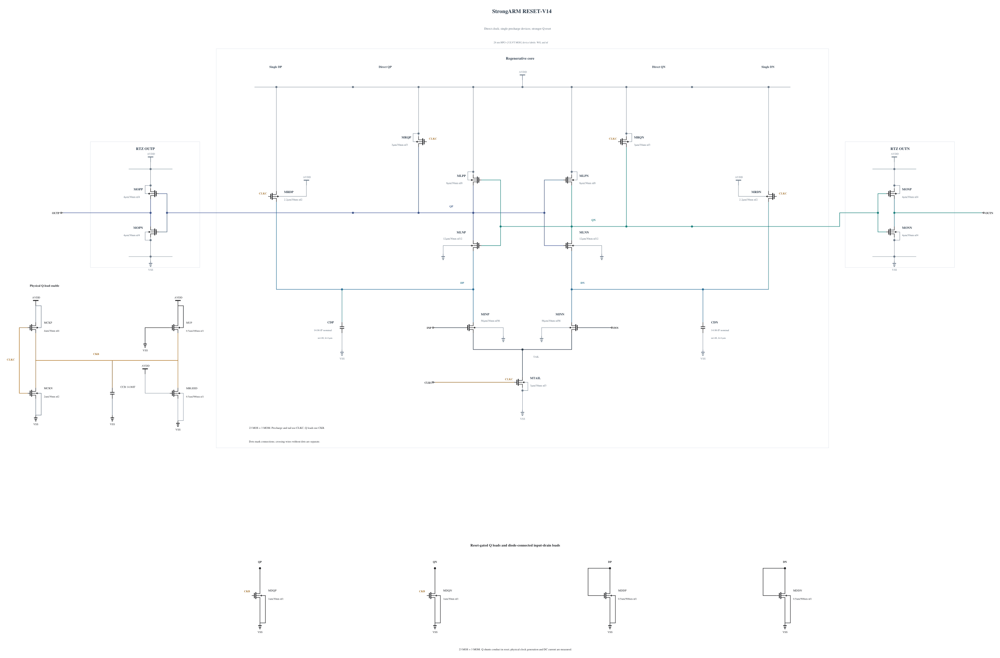

# RESET-V14: earlier reset-shunt enable

V13 passes delay, reset and physical output validity at all ten measured corners, but SF/high/-40 reaches QN=1.001890426 V and fails 10 terminal pairs. The peak occurs 5.355228 ps after the falling clock 50% crossing, with CKB still at 0.635933 V. The clock-controlled Q shunt therefore has limited gate drive during the coupled reset peak.

This experiment changes only MCKP from P3/nf3 to P4/nf4, using the complete identical callback-validated geometry of MOPP. The stronger pull-up is intended to enable the existing N1 Q shunts earlier. All 23 MOS and 3 physical MOM capacitors remain individually represented. The extra clock input charge and persistent-current cost must be measured.

The [independent source](RESET-V14.txt) has electrical SHA-256 `dd44da2a98a529e3f4dced4b72a1728101738d03a1bdc63d4042371206fa6455`. Full RNL on a byte-identical Spectre mirror passes core 0.5.2 with 0 errors, 0 warnings and 0 hints. The rendered schematic was inspected.

Screen SF/high/-40 and FS/high/-40 first. Only after they pass, complete TT, SS low/hot, SF low/cold, FF high/cold and high/hot, SF high/27 and high/hot, and FS low/hot. Check every MOS terminal voltage over the complete trace, all 36 physical polarities and resets, validity, delay, regeneration time and AVDD energy. Keep the total session concurrency at or below six jobs. No prior noise, mismatch or capacitance performance is inherited.

Passing screening would be supplemental evidence. Canonical promotion and qualification use the existing official runner, with old records preserved and honestly marked stale until replaced.
