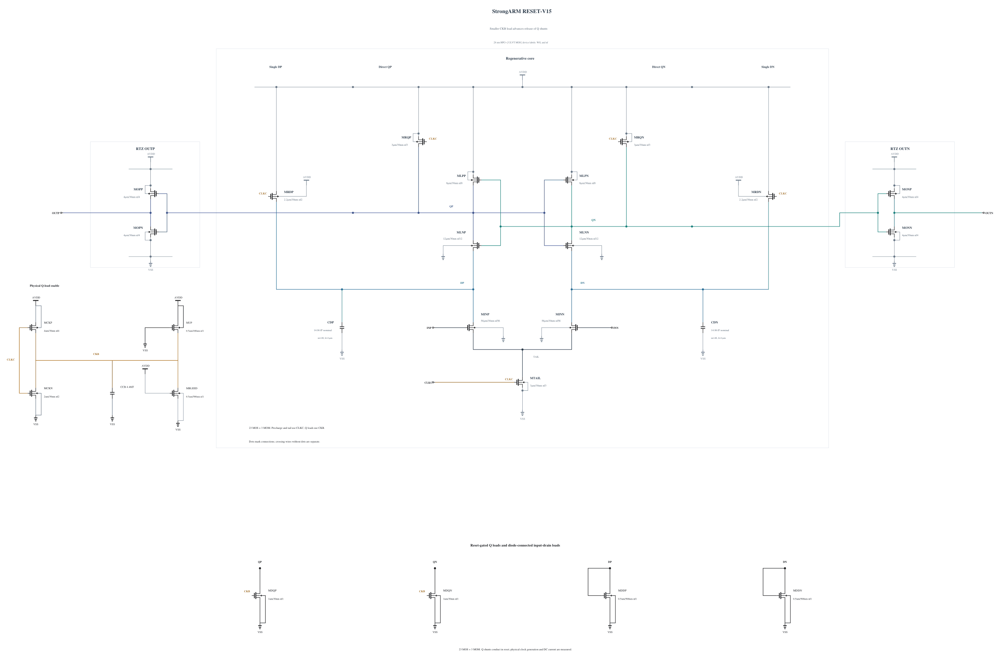

# RESET-V15: release the Q shunts earlier

V14 fails the genuine official TT noise gate at 2094.115400 uV rms. Its short instrumented diagnosis reproduces the broad decision errors at both default and fine numerical settings, with complete reset and stable early-to-final decisions. Q-node differential noise grows during the initial common-mode drop while transfer of the input difference is weak; this supports investigating the release trajectory, without attributing the failure to one device noise source.

This source changes only the CKB MOM from 48 to 16 fingers, nominally 14.06 to 4.46 fF. The smaller clock load is intended to turn the reset-only Q shunts off earlier on a rising CLKC edge, reducing the initial Q-node drop and the interval of weak input coupling. It also changes falling-edge behavior, so terminal stress, reset and output validity must be measured again. The full capacitor geometry exactly reuses a previously callback-validated instance; all MOS dimensions and other electrical statements are unchanged.

Electrical SHA-256: `34e60d7b2afcb0d9a6c3ed8743189c704399b31612824baf26ca7cf621689a44`. The [source](RESET-V15.txt) has 23 MOS and 3 MOM devices, with complete RNL and a byte-identical validation mirror. The canonical V14 source and its recorded failure are preserved.

First screen SF/high/-40 and FS/high/-40 with full-trace terminal voltages, physical decisions and reset. If they pass, check TT timing and a short noise diagnosis early before wider characterization. Promotion and formal qualification require the complete gates; no noise, capacitance or SOA pass is inherited.

