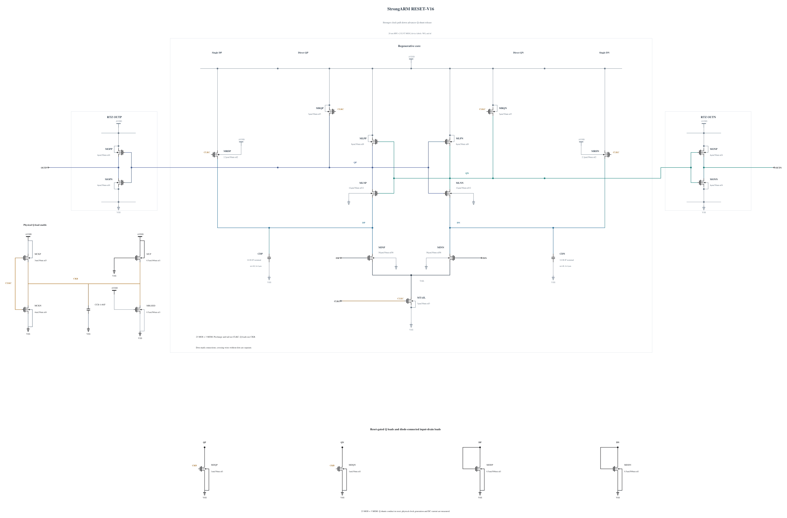

# RESET-V16: change the clock-inverter drive ratio

V15 reduces wrong polarity in the matched short noise diagnosis from V14 fine-control 91/256 to 52/256 at +/-800 uV, but this is still a gross error rate and does not support wider qualification. At +5 ps after the clock midpoint QP remains near 0.586 V; Q differential noise still grows while signal transfer is weak. Complete reset and stable 80 ps-to-final signs persist. This is diagnostic evidence, not a new official noise estimate.

This experiment changes only MCKN N2 to N4 and MCKP P4 to P3, retaining the 4.46 fF CKB capacitor and every other electrical statement. The stronger pull-down and shifted inverter trip point are intended to release the Q shunts before Q precharge is lost. The smaller PMOS also limits the added input clock-gate load. Both full geometries exactly reuse validated devices already in V15. Clock capacitance and falling-edge stress must be remeasured; neither is assumed to pass.

Electrical SHA-256: `ef4549caa57c005bae663d6473866eea5da81db4db57dbabb4f0f4acb814d4c9`. The [source](RESET-V16.txt) retains 23 MOS and 3 MOM devices and complete RNL, checked through a byte-identical mirror. Canonical V14 and all V14/V15 failures remain preserved. First screen SF/high/-40 and FS/high/-40, then TT timing and short noise if those pass. No expanded corners or formal qualification is claimed at source freeze.

