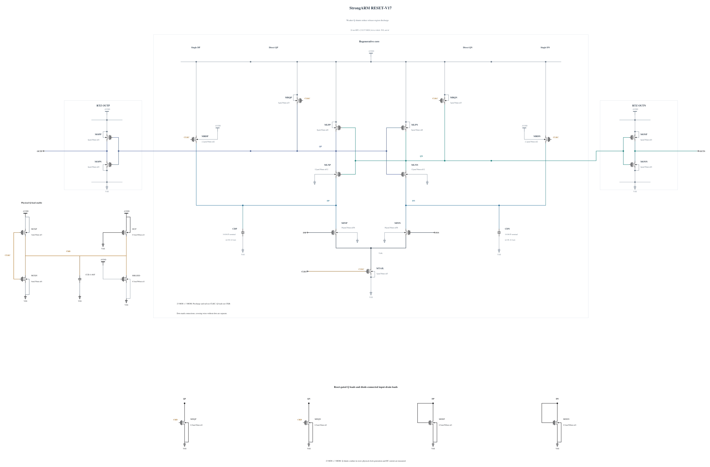

# RESET-V17: reduce Q reset-shunt strength

V16's matched short fine-step noise diagnosis improves from V15's 52/256 wrong polarities to 13/256 at +/-800 uV, while all 256 resets, stable early/mid-to-final signs, output validity and full 69-pair MOS stress pass. QP at rising midpoint +5 ps rises from approximately 0.586 V to 0.649 V. The +30 ps Q differential standard deviation drops to 1.34/1.52 mV, but is still large relative to the input-derived differential signal. These short two-level records are diagnostic only and do not estimate formal noise or isolate one device's noise contribution. V16 expansion stops.

This source changes only MDQP and MDQN from 1 um/30 nm to 0.5 um/30 nm, reusing the complete successful N0.5 geometry already present in V3. All terminal parasitics are copied exactly; callback SHA-256 is `fc440ca368b3063979554e2eef4ee6e93e94e1210a67f7d94f97302d09b192b2`. The N4/P3 clock inverter and 4.46 fF CKB capacitor remain. Weaker reset shunts are intended to reduce Q discharge during release and the premature growth of differential noise. Less charge absorption may restore the earlier Q overshoot, so SF/high/-40 and FS/high/-40 are mandatory first screens. No stress or noise benefit is assumed.

Electrical SHA-256: `24d5361e213a9a02c24ddf4a40a347409d16f89b5c9f43e8182fdcbb6487dbd6`. The [source](RESET-V17.txt) retains all 23 MOS and 3 MOM devices with complete RNL, checked through a byte-identical mirror. Canonical V14 and every prior failed version remain preserved. TT timing and a matched short noise diagnosis follow only if the first stress gates pass; no expanded-corner or formal qualification is claimed at source freeze.

## Completed screen 20261031-070558-strongarm-reset-v17-screen

Reject expansion: SF/high/-40 fails ten MOS terminal pairs at 1.00108 V. Both corners pass every actual polarity including 10 uV, all 36 resets per corner, timing and output validity. The FS corner passes all terminal pairs, but that does not waive the SF failure.

Actual clean source commit: `d7afab5b09f2c703dcb6054064f79a94c24497eb`. Electrical SHA-256: `24d5361e213a9a02c24ddf4a40a347409d16f89b5c9f43e8182fdcbb6487dbd6`. The canonical netlist and 274 official result/figure files are unchanged.

| Corner | 1 mV / 30 mV delay (ps) | Reset (ps) | AVDD (fJ/cycle) | Decided / cycles | Wrong | CMP-15 | Max stress (V) | Failed pairs |
|---|---:|---:|---:|---:|---:|---:|---:|---:|
| fs_high_m40 | 50.842057 / 41.140866 | 20.191095 | 533.912765 | 36 / 36 | 0 | 0 | 0.99735 | 0 / 69 |
| sf_high_m40 | 64.978335 / 51.144364 | 18.461131 | 502.818189 | 36 / 36 | 0 | 0 | 1.00108 | 10 / 69 |

The entire trace, including clock edges and reset, is checked for every MOS |Vgs|, |Vgd| and |Vds|. Each job uses +aps, no explicit +mt, traponly, maxstep=0.5p, reltol=1e-6 and vabstol=1e-8. The observed batch peak is 1 concurrent jobs; logs report effective single-thread simulation. All raw/deck hashes were verified, and the exact owned remote run was removed with absence confirmed.

Per-device maximum over all three terminal pairs (V):

| Device | fs_high_m40 | sf_high_m40 |
|---|---:|---:|
| MINP | 0.69739 | 0.76358 |
| MINN | 0.69751 | 0.76378 |
| MTAIL | 0.99000 | 0.99000 |
| MRDP | 0.99333 | 0.99211 |
| MRDN | 0.99333 | 0.99211 |
| MLNP | 0.99116 | 0.99013 |
| MLNN | 0.99116 | 0.99013 |
| MLPP | 0.99349 | 0.99236 |
| MLPN | 0.99349 | 0.99236 |
| MRQP | 0.99572 | 1.00108 |
| MRQN | 0.99572 | 1.00108 |
| MOPN | 0.99735 | 1.00108 |
| MOPP | 0.99716 | 1.00100 |
| MONN | 0.99735 | 1.00108 |
| MONP | 0.99715 | 1.00100 |
| MDQP | 0.99735 | 1.00108 |
| MDQN | 0.99735 | 1.00108 |
| MDDP | 0.98353 | 0.98520 |
| MDDN | 0.98665 | 0.98768 |
| MCKN | 0.99441 | 0.99657 |
| MCKP | 0.99061 | 0.99000 |
| MBLEED | 0.99441 | 0.99657 |
| MUP | 0.99441 | 0.99657 |

Clock charge from the mixed delay sequence is a supplemental diagnostic, not the official CMP-14 input-capacitance result. No all-corner, noise, Monte Carlo or mixed-top qualification is inferred from this screen.

Raw-waveform extrema locate QP = 1.001079522065 V at 14316.653061 ps, 11.653061 ps after the falling clock midpoint. CLKC is 0 V and CKB is 0.983552074 V, so the shunt is already enabled at the failing reset peak. This supports insufficient charge absorption at the reduced shunt strength, without proving an individual coupling contribution. Ten pairs fail strictly; rounding does not make this a pass. No TT, noise, remaining-corner or Monte Carlo job is launched for V17. All 72 decisions/resets and current-probe phase records are retained with the failing traces in verified archive f9b8c0f94462ccb2c7dace7d97854a3a3ae4ec1c73a01392a40a0d6b6aa51620; the owned remote run is absent.
