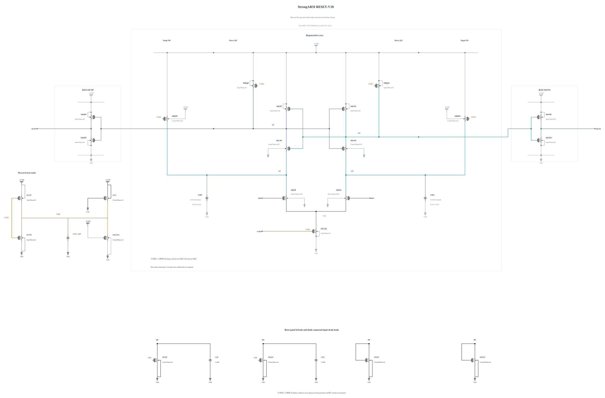

# RESET-V18: physical Q-node capacitance

V17 passes all 72 polarities/resets and output-validity checks in its first two corners, but SF/high/-40 reaches 1.001079522 V at Q during reset, about 11.653 ps after the clock falling midpoint. CKB is already 0.98355 V and CLKC is zero, so the weak shunt is on at the failing peak. Ten terminal pairs fail. The FS corner passes at 0.99735 V. V17 therefore stops before TT, noise or broader qualification.

This experiment adds only CQP/CQN, each a physical 4.46 fF MOM from QP/QN to VSS, copying the exact validated CCB geometry. All 23 MOS, the N0.5 reset shunts, clock controls, and three existing capacitors are unchanged. The added capacitance tests whether storing the coupled edge charge can reduce the reset peak and release droop without restoring the large shunt current. It also loads regeneration and reset; the TT 30 mV delay limit remains 50 ps and must be rechecked. No stress or noise benefit is assumed.

Electrical SHA-256: `eba5b9f0cb2409b69dc660dd433da7ec13ca3a809c4de9d2817602a51b21d11c`. The [source](RESET-V18.txt) contains 23 MOS and 5 MOM devices, with complete RNL checked through a byte-identical mirror. First screen SF/high/-40 and FS/high/-40. TT speed and matched short noise follow only after these pass; wider qualification remains gated. Canonical V14 and all prior failures stay preserved.

