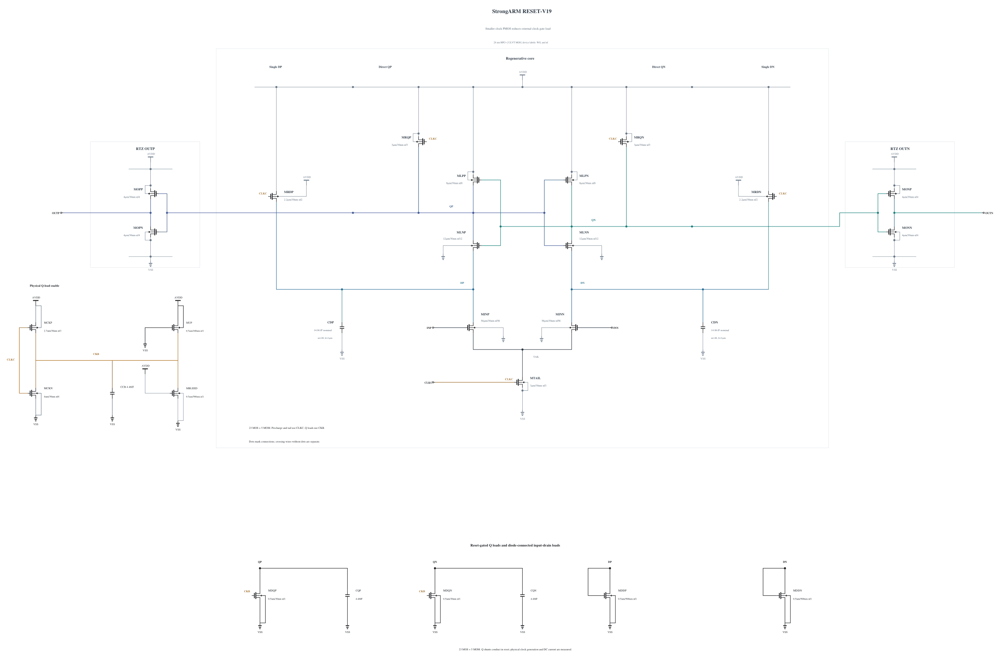

# RESET-V19: reduce clock-gate load

V18 passes SF/high/-40, FS/high/-40 and TT timing, reset, output validity and all 69 MOS terminal pairs. The two Q MOMs reduce the previously failing reset peak to 0.99878 V. TT 1/30 mV delay is 61.343944/47.475090 ps. Its matched short fine-step diagnosis records 0/256 wrong polarities at +/-800 uV (OUTP counts 0/128 and 128/128). This remains a short diagnostic with a different low noise frequency, not an official noise estimate.

V18's TT mixed-sequence CLK charge gives 16.037833 fF, slightly above the 16 fF gate. The mixed sequence is not the official capacitance test, but it provides insufficient confidence to expand a marginal clock load. This source changes only MCKP from 3.0 um to 2.7 um at 30 nm, retaining three fingers, N4 clock pull-down, both N0.5 Q shunts and all five MOMs. The new callback succeeds without warnings; all terminal parasitics come from its result, SHA-256 `4c95992b12488f02b405cc506443cde9dc0bb5750de45d19aff81a133bffa2e5`. No other electrical statement changes.

The smaller PMOS should reduce external clock-gate charge but may delay shunt turn-on and restore reset overshoot. SF/high/-40 and FS/high/-40 therefore come first, followed by TT and the matched noise diagnosis only if those pass. Electrical SHA-256: `c14d49b929c6c404d4166762d41bc8773e097a141c4ba0365d5462fbd007e008`. The [source](RESET-V19.txt) contains 23 MOS and 5 MOMs, with complete RNL checked on a byte-identical mirror. Canonical V14 and all older evidence remain preserved. Formal capacitance, noise and qualification do not transfer.

## Completed screen 20261031-073542-strongarm-reset-v19-screen

Both first stress corners pass every timing, reset, output-validity and terminal-stress gate. All 72 actual polarities, including 10 uV, and all 72 resets pass the independent waveform audit.

Actual clean source commit: `0b026e2487d815e377ff0de99e28ad3a38a039ab`. Electrical SHA-256: `c14d49b929c6c404d4166762d41bc8773e097a141c4ba0365d5462fbd007e008`. The canonical netlist and 274 official result/figure files are unchanged.

| Corner | 1 mV / 30 mV delay (ps) | Reset (ps) | AVDD (fJ/cycle) | Decided / cycles | Wrong | CMP-15 | Max stress (V) | Failed pairs |
|---|---:|---:|---:|---:|---:|---:|---:|---:|
| fs_high_m40 | 53.107302 / 42.294168 | 20.867012 | 539.540167 | 36 / 36 | 0 | 0 | 0.99709 | 0 / 69 |
| sf_high_m40 | 67.927064 / 52.467425 | 19.288777 | 508.991202 | 36 / 36 | 0 | 0 | 0.99882 | 0 / 69 |

The entire trace, including clock edges and reset, is checked for every MOS |Vgs|, |Vgd| and |Vds|. Each job uses +aps, no explicit +mt, traponly, maxstep=0.5p, reltol=1e-6 and vabstol=1e-8. The observed batch peak is 1 concurrent jobs; logs report effective single-thread simulation. All raw/deck hashes were verified, and the exact owned remote run was removed with absence confirmed.

Per-device maximum over all three terminal pairs (V):

| Device | fs_high_m40 | sf_high_m40 |
|---|---:|---:|
| MINP | 0.69823 | 0.76421 |
| MINN | 0.69835 | 0.76441 |
| MTAIL | 0.99000 | 0.99000 |
| MRDP | 0.99325 | 0.99197 |
| MRDN | 0.99325 | 0.99196 |
| MLNP | 0.99100 | 0.98994 |
| MLNN | 0.99100 | 0.98994 |
| MLPP | 0.99338 | 0.99215 |
| MLPN | 0.99338 | 0.99215 |
| MRQP | 0.99622 | 0.99882 |
| MRQN | 0.99622 | 0.99882 |
| MOPN | 0.99709 | 0.99882 |
| MOPP | 0.99692 | 0.99879 |
| MONN | 0.99709 | 0.99882 |
| MONP | 0.99692 | 0.99879 |
| MDQP | 0.99709 | 0.99882 |
| MDQN | 0.99709 | 0.99882 |
| MDDP | 0.98352 | 0.98520 |
| MDDN | 0.98664 | 0.98767 |
| MCKN | 0.99345 | 0.99595 |
| MCKP | 0.99031 | 0.99000 |
| MBLEED | 0.99345 | 0.99595 |
| MUP | 0.99345 | 0.99595 |

Clock charge from the mixed delay sequence is a supplemental diagnostic, not the official CMP-14 input-capacitance result. No all-corner, noise, Monte Carlo or mixed-top qualification is inferred from this screen.

## Completed screen 20261031-074310-strongarm-reset-v19-screen

TT passes all timing, reset, validity and full-trace stress gates, with all 36 actual polarities and resets independently audited. The mixed CLK charge diagnostic falls to 15.783664 fF; official capacitance and noise remain unestablished for this source.

Actual clean source commit: `0b026e2487d815e377ff0de99e28ad3a38a039ab`. Electrical SHA-256: `c14d49b929c6c404d4166762d41bc8773e097a141c4ba0365d5462fbd007e008`. The canonical netlist and 274 official result/figure files are unchanged.

| Corner | 1 mV / 30 mV delay (ps) | Reset (ps) | AVDD (fJ/cycle) | Decided / cycles | Wrong | CMP-15 | Max stress (V) | Failed pairs |
|---|---:|---:|---:|---:|---:|---:|---:|---:|
| tt_nom_27 | 61.345488 / 47.472377 | 23.498218 | 404.753296 | 36 / 36 | 0 | 0 | 0.90758 | 0 / 69 |

The entire trace, including clock edges and reset, is checked for every MOS |Vgs|, |Vgd| and |Vds|. Each job uses +aps, no explicit +mt, traponly, maxstep=0.5p, reltol=1e-6 and vabstol=1e-8. The observed batch peak is 1 concurrent jobs; logs report effective single-thread simulation. All raw/deck hashes were verified, and the exact owned remote run was removed with absence confirmed.

Per-device maximum over all three terminal pairs (V):

| Device | tt_nom_27 |
|---|---:|
| MINP | 0.60139 |
| MINN | 0.60147 |
| MTAIL | 0.90000 |
| MRDP | 0.90128 |
| MRDN | 0.90128 |
| MLNP | 0.89886 |
| MLNN | 0.89886 |
| MLPP | 0.90139 |
| MLPN | 0.90139 |
| MRQP | 0.90758 |
| MRQN | 0.90758 |
| MOPN | 0.90758 |
| MOPP | 0.90742 |
| MONN | 0.90758 |
| MONP | 0.90742 |
| MDQP | 0.90758 |
| MDQN | 0.90758 |
| MDDP | 0.89730 |
| MDDN | 0.90045 |
| MCKN | 0.90609 |
| MCKP | 0.90065 |
| MBLEED | 0.90609 |
| MUP | 0.90609 |

Clock charge from the mixed delay sequence is a supplemental diagnostic, not the official CMP-14 input-capacitance result. No all-corner, noise, Monte Carlo or mixed-top qualification is inferred from this screen.

## Matched short physical noise diagnosis

Run `20261031-074942-strongarm-reset-v19-noise-numerics-diagnostic-screen` uses actual clean source `70e17c44051c89446c32d2ba22235a8884181ac5` with the same physical V19 source, fine 0.5 ps integration, reltol=1e-6, vabstol=1e-8, 50 GHz bandwidth and seed 1. It records OUTP counts 1/128 at -800 uV and 128/128 at +800 uV: one wrong polarity in 256 decisions. That error is retained. V18 had zero in the matched short sample; these small two-level counts do not establish either a formal sigma or a statistically isolated clock-device effect.

All 256 resets complete, maximum 22.618032995 ps. There are zero early (+80 ps) or middle (+150 ps) to final sign changes, late-reset violations and physical output-validity violations. All 69 MOS terminal pairs pass over the full trace, maximum 0.90821 V. At rise +30 ps QP-QN means are +1.758495/-1.754884 mV, with standard deviations 0.983277/0.929692 mV; at +40 ps the means are +8.649103/-8.818842 mV and standard deviations 2.767018/2.527898 mV. This retains useful signal transfer but does not establish the 200 uV requirement.

The 102.5 ns duration raises noisefmin to 9.7561 MHz, compared with 287.216 kHz in the original full test, and the read-only samplers add time points. All original formal files remain unchanged. Raw/deck hashes and the private archive are verified; the exact owned remote directory is absent. The other known deterministic corners and actual-worst convergence are next prerequisites before canonical promotion and the unchanged original formal capacitance/noise tests.

| Device | Maximum terminal stress (V) |
|---|---:|
| MINP | 0.59064 |
| MINN | 0.59092 |
| MTAIL | 0.90000 |
| MRDP | 0.90134 |
| MRDN | 0.90137 |
| MLNP | 0.89915 |
| MLNN | 0.89909 |
| MLPP | 0.90163 |
| MLPN | 0.90163 |
| MRQP | 0.90786 |
| MRQN | 0.90800 |
| MOPN | 0.90821 |
| MOPP | 0.90821 |
| MONN | 0.90816 |
| MONP | 0.90816 |
| MDQP | 0.90786 |
| MDQN | 0.90800 |
| MDDP | 0.89535 |
| MDDN | 0.89599 |
| MCKN | 0.90667 |
| MCKP | 0.90133 |
| MBLEED | 0.90667 |
| MUP | 0.90667 |
