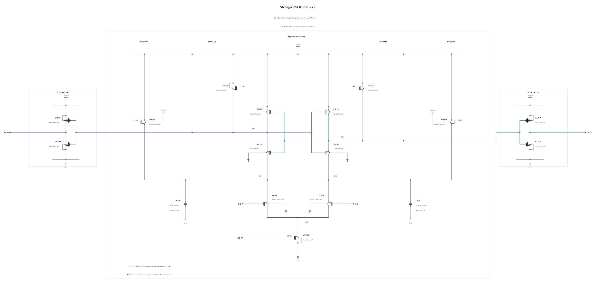

# RESET-V2: direct-clock reset experiment

This independent experiment removes RESET-V1's NAND/NOR controls, their internal floating nodes and the now-unused two-inverter clock branch. The tail and all four single precharge devices use CLKC. Input precharge remains 2.4 um / 30 nm, nf3; Q precharge remains 6 um / 30 nm, nf6. The other device geometries and the two input-drain capacitors are unchanged. These geometries reuse successful, warning-free callbacks from RESET-V1; no parasitic values were hand scaled.

The hypothesis is that direct tail activation avoids V1's added evaluation delay and Q-node rising-edge overshoot, while single precharge removes DPX/DNX and AX entirely. Stronger Q reset may retain the slow-corner reset improvement. Direct clock coupling and clock-input charge remain risks to measure.

The standalone Spectre source is [RESET-V2.txt](RESET-V2.txt), with full RNL. Its electrical SHA-256 is `608dfd3e547ee65738662bf62ef9c9cb548b0b7ea1000b21c22087ee0c958db8`. It has 15 MOS and two MOM capacitors. A byte-identical `.scs` validation mirror passes RNL core 0.5.2 with 0 errors, 0 warnings and 0 hints; the extension workaround does not change the source.

The planned first screen uses TT nominal 27 C, FF high -40 C, FF high 125 C and SS low 125 C, the current v0.7.0 delay stimulus and measurement, 0.5 ps maximum step, traponly, reltol 1e-6 and vabstol 1e-8. Every MOS |Vgs|, |Vgd| and |Vds| is checked over the full trace. Physical output validity, delay, reset, AVDD energy and supplemental clock charge are measured. Existing matched baseline traces are reused as references, not rerun or relabeled. No new validation is claimed in this source-freeze commit.

Canonical `adc_comp.scs` and its official results remain the previous baseline. A failed screen stops this version's expansion while evidence-based iteration continues.
