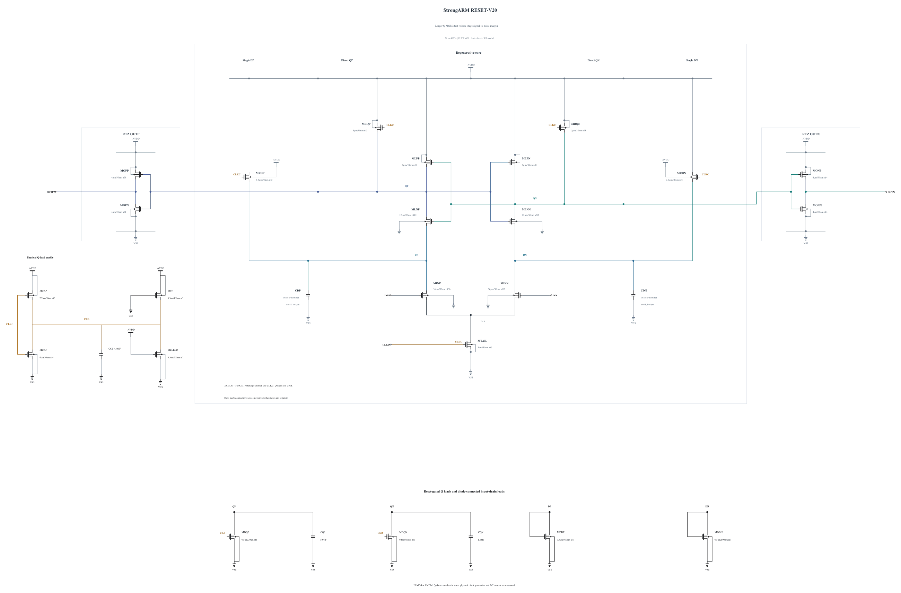

# RESET-V20: test Q release-stage charge storage

Canonical V19 passes all ten private key corners, actual-worst numerical convergence and the original TT input/clock capacitance and kickback tests. Its original 17 x 512 TT noise run fails at 218.770058633 uV rms, with a 95% profile interval of 210.31–227.64 uV against 200 uV. All 8704 samples are present and resolved; the largest Gaussian-fit standardized residual is 3.784980, so a purely Gaussian mechanism is not established. The genuine failure remains in [FORMAL-RESET-V19.md](FORMAL-RESET-V19.md), and V19 qualification expansion stops.

Earlier full physical observations identified the reset-release Q trajectory as a decision-sensitive stage. V19's short matched diagnostic has one wrong polarity at cycle 54, with complete reset and no new early-to-final sign changes. At +30 ps the two input levels have Q differential standard deviations about 0.983/0.930 mV. The V16-to-V18 improvement changed both Q shunts and capacitors, so it did not isolate a capacitor effect. This revision now tests only Q-node charge storage, without assuming a kT/C scaling law or transferring the Miyahara noise conclusion.

Only CQP/CQN change from 16 to 20 fingers, nominally 4.46 to 5.66049 fF. The existing successful, zero-warning capacitor callback is reused exactly, SHA-256 `613c7aa6a617bd67d2699ba18a547794f801dbaee33aeab31e6b964b5ba9cc5d`. All 23 MOS devices and the other three MOMs remain electrically identical, including MCKN N4, MCKP P2.7 and both N0.5 Q shunts. Additional Q loading can delay regeneration and increase reset charge; those costs and the actual differential mean/variance must be measured.

Electrical SHA-256: `fb5dcf65ea818e14a24913b753c01226796d8f3f06aa9136fd779f9298cb6b60`. The [source](RESET-V20.txt) contains 23 MOS and 5 MOMs, with complete RNL checked on a byte-identical mirror. First test SF/high/-40 and FS/high/-40, then TT timing and a matched short phase diagnosis. Only a useful result warrants remaining known corners, actual-worst convergence, source-preserving promotion and genuine original formal tests. Canonical V19 and every older result remain preserved; no previous pass transfers.

## Completed screen 20261031-084147-strongarm-reset-v20-screen

Both high-voltage cold corners pass all 72 actual polarities including 10 uV, all 72 resets, timing, physical output validity and all 69 terminal pairs. No formal noise benefit is inferred.

Actual clean source commit: `810b72da43f53a5907bbedc3d55a890a24a98c67`. Electrical SHA-256: `fb5dcf65ea818e14a24913b753c01226796d8f3f06aa9136fd779f9298cb6b60`. The canonical netlist and 274 official result/figure files are unchanged.

| Corner | 1 mV / 30 mV delay (ps) | Reset (ps) | AVDD (fJ/cycle) | Decided / cycles | Wrong | CMP-15 | Max stress (V) | Failed pairs |
|---|---:|---:|---:|---:|---:|---:|---:|---:|
| fs_high_m40 | 53.756647 / 42.642013 | 21.054437 | 541.343381 | 36 / 36 | 0 | 0 | 0.99693 | 0 / 69 |
| sf_high_m40 | 68.764171 / 52.868261 | 19.467656 | 510.985212 | 36 / 36 | 0 | 0 | 0.99840 | 0 / 69 |

The entire trace, including clock edges and reset, is checked for every MOS |Vgs|, |Vgd| and |Vds|. Each job uses +aps, no explicit +mt, traponly, maxstep=0.5p, reltol=1e-6 and vabstol=1e-8. The observed batch peak is 1 concurrent jobs; logs report effective single-thread simulation. All raw/deck hashes were verified, and the exact owned remote run was removed with absence confirmed.

Per-device maximum over all three terminal pairs (V):

| Device | fs_high_m40 | sf_high_m40 |
|---|---:|---:|
| MINP | 0.69838 | 0.76432 |
| MINN | 0.69850 | 0.76452 |
| MTAIL | 0.99000 | 0.99000 |
| MRDP | 0.99323 | 0.99192 |
| MRDN | 0.99323 | 0.99192 |
| MLNP | 0.99097 | 0.98990 |
| MLNN | 0.99097 | 0.98990 |
| MLPP | 0.99334 | 0.99209 |
| MLPN | 0.99334 | 0.99209 |
| MRQP | 0.99607 | 0.99831 |
| MRQN | 0.99607 | 0.99831 |
| MOPN | 0.99693 | 0.99840 |
| MOPP | 0.99675 | 0.99828 |
| MONN | 0.99693 | 0.99840 |
| MONP | 0.99675 | 0.99828 |
| MDQP | 0.99693 | 0.99840 |
| MDQN | 0.99693 | 0.99840 |
| MDDP | 0.98352 | 0.98520 |
| MDDN | 0.98664 | 0.98767 |
| MCKN | 0.99345 | 0.99595 |
| MCKP | 0.99031 | 0.99000 |
| MBLEED | 0.99345 | 0.99595 |
| MUP | 0.99345 | 0.99595 |

Clock charge from the mixed delay sequence is a supplemental diagnostic, not the official CMP-14 input-capacitance result. No all-corner, noise, Monte Carlo or mixed-top qualification is inferred from this screen.

## Completed screen 20261031-084834-strongarm-reset-v20-screen

TT passes all 36 actual polarities including 10 uV, all resets, timing, physical output validity and all 69 terminal pairs. The next step is the matched short Q-phase noise diagnosis before broader expansion.

Actual clean source commit: `810b72da43f53a5907bbedc3d55a890a24a98c67`. Electrical SHA-256: `fb5dcf65ea818e14a24913b753c01226796d8f3f06aa9136fd779f9298cb6b60`. The canonical netlist and 274 official result/figure files are unchanged.

| Corner | 1 mV / 30 mV delay (ps) | Reset (ps) | AVDD (fJ/cycle) | Decided / cycles | Wrong | CMP-15 | Max stress (V) | Failed pairs |
|---|---:|---:|---:|---:|---:|---:|---:|---:|
| tt_nom_27 | 62.091895 / 47.862333 | 23.672701 | 406.390516 | 36 / 36 | 0 | 0 | 0.90741 | 0 / 69 |

The entire trace, including clock edges and reset, is checked for every MOS |Vgs|, |Vgd| and |Vds|. Each job uses +aps, no explicit +mt, traponly, maxstep=0.5p, reltol=1e-6 and vabstol=1e-8. The observed batch peak is 1 concurrent jobs; logs report effective single-thread simulation. All raw/deck hashes were verified, and the exact owned remote run was removed with absence confirmed.

Per-device maximum over all three terminal pairs (V):

| Device | tt_nom_27 |
|---|---:|
| MINP | 0.60150 |
| MINN | 0.60158 |
| MTAIL | 0.90000 |
| MRDP | 0.90124 |
| MRDN | 0.90124 |
| MLNP | 0.89882 |
| MLNN | 0.89882 |
| MLPP | 0.90133 |
| MLPN | 0.90133 |
| MRQP | 0.90741 |
| MRQN | 0.90741 |
| MOPN | 0.90741 |
| MOPP | 0.90725 |
| MONN | 0.90741 |
| MONP | 0.90725 |
| MDQP | 0.90741 |
| MDQN | 0.90741 |
| MDDP | 0.89730 |
| MDDN | 0.90045 |
| MCKN | 0.90609 |
| MCKP | 0.90065 |
| MBLEED | 0.90609 |
| MUP | 0.90609 |

Clock charge from the mixed delay sequence is a supplemental diagnostic, not the official CMP-14 input-capacitance result. No all-corner, noise, Monte Carlo or mixed-top qualification is inferred from this screen.

## Matched short Q-phase diagnosis

Run `20261031-085505-strongarm-reset-v20-noise-numerics-diagnostic-screen` uses clean source `e45f2ad7bea3b45f5822eae18549b326c19fc727`. The two levels, 128 cycles per level, seed 1, 50 GHz bandwidth, 0.5 ps/1e-6/1e-8 integration and the instrumented testbench hash match V19's earlier short diagnostic. V20 has OUTP 1/128 at -800 uV and 128/128 at +800 uV: one wrong polarity, again at cycle 54. All samples are retained. Identical finite error counts do not prove equal underlying noise, and the same seed does not make these nonlinear waveforms independent trials.

All 256 resets complete, maximum 22.830572156 ps. There are no +80/+150 ps to final sign changes, late-reset or output-validity violations. All 69 MOS terminal pairs pass, maximum 0.90804 V.

| Phase and quantity | V19 descriptive SNR | V20 descriptive SNR |
|---|---:|---:|
| +20 ps DP_minus_DN | 4.099504935 | 4.099704178 |
| +20 ps QP_minus_QN | 0.317416035 | 0.305432364 |
| +30 ps DP_minus_DN | 4.183326905 | 4.112015332 |
| +30 ps QP_minus_QN | 1.838000206 | 1.896073158 |
| +40 ps DP_minus_DN | 0.932839270 | 0.976058759 |
| +40 ps QP_minus_QN | 3.307195538 | 3.346147610 |

SNR is the average of the two absolute differential means divided by their sample standard deviations. It is a descriptive phase statistic, not input-referred noise. At +30 ps Q mean/std ratios improve by about 3.16%; at +40 ps by about 1.18%. The larger capacitor changes both signal and variation; the observations do not support assuming a simple kT/C noise benefit. Later saturated or sign-reversed node statistics are not used as a linear noise estimate.

At +30 ps V20 Q means are +1.807340/-1.806213 mV, with standard deviations 0.982561/0.924969 mV. At +40 ps they are +8.439833/-8.605365 mV and 2.671059/2.436012 mV. The measured timing and energy costs are in the earlier sections. The small early SNR change is insufficient evidence to treat this revision as the solution to V19’s 218.770059 uV formal failure. V20 is retained as an unpromoted experiment rather than expanded through all remaining corners and formal qualification. The next controlled experiment tests Q reset-shunt strength with these capacitors held fixed.

| Device | Maximum terminal stress (V) |
|---|---:|
| MINP | 0.59074 |
| MINN | 0.59102 |
| MTAIL | 0.90000 |
| MRDP | 0.90128 |
| MRDN | 0.90130 |
| MLNP | 0.89908 |
| MLNN | 0.89904 |
| MLPP | 0.90154 |
| MLPN | 0.90154 |
| MRQP | 0.90768 |
| MRQN | 0.90782 |
| MOPN | 0.90804 |
| MOPP | 0.90804 |
| MONN | 0.90798 |
| MONP | 0.90798 |
| MDQP | 0.90768 |
| MDQN | 0.90782 |
| MDDP | 0.89537 |
| MDDN | 0.89602 |
| MCKN | 0.90668 |
| MCKP | 0.90133 |
| MBLEED | 0.90668 |
| MUP | 0.90668 |

Archive SHA-256 `6feb033472cadf197d43b675c47ffee60be114e8a88aa3ac336c81249ae96c2e` preserves raw data, all error-cycle indices and the V19/V20 phase comparison, with every member verified. The owned remote run is absent. The shorter 102.5 ns duration raises noisefmin to 9.7561 MHz versus the original 287.216 kHz, and read-only samplers add time points. No formal V20 noise result is claimed. Canonical V19 and its genuine original records remain unchanged.
