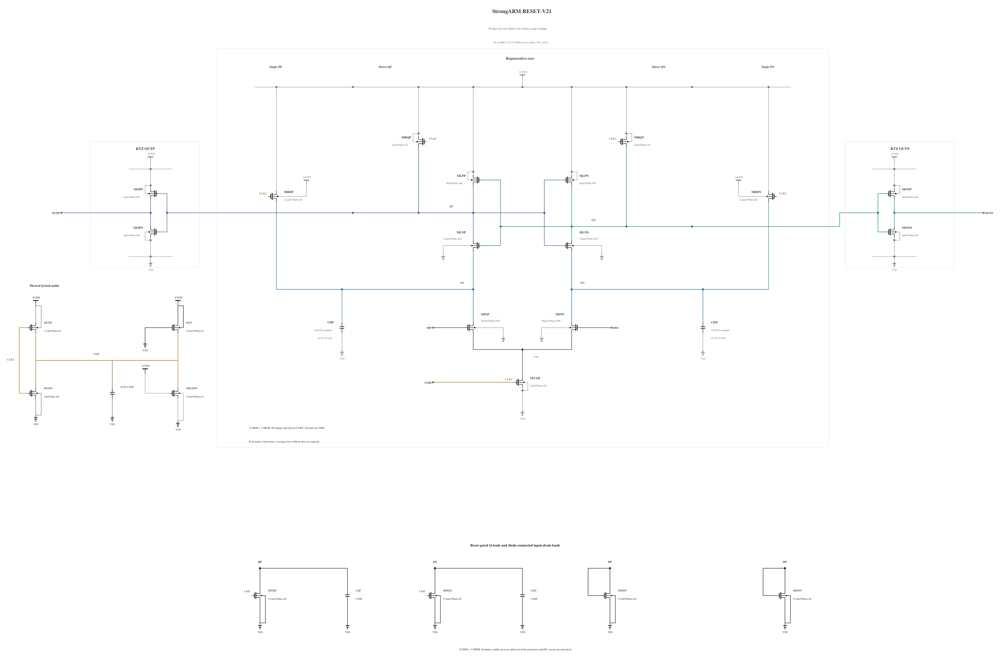

# RESET-V21: test weaker Q reset shunts

V20 passes the first SF/FS high/-40 and TT deterministic screens, but its matched short noise diagnosis retains the same one wrong polarity at cycle 54 as V19. At +30/+40 ps the descriptive Q differential SNR improves only about 3.16%/1.18%, with both signal and variation changing. This does not establish enough benefit to solve V19's genuine 218.770059 uV TT noise failure. [RESET-V20.md](RESET-V20.md) preserves the measured cost and phase evidence; V20 remains an unpromoted experiment.

In the independent StrongARM phase evidence, input-drain discrimination is already present at +20 ps while Q differential transfer remains small and initially opposed. The Q reset/load release trajectory remains a testable sensitivity. This experiment changes only the two physical Q reset shunts MDQP/MDQN from 0.5 to 0.3 um at 100 nm with one finger. It tests how lower shunt drive/loading changes Q initialization and release, rather than increasing the capacitors again. The result may also change clock loading, bias trajectory and device noise; no isolated channel-noise cause is assumed.

The new N0.3 callback succeeds with zero warnings; its complete geometry and terminal parasitics are used, SHA-256 `dff23b2714ce7c9d7cd5ceece462347b619b63183c1d6b00179932e71b6fc62d`. All other 21 MOS devices and all five MOMs remain electrically identical to V20, including the two 5.66049 fF Q capacitors and N4/P2.7 physical clock devices. Reduced shunt strength may restore Q voltage overshoot; the two known high-voltage cold corners therefore come first. Reset, output validity, full terminal stress and complete AVDD costs must be measured along with the phase response.

Electrical SHA-256: `51e0735f2471b3edbfc79f641438d016320d096a689b9e45bd7265661944a90e`. The [source](RESET-V21.txt) contains 23 MOS and 5 MOMs, with complete RNL checked on a byte-identical mirror. After the first stress corners, TT and a matched short phase diagnosis determine whether broader known-corner coverage and actual-worst convergence are useful. Original formal capacitance and noise gates require an electrically identical frozen canonical promotion; no private result substitutes for them. Canonical V19 and all original results remain unchanged.

