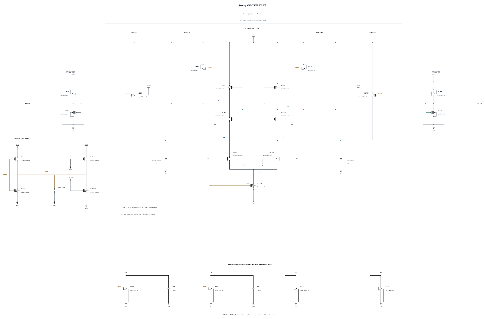

# RESET-V22: isolate Q reset-shunt width at fixed length

V20 retains one wrong polarity at cycle 54 in the matched short noise diagnosis, with only small Q-stage descriptive SNR improvements over V19. V21 then changes Q reset shunts from 0.5 um/30 nm to 0.3 um/100 nm and fails both high-voltage cold stress screens. Its initial prose incorrectly described the predecessor length; [RESET-V21.md](RESET-V21.md) corrects that statement against the actual preserved source and explicitly retains both geometry changes and the failed result. V21 provides no isolated width or noise conclusion.

This experiment branches electrically from V20. Only MDQP/MDQN width changes from 0.5 to 0.4 um; **channel length remains 30 nm and nf remains 1 in both sources**, checked directly from the electrical statements. A successful zero-warning N0.4/30 nm callback supplies the complete geometry and parasitics, SHA-256 `57db486ef0b21a4e4dd1b787480db987b7d06343a1a5bde6750da8925ee45d57`. All other 21 MOS devices and all five MOMs remain identical to V20, including the 5.66049 fF Q capacitors and N4/P2.7 clock inverter.

The 20% width reduction tests a smaller change in physical Q reset strength and loading at fixed length. It still changes drive, capacitance, trajectory and noise together; no isolated channel-noise mechanism is assumed. SF/high/-40 and FS/high/-40 come first because the weaker V21 geometry restores Q overshoot. A useful pass is followed by TT and a matched short phase diagnosis, with reset, complete output validity, full terminal stress and full AVDD cost measured throughout.

Electrical SHA-256: `67137adab331fb3243cb50939afde1e6ff3bb6f733888439348b3dc85380202e`. The [source](RESET-V22.txt) contains 23 MOS and 5 MOMs, with complete RNL checked on a byte-identical mirror. Remaining known corners, actual-worst convergence, electrically identical canonical promotion and original formal tests remain open. Canonical V19 and all genuine original records remain unchanged.

