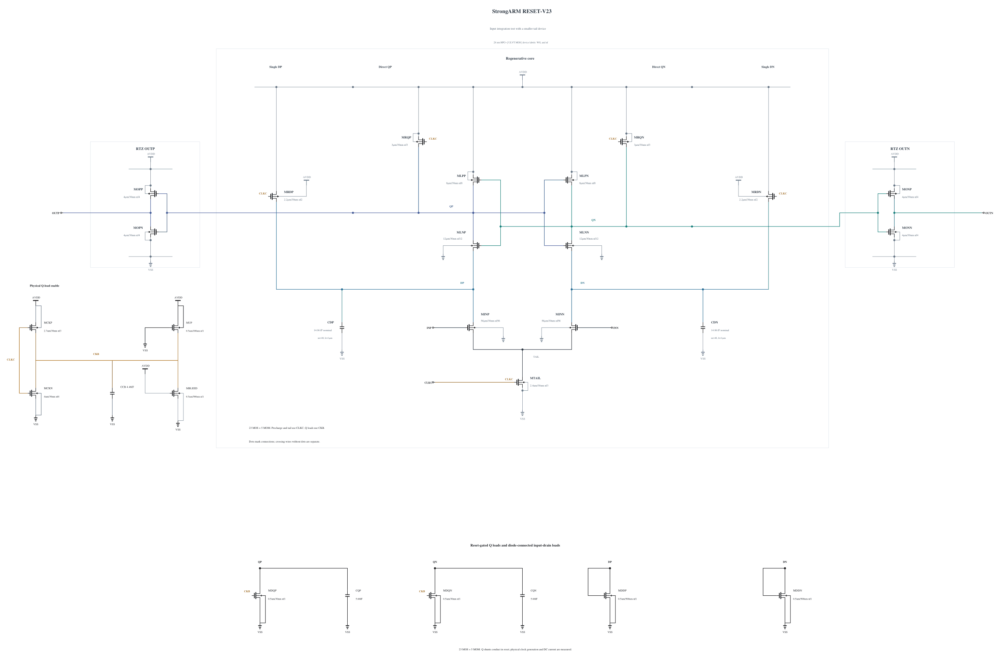

# RESET-V23: test the input integration interval

The fixed-length Q-shunt width experiment V22 fails ten terminal pairs at SF/high/-40, with a rounded 1.00398 V peak; FS/high/-40 passes. [RESET-V22.md](RESET-V22.md) preserves the actual raw peak, full checks and stopped expansion. V23 therefore branches electrically from V20, restoring its 0.5 um/30 nm Q shunts and retaining all five MOMs and physical clock devices.

StrongARM's own V20 phase evidence shows mean CKB near 74.77 mV at +5 ps and 11.57 mV at +10 ps, staying near 11.4 mV through +30 ps. Input-drain differential means at +20 ps are +2.88739/-2.95272 mV with about 0.712 mV within-level deviation; Q transfer remains small and opposed there. By +30 ps the DP difference has fallen to +2.34277/-2.38852 mV while Q differential transfer develops, and DP reverses sign by +40 ps as the latch takes over. These observations motivate testing the input integration interval. They do not identify a unique device-noise source or justify transferring a Miyahara clock conclusion.

Only MTAIL width changes from 3.0 to 2.4 um, at directly verified **30 nm length and nf3 in both sources**. A successful zero-warning N2.4 callback supplies the full geometry and parasitics, SHA-256 `a7a4e1951d17fc356e11127031f818e63a49ab55052d17b2561b540392255598`. All other 22 MOS devices and all five MOMs are electrically identical to V20. The hypothesis is that a weaker tail can extend input integration before strong regeneration; the actual signal, variance and delay response must be measured. No improvement is presumed from device sizing alone.

Electrical SHA-256: `a3d21ee7163a19a881abc0592038e318efe8ee8fd75977c236608ca5aa711116`. The [source](RESET-V23.txt) contains 23 MOS and 5 MOMs, with complete RNL checked on a byte-identical mirror. SF/FS high/-40 are screened first for stress and validity. TT follows on a useful pass, particularly its 50 ps limit at 30 mV, before a matched short phase diagnosis. Remaining known corners, actual-worst convergence, source-preserving promotion and original formal tests remain open. Canonical V19 and all genuine original records remain unchanged.

