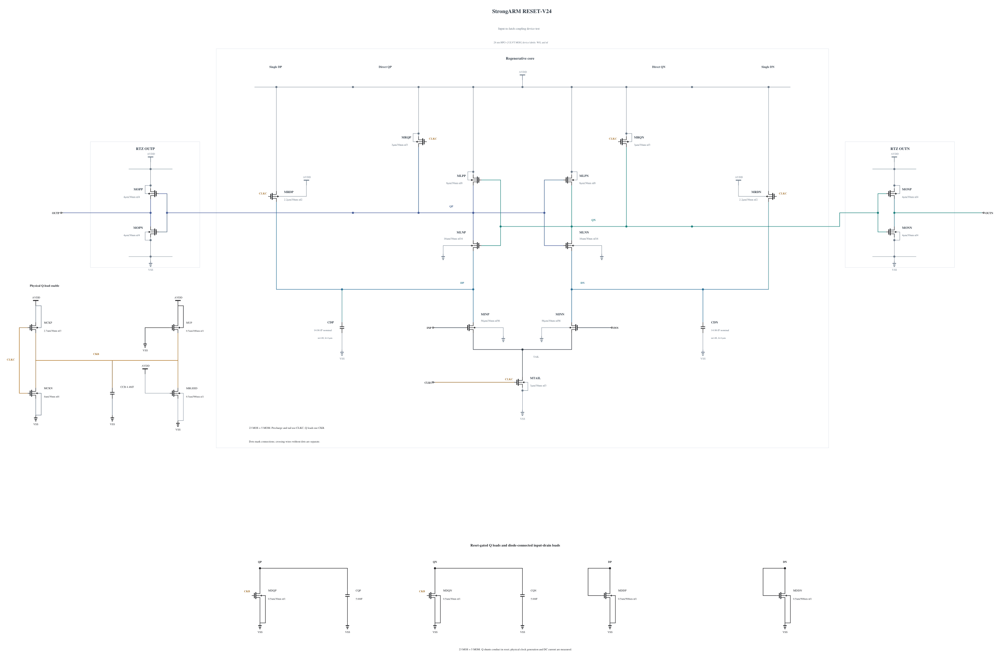

# RESET-V24: test input-to-latch coupling devices

V23 retains complete polarity, reset, output validity and terminal-stress checks, but its weaker tail increases TT 30 mV delay to 55.258398 ps, failing the 50 ps gate. [RESET-V23.md](RESET-V23.md) preserves the stopped source, complete deterministic evidence and its comparison with V20. No noise benefit is claimed for that failed timing experiment.

V24 branches electrically from V20, restoring the 3 um tail and keeping its 0.5 um/30 nm Q shunts, clock and all five MOMs. Only MLNP/MLNN change from 12 um/30 nm/nf12 to 16 um/30 nm/nf16. Channel length and 1 um finger width remain fixed; total width and finger count both increase. The complete zero-warning N16 callback geometry is used, SHA-256 `f7dd3061987c03157e7411ed97c5554d5d6981d377691e3da1413bee8298ef85`. All other 21 MOS devices and every capacitor remain electrically identical to V20.

These two NMOS devices connect the input drains to Q and also participate in cross-coupled regeneration. V20's own short phase data show DP discrimination before appreciable correct Q transfer, with CKB already near its low value by +10 ps. Increasing these devices tests the coupling and regeneration trajectory while preserving the original tail drive. The change also increases capacitances and alters feedback and noise; no isolated transconductance or device-noise improvement is assumed.

Electrical SHA-256: `d1f39f9752433bf61e8c6d6727d0096a73c5b86e545e4317c7590a733411847d`. The [source](RESET-V24.txt) contains 23 MOS and 5 MOMs with complete RNL checked on a byte-identical mirror. SF/FS high/-40 are screened first, then TT on a useful pass, including the 50 ps delay limit at 30 mV. A matched short phase diagnosis follows only after those gates. Remaining known corners, actual-worst convergence, source-preserving promotion and original formal tests remain open. Canonical V19 and all genuine original records remain unchanged.

