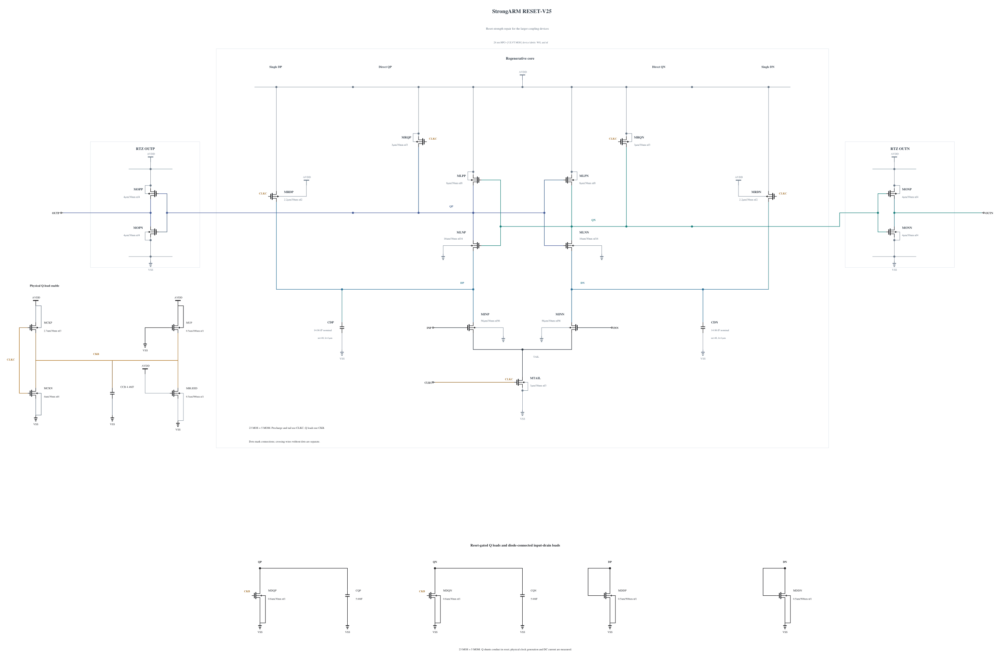

# RESET-V25: restore reset stress margin with N16 coupling devices

V24 retains all 72 actual decisions/resets and output validity in its first two corners, but SF/high/-40 fails ten terminal pairs. The raw QP peak is 1.003007138068 V at 12.971441 ps after the falling clock midpoint, with CLKC at zero and CKB already 0.982878276 V. [RESET-V24.md](RESET-V24.md) preserves the failure and complete waveform context. This is a measured reset-phase excursion; V24 has no TT or noise result.

This experiment retains V24's N16 input-to-latch devices and changes only MDQP/MDQN width from 0.5 to 0.6 um, with **30 nm length and nf1 directly verified in both sources**. A successful zero-warning N0.6 callback supplies full geometry and parasitics, SHA-256 `ccfef9d9791477066b24dc0de5813cab07a124a26c6dae5e9ced0468b2b41116`. All other 21 MOS devices and all five MOMs remain electrically identical to V24, including the 3 um tail, N4/P2.7 clock inverter and 20-finger Q capacitors.

The stronger reset pull-down tests whether more sink strength suppresses the observed peak while retaining the larger coupling devices. It will also change the reset common mode, loading, clock trajectory, current and noise. No noise benefit is assumed or inherited, and the lower shunt-width experiments on a different coupling geometry do not establish its performance. Complete AVDD cost, including persistent reset current, must be measured.

Electrical SHA-256: `6209fed9ad21a8f92ce471c5e762260227b0d820c22cba8396cd6c637b543cdf`. The [source](RESET-V25.txt) contains 23 MOS and 5 MOMs with complete RNL checked on a byte-identical mirror. SF/FS high/-40 are checked first for stress, polarity, reset and output validity. TT and a matched short phase diagnosis follow only on a useful pass. Remaining known corners, actual-worst convergence, source-preserving canonical promotion and original formal tests remain open. Canonical V19 and every genuine formal result remain unchanged.

