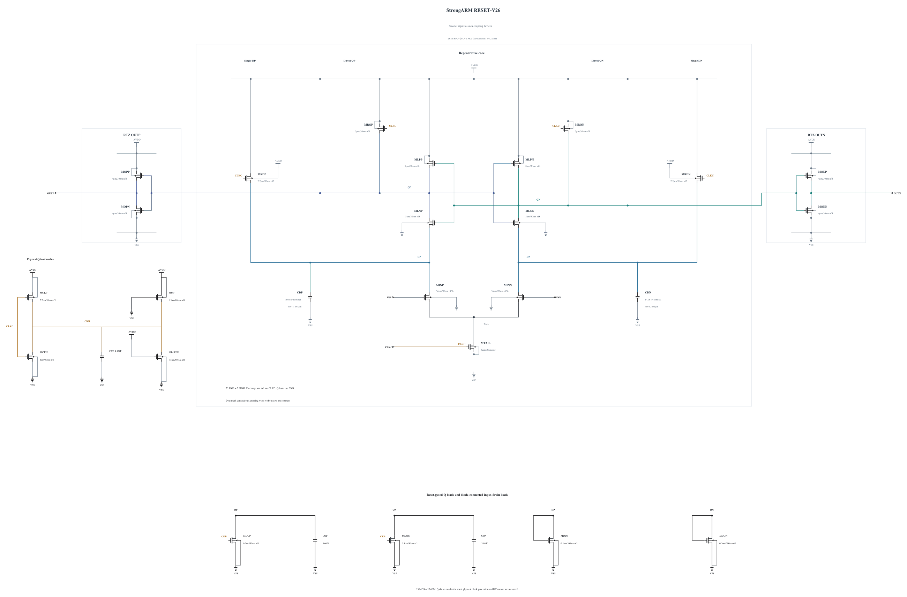

# RESET-V26: smaller input-to-latch coupling devices

V25 passes its three initial deterministic corners but retains the same short-diagnostic error at cycle 54 as V20. Its Q descriptive SNR falls from 1.896073 to 1.362273 at +30 ps and from 3.346148 to 3.165670 at +40 ps. At +30 ps all 256 DP signs are correct while 25 Q signs disagree with the input, versus eight for V20. By +40 ps only the final wrong Q sign remains. The source, complete data and comparison are preserved in [RESET-V25.md](RESET-V25.md). V25 stops broader expansion without a formal noise claim.

This experiment branches electrically from V20, retaining its original 0.5 um/30 nm Q reset pull-downs, 3 um tail, clock inverter and all five MOMs. Only MLNP/MLNN change from 12 um/nf12 to 8 um/nf8, with 30 nm length and 1 um finger width fixed. All other 21 MOS devices and every capacitor are electrically identical to V20.

These two devices connect input drains to Q and participate in regeneration. Reducing their size tests lower loading and feedthrough against weaker conduction. V25 differs from V20 in both coupling devices and reset pull-downs, so its phase result cannot identify the contribution of either change alone. No device-noise or transconductance benefit is assumed for V26.

The successful zero-warning callback supplies the full geometry and parasitics, SHA-256 `e705ebc2985cc3b6bbbe232cb188f1b0c155751d55a7a5aeaeec5df014a19f6a`. Electrical SHA-256: `b998df98508db1d2ee4ce09c29501dc78ed54f93ce5b7416002dd934b4b5ab8d`. The [source](RESET-V26.txt) contains 23 MOS and 5 MOMs with complete RNL checked on a byte-identical mirror.

SF/FS high/-40 are checked first, then TT and a matched short phase diagnosis on a useful pass. Timing, full AVDD cost, reset, output validity and every terminal pair must be measured again. Remaining known corners, actual-worst numerical convergence, source-preserving canonical promotion and original formal tests remain open. The canonical source and every genuine original record remain unchanged.

