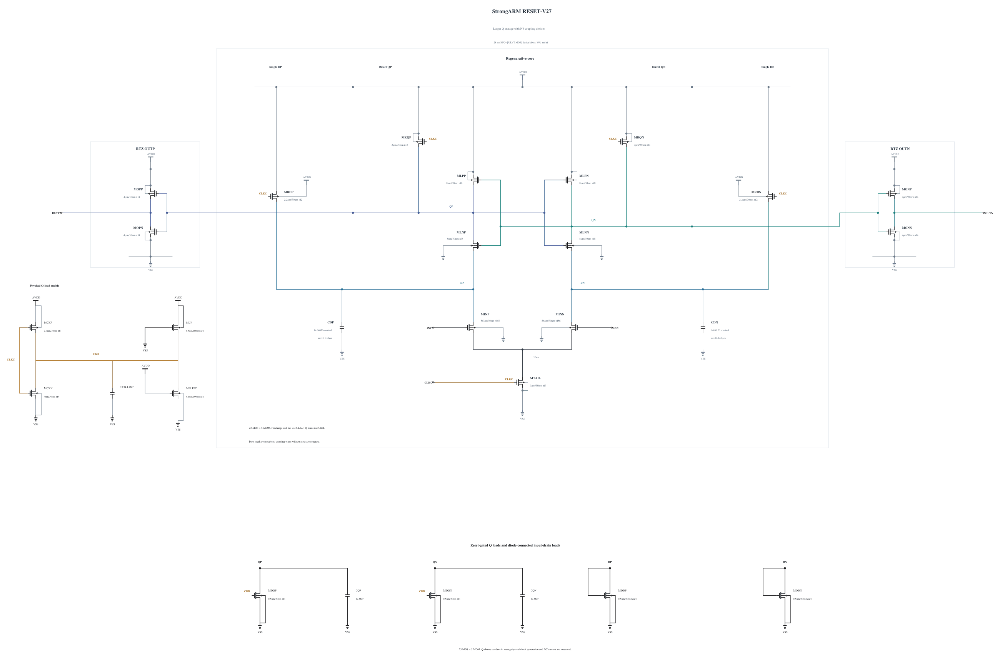

# RESET-V27: larger Q storage with N8 coupling devices

V26 passes its three initial deterministic corners, but its matched short noise diagnosis retains the same wrong cycle 54 as V20. Descriptive Q SNR changes from 1.896073 to 1.917068 at +30 ps and from 3.346148 to 3.261936 at +40 ps. At -20 ps, Q differential standard deviations remain 0.361281/0.373230 mV across the two input levels; the wrong cycle already has -0.812609 mV Q differential. These phase observations do not establish a noise source or completed decision. [RESET-V26.md](RESET-V26.md) preserves the full result.

This experiment changes only CQP/CQN from 20 to 44 fingers, nominally 5.66049 to 12.86040 fF. All 23 MOS devices and the other three MOMs remain electrically identical to V26, including its N8 coupling devices, 0.5 um/30 nm Q reset shunts and 3 um tail. Finger length, width, spacing and metal range are unchanged. The zero-warning capacitor callback SHA-256 is `7c980b3d9fa9ea317087d837feea5cab285a7ff84a9de34c7d0fe95f6b90b851`.

The added storage tests whether early Q variation and release disturbance decrease enough to improve signal-to-noise after transfer. It may also attenuate the signal and slow regeneration and reset. V26 has 2.823328 ps of TT 30 mV delay margin; an earlier smaller capacitance step on V19 is not a guarantee for this source. TT and SS/low/125 timing and reset are therefore checked together with both high-voltage cold stress corners before any short noise run. No noise improvement is assumed.

Electrical SHA-256: `7b20b19a2434da94d732f9785a3a8f1a2138d17ed4f4854dbdc5ab1a6cff18df`. The [source](RESET-V27.txt) contains 23 MOS and 5 MOMs with complete RNL checked on a byte-identical mirror. Remaining known corners, actual-worst numerical convergence, source-preserving canonical promotion and original formal tests remain open. Canonical V19 and every genuine original record are unchanged.

## Completed screen 20261031-110456-strongarm-reset-v27-screen

All 144 actual polarities including 10 uV and all 144 resets pass, together with timing, physical output validity and all 69 terminal pairs at each corner. These deterministic gates do not establish formal noise.

Actual clean source commit: `ca508316feb0325caaf9ab043a080b82d773c74a`. Electrical SHA-256: `7b20b19a2434da94d732f9785a3a8f1a2138d17ed4f4854dbdc5ab1a6cff18df`. The canonical netlist and 274 official result/figure files are unchanged.

| Corner | 1 mV / 30 mV delay (ps) | Reset (ps) | AVDD (fJ/cycle) | Decided / cycles | Wrong | CMP-15 | Max stress (V) | Failed pairs |
|---|---:|---:|---:|---:|---:|---:|---:|---:|
| fs_high_m40 | 57.265711 / 44.110802 | 21.125640 | 544.329934 | 36 / 36 | 0 | 0 | 0.99542 | 0 / 69 |
| sf_high_m40 | 73.039179 / 54.721762 | 19.676703 | 514.538705 | 36 / 36 | 0 | 0 | 0.99680 | 0 / 69 |
| ss_low_125 | 91.658688 / 67.183973 | 33.257508 | 303.827011 | 36 / 36 | 0 | 0 | 0.81632 | 0 / 69 |
| tt_nom_27 | 66.385960 / 49.837598 | 23.747424 | 408.901925 | 36 / 36 | 0 | 0 | 0.90609 | 0 / 69 |

The entire trace, including clock edges and reset, is checked for every MOS |Vgs|, |Vgd| and |Vds|. Each job uses +aps, no explicit +mt, traponly, maxstep=0.5p, reltol=1e-6 and vabstol=1e-8. The observed batch peak is 2 concurrent jobs; logs report effective single-thread simulation. All raw/deck hashes were verified, and the exact owned remote run was removed with absence confirmed.

Per-device maximum over all three terminal pairs (V):

| Device | fs_high_m40 | sf_high_m40 | ss_low_125 | tt_nom_27 |
|---|---:|---:|---:|---:|
| MINP | 0.69914 | 0.76477 | 0.53566 | 0.60191 |
| MINN | 0.69927 | 0.76498 | 0.53565 | 0.60200 |
| MTAIL | 0.99000 | 0.99000 | 0.81000 | 0.90000 |
| MRDP | 0.99323 | 0.99186 | 0.81000 | 0.90135 |
| MRDN | 0.99323 | 0.99186 | 0.81108 | 0.90135 |
| MLNP | 0.99110 | 0.99000 | 0.80203 | 0.89915 |
| MLNN | 0.99110 | 0.99000 | 0.80201 | 0.89915 |
| MLPP | 0.99341 | 0.99207 | 0.80468 | 0.90146 |
| MLPN | 0.99341 | 0.99207 | 0.80468 | 0.90146 |
| MRQP | 0.99341 | 0.99353 | 0.81593 | 0.90440 |
| MRQN | 0.99341 | 0.99353 | 0.81593 | 0.90440 |
| MOPN | 0.99542 | 0.99680 | 0.81593 | 0.90494 |
| MOPP | 0.99438 | 0.99561 | 0.81540 | 0.90450 |
| MONN | 0.99542 | 0.99680 | 0.81593 | 0.90494 |
| MONP | 0.99438 | 0.99561 | 0.81540 | 0.90450 |
| MDQP | 0.99453 | 0.99595 | 0.81632 | 0.90609 |
| MDQN | 0.99453 | 0.99595 | 0.81632 | 0.90609 |
| MDDP | 0.98360 | 0.98524 | 0.80775 | 0.89739 |
| MDDN | 0.98674 | 0.98774 | 0.81108 | 0.90057 |
| MCKN | 0.99345 | 0.99595 | 0.81632 | 0.90609 |
| MCKP | 0.99031 | 0.99000 | 0.81334 | 0.90065 |
| MBLEED | 0.99345 | 0.99595 | 0.81632 | 0.90609 |
| MUP | 0.99345 | 0.99595 | 0.81632 | 0.90609 |

Clock charge from the mixed delay sequence is a supplemental diagnostic, not the official CMP-14 input-capacitance result. No all-corner, noise, Monte Carlo or mixed-top qualification is inferred from this screen.

## Completed screen 20261031-111217-strongarm-reset-v27-screen

All 72 actual polarities including 10 uV and all 72 resets pass, together with timing, physical output validity and all 69 terminal pairs at each corner. These deterministic gates do not establish formal noise.

Actual clean source commit: `ca508316feb0325caaf9ab043a080b82d773c74a`. Electrical SHA-256: `7b20b19a2434da94d732f9785a3a8f1a2138d17ed4f4854dbdc5ab1a6cff18df`. The canonical netlist and 274 official result/figure files are unchanged.

| Corner | 1 mV / 30 mV delay (ps) | Reset (ps) | AVDD (fJ/cycle) | Decided / cycles | Wrong | CMP-15 | Max stress (V) | Failed pairs |
|---|---:|---:|---:|---:|---:|---:|---:|---:|
| sf_high_m40 | 73.045047 / 54.722633 | 19.629803 | 514.554669 | 36 / 36 | 0 | 0 | 0.99680 | 0 / 69 |
| tt_nom_27 | 66.393754 / 49.838320 | 23.660077 | 408.916654 | 36 / 36 | 0 | 0 | 0.90609 | 0 / 69 |

The entire trace, including clock edges and reset, is checked for every MOS |Vgs|, |Vgd| and |Vds|. Each job uses +aps, no explicit +mt, traponly, maxstep=0.125p, reltol=1e-7 and vabstol=1e-9. The observed batch peak is 1 concurrent jobs; logs report effective single-thread simulation. All raw/deck hashes were verified, and the exact owned remote run was removed with absence confirmed.

Per-device maximum over all three terminal pairs (V):

| Device | sf_high_m40 | tt_nom_27 |
|---|---:|---:|
| MINP | 0.76476 | 0.60191 |
| MINN | 0.76498 | 0.60201 |
| MTAIL | 0.99000 | 0.90000 |
| MRDP | 0.99186 | 0.90135 |
| MRDN | 0.99186 | 0.90135 |
| MLNP | 0.99000 | 0.89915 |
| MLNN | 0.99000 | 0.89915 |
| MLPP | 0.99208 | 0.90147 |
| MLPN | 0.99208 | 0.90147 |
| MRQP | 0.99353 | 0.90440 |
| MRQN | 0.99353 | 0.90440 |
| MOPN | 0.99680 | 0.90495 |
| MOPP | 0.99561 | 0.90450 |
| MONN | 0.99680 | 0.90495 |
| MONP | 0.99561 | 0.90450 |
| MDQP | 0.99595 | 0.90609 |
| MDQN | 0.99595 | 0.90609 |
| MDDP | 0.98524 | 0.89739 |
| MDDN | 0.98774 | 0.90057 |
| MCKN | 0.99595 | 0.90609 |
| MCKP | 0.99000 | 0.90065 |
| MBLEED | 0.99595 | 0.90609 |
| MUP | 0.99595 | 0.90609 |

Clock charge from the mixed delay sequence is a supplemental diagnostic, not the official CMP-14 input-capacitance result. No all-corner, noise, Monte Carlo or mixed-top qualification is inferred from this screen.

### Raw peak and complete-supply audits for the new gates

Run `20261031-110456-strongarm-reset-v27-screen` has the following independently recomputed, unrounded full-trace maxima.

| Corner | Device pair | Peak V | Margin uV | Since rise ps | Since fall ps |
|---|---|---:|---:|---:|---:|
| fs_high_m40 | MOPN ds | 0.995415857972 | 4584.142027607 | -194.651170963 | 5.348829037 |
| sf_high_m40 | MONN ds | 0.996799525655 | 3200.474345289 | -194.124344149 | 5.875655851 |
| ss_low_125 | MDQP gs | 0.816315253099 | 183684.746900604 | -2.768910398 | 197.231089602 |
| tt_nom_27 | MDQP gs | 0.906088107932 | 93911.892068075 | -3.122926088 | -203.122926088 |

All supply probes are present and KCL closes to numerical precision. The complete AVDD integrals cover all 36 mixed cycles from 100 ps to 14.5 ns, including reset and physical weak loads.

| Corner | Total fJ/cycle | Evaluation | Reset | Initial reset current uA |
|---|---:|---:|---:|---:|
| fs_high_m40 | 544.330428181 | 100.009300760 | 444.321127421 | 1640.915033862 |
| sf_high_m40 | 514.539256094 | 117.140554262 | 397.398701832 | 1407.687495035 |
| ss_low_125 | 303.827601621 | 72.878757573 | 230.948844048 | 797.179790241 |
| tt_nom_27 | 408.902291928 | 89.282426247 | 319.619865681 | 1174.561976866 |

Raw/deck evidence and every audit are preserved under archive SHA-256 `16e93730ade5dbacd5701c08f9812ba1044514881b13e2353a937e4e44a8f574`. Every entry was read back with CRC and SHA-256 verification before duplicate raw files were removed; the owned remote run is absent.

Run `20261031-111217-strongarm-reset-v27-screen` has the following independently recomputed, unrounded full-trace maxima.

| Corner | Device pair | Peak V | Margin uV | Since rise ps | Since fall ps |
|---|---|---:|---:|---:|---:|
| sf_high_m40 | MOPN ds | 0.996799425196 | 3200.574804420 | -194.132467015 | 5.867532985 |
| tt_nom_27 | MDQP gs | 0.906088215042 | 93911.784958343 | -3.113159744 | 196.886840256 |

All supply probes are present and KCL closes to numerical precision. The complete AVDD integrals cover all 36 mixed cycles from 100 ps to 14.5 ns, including reset and physical weak loads.

| Corner | Total fJ/cycle | Evaluation | Reset | Initial reset current uA |
|---|---:|---:|---:|---:|
| sf_high_m40 | 514.554759614 | 117.156433942 | 397.398325672 | 1407.687495035 |
| tt_nom_27 | 408.916728932 | 89.296691225 | 319.620037707 | 1174.561976866 |

Raw/deck evidence and every audit are preserved under archive SHA-256 `99bd68a940558c3fbbe417e4fc18b16a89b769c550242a355c8510a636f88264`. Every entry was read back with CRC and SHA-256 verification before duplicate raw files were removed; the owned remote run is absent.

### Numerical convergence

The same electrical source is repeated with 0.125 ps, reltol 1e-7 and vabstol 1e-9. All actual polarities, resets, output validity, timing and terminal pairs still pass. Deltas below are tighter minus initial; all per-pair changes are retained in the archived comparison.

| Corner | 1 mV delay delta ps | 30 mV delay delta ps | Reset delta ps | Largest absolute pair-peak change V |
|---|---:|---:|---:|---:|
| sf_high_m40 | +0.005868151 | +0.000870216 | -0.046899604 | 0.00001 |
| tt_nom_27 | +0.007794814 | +0.000721559 | -0.087347257 | 0.00001 |

Tighter TT 30 mV delay is 49.838319918 ps, leaving 0.161680082 ps to 50 ps. This remains a thin measured margin. The four initial corners retain all 144 nominal-cycle polarities and resets, followed by 72 tighter repeats. A matched short diagnosis against V26 follows; no capacitance, noise or full-corner qualification is inherited.

## Matched short noise-phase diagnosis

Run `20261031-112202-strongarm-reset-v27-noise-numerics-diagnostic-screen` uses clean source `99b0b80def67cd569723b536b4ebfec92bc77534` and matches V26's short instrumented testbench, +/-800 uV, 128 cycles per level, seed 1, 50 GHz and 0.5 ps/1e-6/1e-8 integration. It retains one wrong polarity, again at cycle 54. All 256 samples remain included. Identical error counts and a shared seed do not establish equal underlying noise or independent trials.

All 256 resets complete, maximum 22.960385221 ps, with no +80/+150 ps to final sign changes, late reset or output-validity violations. Every one of the 69 MOS terminal pairs passes, maximum 0.90667 V.

| Phase | Quantity | V26 secant gain | V27 secant gain | V26 descriptive SNR | V27 descriptive SNR |
|---|---|---:|---:|---:|---:|
| +20 ps | DP_minus_DN | -3.737213241 | -3.712764404 | 4.103276767 | 4.104177783 |
| +20 ps | QP_minus_QN | 0.157514921 | 0.110178722 | 0.216591685 | 0.165871872 |
| +30 ps | DP_minus_DN | -3.102577705 | -2.745051112 | 4.119998153 | 3.834737040 |
| +30 ps | QP_minus_QN | -2.505933692 | -2.530136887 | 1.917068000 | 2.090607443 |
| +40 ps | DP_minus_DN | 0.951521206 | 0.961255468 | 0.844930207 | 0.874191357 |
| +40 ps | QP_minus_QN | -11.751703200 | -9.656905251 | 3.261935628 | 3.415278200 |

The observed Q descriptive SNR rises about 9.1% at +30 ps and 4.7% at +40 ps. At -20 ps, its differential standard deviations are 0.352922/0.360114 mV, versus V26 0.361281/0.373230 mV; at +20 ps they are 0.521806/0.536165 mV versus 0.565746/0.591128 mV. These phase distributions reflect changing transfer and regeneration and are not formal input-referred noise. The phase result does not establish that the 200 uV TT requirement is met.

All DP signs at +20/+30 ps remain correct. At +30 ps Q disagrees with the input in six cycles; at +40 ps it matches all final decisions, including the error. Early internal signs are not completed output decisions. Cycle 54 retains the following measured differentials:

| Phase | DP-DN mV | QP-QN mV |
|---|---:|---:|
| -20 ps | -0.005795224 | -0.772069512 |
| +5 ps | -0.200072595 | -1.311536882 |
| +10 ps | 0.383276902 | -1.357561164 |
| +20 ps | 0.980668227 | -1.373961943 |
| +30 ps | 1.735775794 | -1.146955162 |
| +40 ps | 2.067949788 | -1.267955690 |
| +60 ps | 2.901913930 | -17.492866988 |

The four initial deterministic corners and tight TT/initial-worst checks pass, while the short phase change is modest but positive at both +30/+40 ps. The remaining six known risk corners will be completed before deciding source-preserving promotion and original full noise testing. No noise pass or all-corner qualification is claimed.

| Device | max abs(Vgs) V | max abs(Vgd) V | max abs(Vds) V |
|---|---:|---:|---:|
| MINP | 0.49211 | 0.49171 | 0.59080 |
| MINN | 0.49210 | 0.49173 | 0.59109 |
| MTAIL | 0.90000 | 0.89896 | 0.56812 |
| MRDP | 0.90000 | 0.89896 | 0.90131 |
| MRDN | 0.90000 | 0.89890 | 0.90133 |
| MLNP | 0.89910 | 0.89930 | 0.89922 |
| MLNN | 0.89916 | 0.89930 | 0.89906 |
| MLPP | 0.90160 | 0.89930 | 0.90159 |
| MLPN | 0.90159 | 0.89930 | 0.90160 |
| MRQP | 0.90000 | 0.90468 | 0.90159 |
| MRQN | 0.90000 | 0.90481 | 0.90160 |
| MOPN | 0.90500 | 0.90519 | 0.90572 |
| MOPP | 0.90159 | 0.90519 | 0.90197 |
| MONN | 0.90505 | 0.90517 | 0.90565 |
| MONP | 0.90160 | 0.90517 | 0.90190 |
| MDQP | 0.90667 | 0.89914 | 0.90500 |
| MDQN | 0.90667 | 0.89901 | 0.90505 |
| MDDP | 0.89578 | 0.00000 | 0.89578 |
| MDDN | 0.89645 | 0.00000 | 0.89645 |
| MCKN | 0.90000 | 0.89419 | 0.90667 |
| MCKP | 0.90000 | 0.89419 | 0.90133 |
| MBLEED | 0.90000 | 0.90133 | 0.90667 |
| MUP | 0.90000 | 0.90667 | 0.90133 |

Archive SHA-256 `90c87f16f051217c6f1e63867f711f2b490302a07150913cb218e17a313e939d` preserves complete raw data, every error index, phase signs and the matched V26 comparison. Every entry was read back with CRC and SHA-256 verification, and the owned remote run is absent. The 102.5 ns duration raises noisefmin to 9.7561 MHz versus the original 287.216 kHz. Canonical V19 and every genuine original record remain unchanged.

## Completed screen 20261031-113339-strongarm-reset-v27-screen

All 216 additional actual polarities including 10 uV and all 216 resets pass, together with timing, physical output validity and all 69 full-trace terminal pairs at each of the six corners.

Actual clean source commit: `f8a7fc89a689f9ea6545b388dc4e013a1238f0c7`. Electrical SHA-256: `7b20b19a2434da94d732f9785a3a8f1a2138d17ed4f4854dbdc5ab1a6cff18df`. The canonical netlist and 274 official result/figure files are unchanged.

| Corner | 1 mV / 30 mV delay (ps) | Reset (ps) | AVDD (fJ/cycle) | Decided / cycles | Wrong | CMP-15 | Max stress (V) | Failed pairs |
|---|---:|---:|---:|---:|---:|---:|---:|---:|
| ff_high_125 | 50.589681 / 38.016824 | 20.352318 | 663.048982 | 36 / 36 | 0 | 0 | 0.99037 | 0 / 69 |
| ff_high_m40 | 48.517785 / 37.336487 | 17.886895 | 570.414452 | 36 / 36 | 0 | 0 | 0.99483 | 0 / 69 |
| fs_low_125 | 68.668422 / 51.495751 | 29.049689 | 354.413261 | 36 / 36 | 0 | 0 | 0.81326 | 0 / 69 |
| sf_high_125 | 65.636333 / 49.021199 | 22.609131 | 568.053247 | 36 / 36 | 0 | 0 | 0.99429 | 0 / 69 |
| sf_high_27 | 67.358152 / 50.660287 | 20.819561 | 519.851418 | 36 / 36 | 0 | 0 | 0.99589 | 0 / 69 |
| sf_low_m40 | 91.250588 / 67.018086 | 24.036228 | 282.229642 | 36 / 36 | 0 | 0 | 0.82084 | 0 / 69 |

The entire trace, including clock edges and reset, is checked for every MOS |Vgs|, |Vgd| and |Vds|. Each job uses +aps, no explicit +mt, traponly, maxstep=0.5p, reltol=1e-6 and vabstol=1e-8. The observed batch peak is 2 concurrent jobs; logs report effective single-thread simulation. All raw/deck hashes were verified, and the exact owned remote run was removed with absence confirmed.

Per-device maximum over all three terminal pairs (V):

| Device | ff_high_125 | ff_high_m40 | fs_low_125 | sf_high_125 | sf_high_27 | sf_low_m40 |
|---|---:|---:|---:|---:|---:|---:|
| MINP | 0.57365 | 0.69305 | 0.53433 | 0.64677 | 0.71646 | 0.59786 |
| MINN | 0.57369 | 0.69320 | 0.53433 | 0.64683 | 0.71660 | 0.59801 |
| MTAIL | 0.99000 | 0.99000 | 0.81000 | 0.99000 | 0.99000 | 0.81000 |
| MRDP | 0.99000 | 0.99215 | 0.81000 | 0.99000 | 0.99000 | 0.81128 |
| MRDN | 0.99000 | 0.99215 | 0.81167 | 0.99000 | 0.99000 | 0.81328 |
| MLNP | 0.96617 | 0.99024 | 0.79885 | 0.97614 | 0.98791 | 0.80942 |
| MLNN | 0.96617 | 0.99024 | 0.79885 | 0.97614 | 0.98791 | 0.80942 |
| MLPP | 0.96865 | 0.99237 | 0.80383 | 0.97549 | 0.98964 | 0.81151 |
| MLPN | 0.96865 | 0.99237 | 0.80383 | 0.97549 | 0.98964 | 0.81151 |
| MRQP | 0.99000 | 0.99237 | 0.81158 | 0.99268 | 0.99329 | 0.81675 |
| MRQN | 0.99000 | 0.99237 | 0.81158 | 0.99268 | 0.99329 | 0.81675 |
| MOPN | 0.99037 | 0.99483 | 0.81158 | 0.99429 | 0.99541 | 0.81722 |
| MOPP | 0.98834 | 0.99467 | 0.81115 | 0.99241 | 0.99505 | 0.81658 |
| MONN | 0.99037 | 0.99483 | 0.81158 | 0.99429 | 0.99541 | 0.81722 |
| MONP | 0.98834 | 0.99467 | 0.81115 | 0.99241 | 0.99505 | 0.81658 |
| MDQP | 0.99037 | 0.99483 | 0.81158 | 0.99429 | 0.99589 | 0.82084 |
| MDQN | 0.99037 | 0.99483 | 0.81158 | 0.99429 | 0.99589 | 0.82084 |
| MDDP | 0.98535 | 0.98482 | 0.80778 | 0.98674 | 0.98587 | 0.81038 |
| MDDN | 0.98867 | 0.98776 | 0.81167 | 0.98863 | 0.98831 | 0.81328 |
| MCKN | 0.99000 | 0.99367 | 0.81000 | 0.99382 | 0.99589 | 0.82084 |
| MCKP | 0.99000 | 0.99000 | 0.81326 | 0.99000 | 0.99000 | 0.81196 |
| MBLEED | 0.99000 | 0.99367 | 0.81326 | 0.99382 | 0.99589 | 0.82084 |
| MUP | 0.99000 | 0.99367 | 0.81326 | 0.99382 | 0.99589 | 0.82084 |

Clock charge from the mixed delay sequence is a supplemental diagnostic, not the official CMP-14 input-capacitance result. No all-corner, noise, Monte Carlo or mixed-top qualification is inferred from this screen.

### Completion of ten known risk corners

The combined nominal screens retain all 360 actual polarities and resets across the ten known risk corners. TT and the actual-worst SF/high/-40 source have also passed 72 tighter repeated cycles. Every source has the same electrical hash. The latest six-corner raw audit gives:

| Corner | Worst device pair | Unrounded peak V | Margin uV |
|---|---|---:|---:|
| ff_high_125 | MONN gs | 0.990366769169 | 9633.230831387 |
| ff_high_m40 | MONN gs | 0.994825608636 | 5174.391363642 |
| fs_low_125 | MCKP ds | 0.813261637436 | 186738.362563562 |
| sf_high_125 | MONN gs | 0.994290976101 | 5709.023898941 |
| sf_high_27 | MDQP gs | 0.995886971224 | 4113.028776050 |
| sf_low_m40 | MDQP gs | 0.820835488119 | 179164.511880811 |

The actual largest nominal peak remains sf_high_m40, 0.996799525655 V, already covered by the preserved tighter repeat. Tighter TT 30 mV delay remains 49.838319918 ps; its 0.161680082 ps margin is thin. Mixed-sequence clock capacitance is supplemental; CMP-12 and CMP-14 apply at TT through the original capacitance test, so non-TT mixed-charge values are not assigned a formal capacitance verdict.

All AVDD probes are present and KCL closes over the complete 36-cycle 100 ps–14.5 ns window. Physical weak loads and reset cost are included.

| Corner | Total fJ/cycle | Evaluation | Reset | Initial reset current uA |
|---|---:|---:|---:|---:|
| ff_high_125 | 663.049467760 | 209.940451857 | 453.109015903 | 1628.908006808 |
| ff_high_m40 | 570.415019927 | 124.310871686 | 446.104148241 | 1679.993703516 |
| fs_low_125 | 354.413712350 | 88.465319801 | 265.948392549 | 1040.910821057 |
| sf_high_125 | 568.053746432 | 171.070543868 | 396.983202564 | 1314.045164872 |
| sf_high_27 | 519.851959005 | 130.934301169 | 388.917657836 | 1321.130465270 |
| sf_low_m40 | 282.229972516 | 60.510586700 | 221.719385816 | 852.628392486 |

Archive SHA-256 `f3ce3c1f5d60010dafa64a2dc4850c7ea711ef5e678efc22502b594a250ee197` retains the six complete raw traces, every terminal-pair maximum and all audits. Every member was read back with CRC and SHA-256 verification before duplicate files were removed; the exact owned remote run is absent. Source-preserving canonical promotion and original TT capacitance/full-noise tests are next. The short noise comparison does not establish the 200 uV limit, and full qualification remains open.
