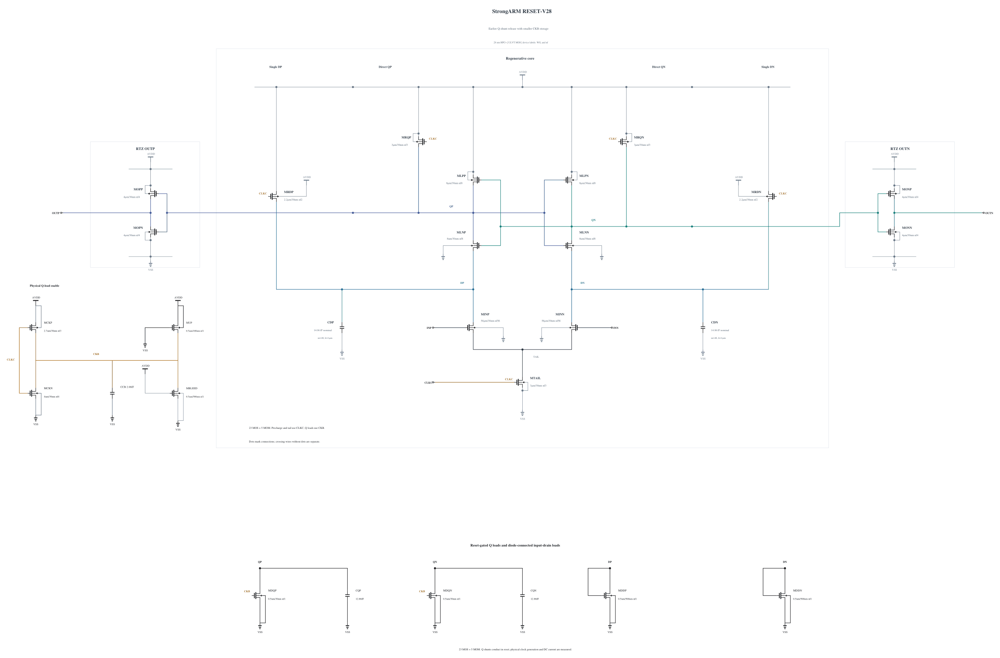

# RESET-V28: smaller CKB storage

> Evidence retention (2026-10-31): Historical raw/archive statements below refer to the original audit. Superseded waveforms were released under the user's retention policy. [EVIDENCE-RETENTION](EVIDENCE-RETENTION.md) lists the completed runs still available for raw re-audit.

The completed private full-noise run on the merged 0.8.0 baseline, `20261031-131451-strongarm-reset-v28-spec08-noise-baseline-screen`, still **fails TT at 206.44956249285457 uV rms against 200 uV**. Its 95% profile interval is 198.24 to 215.06 uV; overlap with the threshold does not turn the measured failure into a pass. All original 17 levels and 512 finite decisions per level are retained. The source was frozen at `274a6dd469cbda33ea68538be2ab9bc1e1c46c21`, with no numerical overrides. [Full counts, actual settings and verified archive](NUMERICS-94.md) preserve this result. V28 qualification expansion stops; canonical V27 and its genuine official failure remain unchanged. The lower point estimate alone does not establish a reliable noise improvement.

The full V27 TT noise precheck under the proposed issue #94 settings fails at 210.1008609253812 uV rms against 200 uV, with a 95% profile interval of 201.81 to 218.79 uV. All 8704 finite samples are preserved. [NUMERICS-94.md](NUMERICS-94.md) retains the complete failed precheck, source, numerical settings and verified archive. V27 qualification expansion has stopped.

This experiment changes only the CKB MOM from 16 to 8 fingers, nominally 4.46 to 2.06055 fF. Every one of the 23 MOS devices and the other four MOMs remains electrically identical to V27, including CQP/CQN at 44 fingers, N8 coupling devices, the 0.5 um Q shunts and N4/P2.7 clock driver. Finger length, width, spacing and metal range remain unchanged. The new callback succeeds without warnings; its SHA-256 is `d1cd467c1d3b6acba416f8d0e58f6f7b2973b5576df3a03d6ac9438a521d9a15`.

Earlier V14-to-V16 diagnoses linked earlier Q-shunt release with lower early Q variation while input transfer was weak. That history motivates testing the remaining CKB load; it does not prove a single noise source or a V28 benefit. Less CKB storage may release the shunts earlier but can also increase clock-node overshoot and change reset timing. TT and SS hot timing/reset plus SF/FS high-voltage cold whole-trace stress and output validity come before a noise conclusion.

The private screen uses conservative APS with no explicit maxstep, checking the actual Spectre log. It does not alter shared testbenches, tools, thresholds or formal results. No proposed-settings screen is relabeled as official acceptance. Electrical SHA-256: `6afbd0274baf428b4e81f38a05f49b96da7af9f33243bb147a9b89d98d5aecbd`. The [source](RESET-V28.txt) has a complete RNL drawing checked on a byte-identical mirror. Canonical V27 and every previous failure remain preserved; V28 is not promoted or qualified.

