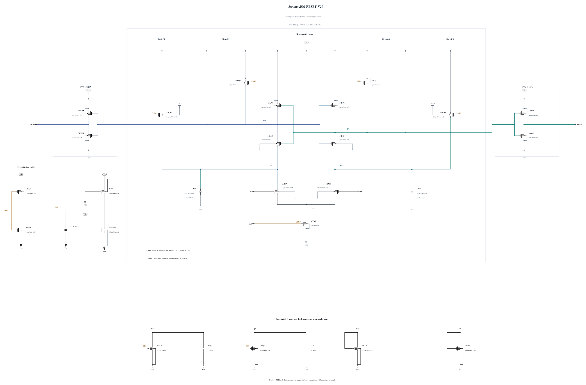

# RESET-V29: stronger physical output drivers

**V29 fails TT 30 mV delay:** 50.5384103494184 ps exceeds 50 ps. All four corners pass actual polarity, completed reset, output validity and every unrounded MOS terminal pair, but this delay failure stops V29 qualification expansion. No V29 noise run or promotion follows.

The complete V28 circuit still fails TT noise at 206.44956249285457 uV rms against 200 uV. Its tighter TT 30 mV delay is 49.84967366576565 ps, leaving only 0.15032633423435 ps. [RESET-V28](RESET-V28.md) preserves the failure; [artificial source diagnostics](NOISE-SOURCE-DIAGNOSTICS-V28.md) guide further work without constituting physical performance.

This experiment doubles all four RTZ output MOS devices MOPN/MONN/MOPP/MONP from 4 um/nf4 to 8 um/nf8, keeping 30 nm length and 1 um fingers. The other 19 MOS devices and all five MOMs are unchanged. The 3 um tail current device, 56 um input pair, Q shunts and storage remain fixed. Exact previously solved, zero-warning N8/P8 callback geometries are reused after SHA-256 verification: N8 `e705ebc2985cc3b6bbbe232cb188f1b0c155751d55a7a5aeaeec5df014a19f6a`, P8 `20855415d9559ad00227138e98d1e759f6c67857f07cd4c5123d67502d0fec87`. Their provider and release match, and the original remote callback directories are absent.

The immediate question is whether stronger output drivers create timing headroom while preserving reset, output validity and full terminal stress. Added gate loading also slows the preceding latch and changes noise transfer, so no delay or noise improvement is assumed. A prior 2.4 um tail experiment failed TT 30 mV delay at 55.2584 ps; a lower-current input stage will only be considered after measuring available headroom. Every physical noise source remains enabled in subsequent noise trials; this is a physical sizing experiment, not a source-suppression diagnostic.

Initial private checks use the merged 0.8.0 baseline, with no numerical overrides, at TT, SS/low/125 and both SF/FS high-voltage cold corners. All actual polarities, reset intervals, output validity, complete-transient terminal stress and full-cycle AVDD energy are audited. Capacitance and noise require their own tests. No formal record, shared tool, testbench, specification or threshold changes. Canonical V27 remains unchanged and neither V28 nor V29 is qualified.

Electrical SHA-256: `f09e932d738d714ea723c327eccecc41a3b1da499a4b1efb561cfdd1b14b7ee9`. The [complete source](RESET-V29.txt) contains RNL checked on a byte-identical mirror.

## Completed four-corner failure

The baseline screen `20261031-135907-strongarm-reset-v29-spec08-delay-baseline-screen` uses frozen clean source `9090cd1297a489aee0bac058ce5347d1a04c5115`. Numeric overrides are empty; actual APS/conservative/gear2only/reltol 1e-4/vabstol 1e-6/relref alllocal/lteratio 10 are verified, with no explicit maxstep or method. All 144 actual decisions, including 10 uV, and all 144 completed resets are retained. Every saved point and all 69 terminal pairs per corner are audited.

| Corner | 1 mV ps | 30 mV ps | Reset ps | Unrounded maximum V | Gate |
|---|---:|---:|---:|---:|---|
| fs_high_m40 | 59.09998304618426 | 44.691524100863795 | 20.60912913048004 | 0.9952501191479523 | PASS |
| sf_high_m40 | 76.08378401140224 | 55.90086657932709 | 19.306941258574767 | 0.9969181382923303 | PASS |
| ss_low_125 | 93.41890605121716 | 67.647388810066 | 32.076531064487774 | 0.8182523802795346 | PASS |
| tt_nom_27 | 68.39337670108074 | 50.5384103494184 | 23.036918142020188 | 0.9073681194688439 | FAIL CMP-06 |

TT full-cycle AVDD waveform energy is `440.60909577752494` fJ/cycle, comprising `114.22083930715482` evaluation and `326.38825647037015` reset. Every supply probe is present and KCL closes. Energy is report-only.

### Measured output path compared with V28

Complete tested testbench bytes and actual numerical settings match the archived V28 baseline. The original pre-adapter TB and override dictionary differ across the workflow merge, so their hashes are not substituted for the tested-TB proof. All 36 cycles per selected corner are kept; the means below use the four original positive/negative 30 mV cycles. Times use the same interpolated output-50% crossing as the official delay metric.

| Corner | Q falling through 50% change ps | OUT rising through 50% change ps | OUT50 minus Q50 interval change ps |
|---|---:|---:|---:|
| ss_low_125 | 2.4642666610938946 | 0.6407292317204991 | -1.8235374293733901 |
| tt_nom_27 | 1.987082135325636 | 0.7827177196642481 | -1.2043644156613755 |

At TT, Q reaches 50% later by 1.987082135325636 ps while the remaining Q50-to-OUT50 interval shortens by 1.2043644156613755 ps. Their sum is the observed 0.7827177196642481 ps delay penalty. This supports testing a different output pull-up/pull-down ratio rather than enlarging both together. Geometry changes drive, capacitance and operating point together, so this waveform comparison does not isolate a unique capacitive or noise contribution. The next physical trial retains P8 pull-ups and restores only the output NMOS devices to N4; reset, output validity and stress must be measured again. No benefit is assumed.

Archive SHA-256 `9a9b64993366a0709af81b7d359c4a98bfbf93052eb8240a1f9ab0ce221bd8f1` was verified by reading every member back with CRC and SHA-256. The original full traces, 69-pair per-corner tables, path timings and all source hashes are retained; the exact owned remote directory is absent. [NUMERICS-94](NUMERICS-94.md) contains the full gate summary. Canonical V27 and formal records are unchanged.
