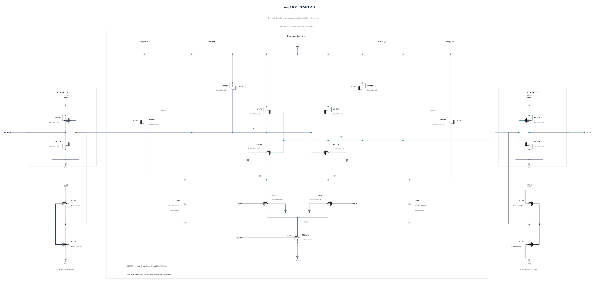

# RESET-V3: output-controlled weak keepers

RESET-V2's remaining peak is QP/QN overshoot at the end of the rising clock edge, while its four-corner delay, reset and output validity pass. This experiment reduces each clocked Q precharge PMOS from 6 um to 2 um and adds a weak inverter from the external output back to its internal Q node: P2 um / N0.5 um, all at 30 nm. The PMOS keeper conducts while that output is low and may absorb positive clock feedthrough. The small NMOS keeper conducts while the output is high. The original output inverter and its external load remain physical circuit elements.

The keeper introduces contention during evaluation and reset. Those delay, reset and energy costs must be measured; no successful validation is inherited. The input precharge, tail, core and two MOM capacitors are unchanged from V2. Existing callback-derived P2 geometry and the new successful N0.5 callback are used without scaling parasitics.

[RESET-V3.txt](RESET-V3.txt) is the independent 19-MOS/two-MOM source. Electrical SHA-256: `b4446fa108ea819712f441abe31a8be623c0eb8a904c8e27b2458260b41f8902`. Its byte-identical `.scs` RNL mirror passes core 0.5.2 with 0 errors, 0 warnings and 0 hints.

The first screen uses the same four key corners and 0.5 ps settings as V2, with all MOS terminal pairs, actual output validity, delay, reset, AVDD energy and supplemental clock charge. This source-freeze commit makes no performance claim. The canonical source and baseline official records remain unchanged.
