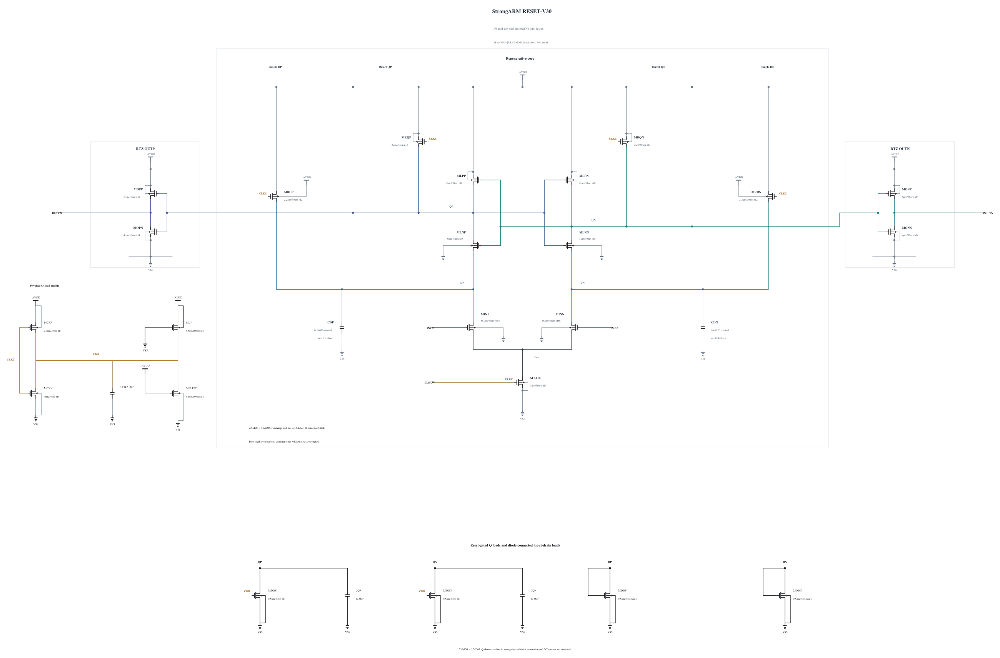

# RESET-V30: stronger output pull-ups with original pull-downs

> Superseded raw was released. Historical audits do not imply availability; see [retained runs](EVIDENCE-RETENTION.md).

**V30 fails SS/low/125 reset:** 36.646221657802904 ps exceeds 35 ps, despite TT 30 mV delay improving to 47.35514490849851 ps. All 144 actual decisions and completed resets, output validity and all 69 unrounded terminal pairs per corner pass. Qualification expansion stops at the reset-time failure; no V30 noise run or promotion follows.

[V29](RESET-V29.md) enlarged both output polarities and failed TT 30 mV delay at 50.5384103494184 ps. Its matched V28 comparison shows Q reaching 50% later by 1.987082135325636 ps, while the Q50-to-OUT50 interval shortens by 1.2043644156613755 ps. All four corners retain correct outputs, completed resets and terminal stress below 1 V. The failed experiment and complete waveform evidence are preserved.

V30 keeps both P8 output pull-ups from V29 and restores only MOPN/MONN to the exact V28 N4 device lines, including all model parameters and terminal parasitics. The other 21 MOS devices and all five MOMs remain identical to V29. Compared with V28, only the two PMOS output devices are enlarged. P8 uses exact zero-warning callback SHA-256 `20855415d9559ad00227138e98d1e759f6c67857f07cd4c5123d67502d0fec87`; the restored N4 parameters also exactly match V28's physical MCKN. No new geometry is fabricated and no physical noise source is disabled.

The experiment tests the output pull-up/pull-down balance before considering reduced input-tail current. Changing the balance can affect loser-output glitches, reset and terminal stress as well as speed. The first private merged-0.8.0 baseline checks TT, SS/low/125 and SF/FS high-voltage cold corners, with all 36 actual decisions and resets, full output validity, every unrounded MOS terminal pair and whole-cycle AVDD energy. Noise and capacitance remain separate required checks; no improvement or qualification is assumed.

Electrical SHA-256: `4e115ae96587505d85011525b8dbe73087c344aa0b867ef39fcc44f7e218f9c4`. The [source](RESET-V30.txt) contains complete RNL checked on a byte-identical mirror. Canonical V27 and every formal record remain unchanged.

## Completed four-corner reset failure

The private baseline `20261031-141113-strongarm-reset-v30-spec08-delay-baseline-screen` uses frozen clean source `750a09c5e82ed0febef9a66e29081d76f4719fbe` with empty numerical overrides. APS and actual conservative/gear2only/reltol 1e-4/vabstol 1e-6/relref alllocal/lteratio 10 are verified. No explicit maxstep or method is set.

| Corner | 1 mV ps | 30 mV ps | Reset ps | Unrounded peak V | Loser peak percent | Gate |
|---|---:|---:|---:|---:|---:|---|
| fs_high_m40 | 55.75131430851082 | 41.911261474702734 | 22.770878142693018 | 0.9951295702194042 | 13.481509561092 | PASS |
| sf_high_m40 | 71.51887521816064 | 52.714657529431044 | 21.2844087676731 | 0.9968828492968066 | 19.655674933804484 | PASS |
| ss_low_125 | 87.77767137598015 | 63.26967966709183 | 36.646221657802904 | 0.8183304562698609 | 16.129828655601763 | FAIL CMP-08 |
| tt_nom_27 | 64.28519790035806 | 47.35514490849851 | 26.07282014404538 | 0.9074184344781927 | 17.400850447602487 | PASS |

TT full-cycle AVDD waveform energy is `424.2659638597819` fJ/cycle: `102.83985763447663` evaluation and `321.42610622530526` reset. Every supply probe is present and KCL closes. This is report-only. Mixed-delay clock charge is diagnostic and does not replace the official capacitance test.

The archived V28 comparison uses identical complete tested-TB bytes and actual numerical settings. All 36 cycles per selected corner are kept. At TT 30 mV, V30 Q50 is later by 0.9770389317709771 ps, but Q50-to-OUT50 shortens by 3.377586653026606 ps, giving the observed 2.400547721255627 ps improvement. At SS 30 mV, mean Q reset to 90% is later by 1.9653281788122428 ps and output reset by 2.467299791546715 ps. The 90% Q crossing is diagnostic; the official reset definition remains both external outputs below 10%.

The worst SS reset is cycle `1`. Its Q90 diagnostic occurs at `46.433287549044344` ps after the clock fall and external reset at `36.646221657802904` ps. This motivates testing stronger Q precharge devices. The next independent trial changes only MRQP/MRQN from 3 to 3.6 um, keeping three fingers. It must recheck full timing/reset/validity/stress and the dedicated clock-capacitance metric before any noise expansion. Added clock loading is a measured constraint, not assumed acceptable. No input-tail change is included.

Archive SHA-256 `411d569d438bf1ed3242e65420057a2140c6c8f276887753170fa8bba1cc03b4` was verified by reading every member back with CRC and SHA-256. Full traces, all unrounded terminal pairs, actual-cycle checks and matched-path timings are preserved; the exact owned remote directory is absent. [NUMERICS-94](NUMERICS-94.md) retains the gate summary. No formal record changes.
