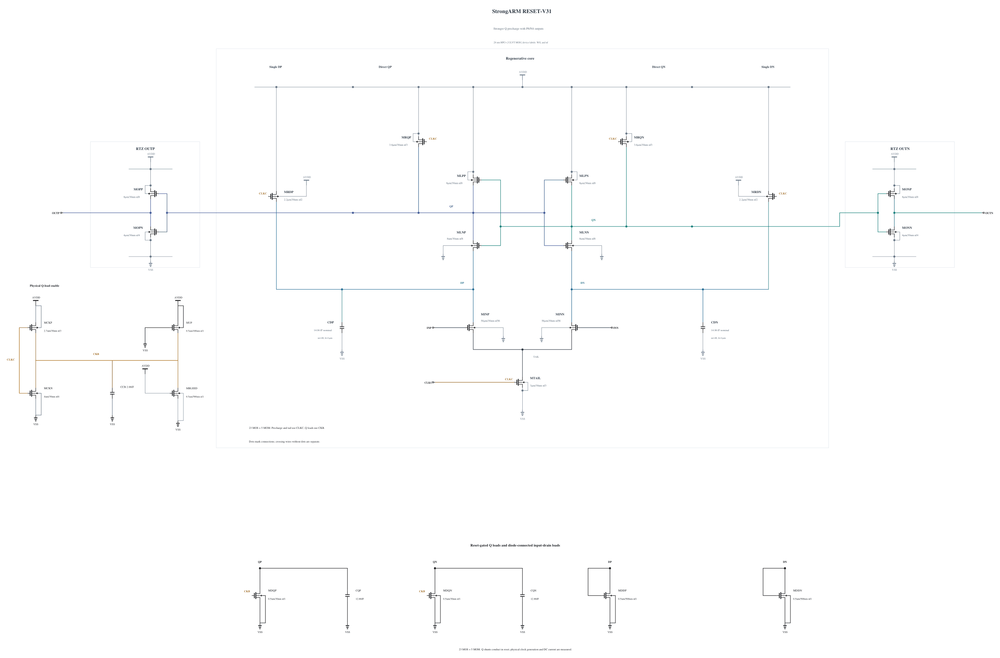

# RESET-V31: stronger Q precharge for reset

[V30](RESET-V30.md) gains useful TT 30 mV timing at 47.35514490849851 ps but fails SS/low/125 reset at 36.646221657802904 ps. The worst reset cycle's Q90 diagnostic is 46.433287549044344 ps after the clock fall. All 144 actual decisions/resets, output validity and every unrounded terminal pair are retained; the reset-time failure stops qualification expansion.

V31 changes only MRQP/MRQN from 3 to 3.6 um, with length 30 nm and three fingers retained; finger width becomes 1.2 um. The other 21 MOS devices and all five MOMs remain exactly V30, including P8/N4 output inverters, input pair and 3 um tail. The zero-warning callback supplies all geometry and terminal parasitics, SHA-256 `9e7e41eba5150991ae03d24448efc5c44411fd5e004808caa7a075aa18ab3827`; its provider/release matches the existing verified geometry and its exact owned remote directory is absent. All physical noise sources remain enabled.

The first independent private checks use the merged 0.8.0 baseline at TT, SS/low/125 and SF/FS high-voltage cold corners. All actual polarities, resets, full output validity, unrounded MOS terminal stress and whole-cycle AVDD energy are audited. Stronger precharge adds clock loading and alters feedthrough and reset current, so a dedicated TT capacitance/kickback test is required before noise expansion. The 16 fF clock limit is unchanged. Tighter critical-corner repeats are separate convergence diagnostics. No timing, noise, loading or qualification pass is assumed; no input-tail reduction is included.

Electrical SHA-256: `49527ccb78676fcf1bc519dea363e7151da21e1fa671fb87a985061d36dadb29`. The [source](RESET-V31.txt) contains complete RNL checked on a byte-identical mirror. Canonical V27 and all formal records remain unchanged.

