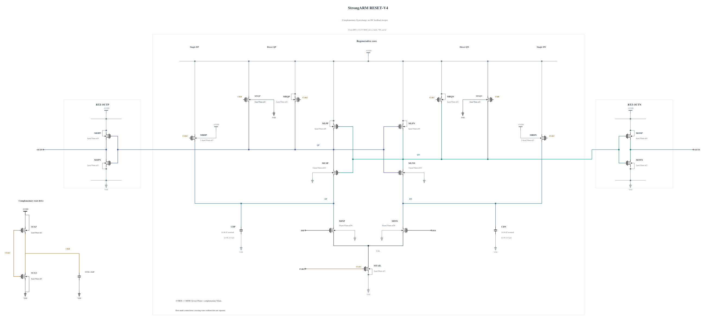

# RESET-V4: complementary Q precharge

The DC keeper in V3 prevents small-input decisions. This experiment returns to V2's unheld regenerative core and attacks clock feedthrough with complementary precharge. Each Q node uses a 2 um PMOS gated by CLKC and a 2 um NMOS between AVDD and Q gated by CKB. One N4/P2 inverter generates CKB and a 4.46051 fF MOM device damps that clock node. The tail stays directly clocked. There is no keeper connected to the output.

The hypothesis is that opposite gate transitions reduce net Q-node injection, while the NMOS assists early reset and the PMOS completes the high level. Driver delay, CKB voltage excursions and extra clock-input charge are explicit risks. Existing callback-derived geometries are copied exactly; no new geometry is synthesized and no parasitic is hand scaled.

The independent [RESET-V4.txt](RESET-V4.txt) has 19 MOS and three MOM capacitors. Electrical SHA-256: `f9cf4bb897ed2e9080e83eb7659570310b464618055f8b7c3e8bf79e57e9b3ac`. Full RNL checks with core 0.5.2 on a byte-identical `.scs` mirror: 0 errors, 0 warnings, 0 hints.

The first screen retains the same four key corners, current delay stimulus, all-terminal voltage scope, physical output checks and 0.5 ps settings used for V2/V3. This source-freeze commit claims no validation. The canonical baseline is preserved.

## Completed screen: reset coupling still fails

Actual frozen source: `1cd93b70ae701182a42eab725f9b2f5cdfc2d35c`. All four traces decide 36/36 cycles with correct first-event polarity and CMP-15 = 0, but high-voltage stress and SS low/hot reset fail. This version is not expanded.

| Corner | 1 mV ps | 30 mV ps | Reset ps | AVDD fJ | Losing peak % VDD | Max terminal V | Violating pairs / 57 |
|---|---:|---:|---:|---:|---:|---:|---:|
| tt_nom_27 | 56.626384 | 44.031326 | 26.135428 | 158.558457 | 17.402364 | 0.957510 | 0 |
| ff_high_m40 | 42.745960 | 33.625483 | 19.560408 | 180.425555 | 18.904778 | 1.054210 | 12 |
| ff_high_125 | 42.154141 | 32.146162 | 22.604806 | 296.121905 | 19.803706 | 1.040850 | 8 |
| ss_low_125 | 73.948088 | 56.767517 | 36.687539 | 147.431370 | 16.213549 | 0.854840 | 0 |

Cold FF QP peaks at 1.054213435 V, 14.870957 ps after a falling CLKC 50% crossing. At that sample CKB is 0.992856 V and QN is still rising through 0.776761 V. CKB was already 0.991142 V at fall +9 ps, while QP continued rising to its later peak. This is consistent with cross-coupling from the other Q node during reset; complementary clock transitions alone do not bound it. The clocked P2 precharge is too weak to suppress the observed excursion. SS low/hot reset is 36.688 ps.

The next design direction restores stronger Q precharge, retains no DC keeper and separates capacitive clock compensation from conducting reset assistance. All 57 terminal pairs were checked over each full trace. Raw/deck/source SHA-256 verification and exact-owned remote cleanup completed; actual peak was three simultaneous jobs. Commands used +aps, no ++aps or explicit +mt; effective solving was single-threaded. Canonical source and official records remain unchanged.
