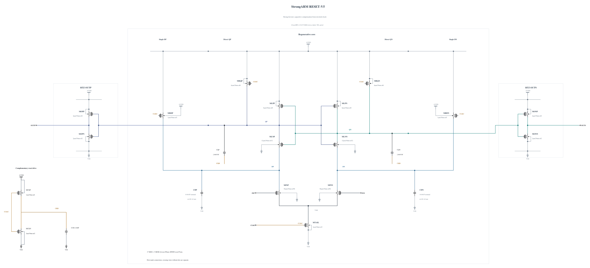

# RESET-V5: strong reset with capacitive clock compensation

V2's strong Q precharge gave fast reset but rising-clock overshoot; V4's weaker Q precharge could not absorb coupling from the opposite regenerating node during reset. This experiment restores the P6 Q precharge of V2 and removes V4's conducting NMOS reset assist. A 2.06055 fF physical MOM capacitor connects each Q node to CKB to oppose the direct clock's capacitive injection. CKB is generated by an N2/P1 inverter with the existing 4.46051 fF damping capacitor.

Input-drain precharge is reduced from P2.4 to P1 to make room for the clock inverter's input capacitance. The tail remains directly clocked, and no DC keeper loads evaluation. Slower DP/DN recharge, clock phase mismatch, reset coupling and added Q capacitance must all be measured; this is a hypothesis, not a proven cancellation model.

All MOS geometries reuse successful callback results. The new MOM geometry was successfully solved with zero warnings and its exact 8-finger, 1 um geometry is used. An earlier callback request using simulator parameter names was rejected; it produced no circuit values used here, and its failure evidence was retained privately. The corrected request used the documented capacitor callback parameter names.

The independent [RESET-V5.txt](RESET-V5.txt) has 17 MOS and five MOM capacitors, with complete RNL and a separate preview. The first screen uses the same four key corners, full terminal-voltage scope, physical outputs and 0.5 ps settings as preceding experiments. This source-freeze commit claims no performance result. Canonical baseline evidence remains unchanged.

