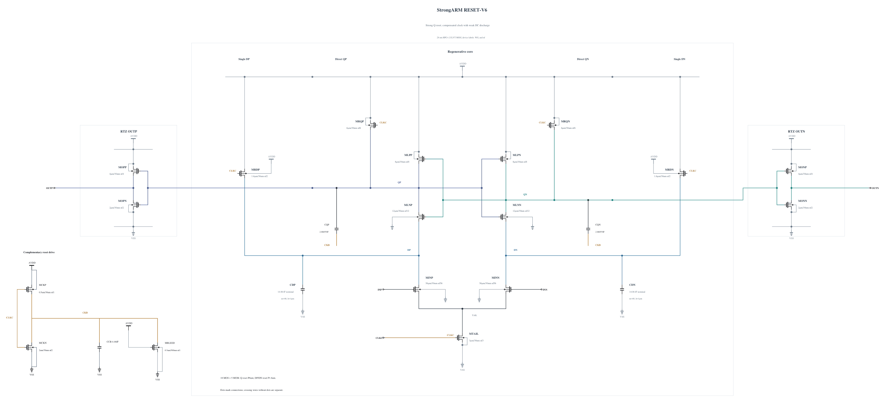

# RESET-V6: bound the compensated clock and input recharge

V5 separates three remaining events: early clock/Q excursions, a reset Q peak while CKB is still rising, and DP/DN injection at an input transition during reset. This experiment changes the input precharge PMOS from 1 to 1.6 um, reduces the clock inverter PMOS from 1 to 0.5 um, and adds a weak CKB discharge NMOS (W=0.5 um, L=500 nm, gate tied to AVDD). All three new geometries have successful, warning-free callbacks.

The weak discharge gives CKB a defined DC load and may create high-level headroom; the smaller PMOS slows its rising edge and advances its falling edge relative to the input clock. Both changes aim to reduce positive compensation current during reset while improving early cancellation. Stronger input precharge targets the separate input-step excursion. The reduced clock PMOS also offsets some of the added direct input capacitance. DC current, clock swing, delay and exact device peaks are measured, not assumed. There is no extra supply, behavioral control or Q-node keeper.

The independent [RESET-V6.txt](RESET-V6.txt) has 18 MOS and five MOM capacitors. Electrical SHA-256: `195e42741ebe64933fc373400bcc375fb4f3b4aba823ac4b188b721ff6359ec5`. Full RNL on a byte-identical `.scs` mirror passes core 0.5.2 with 0 errors, 0 warnings and 0 hints.

The first screen uses TT, FF high cold/hot and SS low/hot at the same 0.5 ps settings, checking all 54 MOS terminal pairs, actual decisions and output validity, delay, reset and total AVDD energy. This source-freeze commit makes no performance claim.
