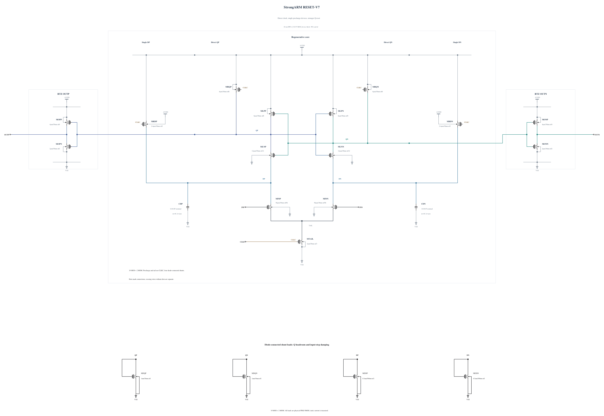

# RESET-V7: physical diode-connected shunt loads

V6 retains a reset peak caused by charge arriving while the opposite Q node and the compensation clock rise. This experiment returns to V2 direct-clock precharge and removes the compensation clock path. Each Q node receives a diode-connected N1 um / 30 nm load, and each input drain receives a weaker N0.5 um / 500 nm load. Their high-level conduction is intended to create voltage headroom and dissipate edge-coupled charge. Gate and drain are physically connected, so these are nonlinear MOS loads, not ideal voltage clamps.

The loads may change common-mode evolution, noise, decision gain and static energy. All of these remain unestablished for this source. The NMOS geometries exactly reuse successful warning-free callbacks; no circuit performance is inherited. The [independent source](RESET-V7.txt) contains 19 MOS and two MOM capacitors. Electrical SHA-256: `a62049295cc9343d260d27b6cbfdba646d1c6ce8d02643de7fea1bed2a46e0e0`. The byte-identical Spectre mirror passes full RNL core 0.5.2 checks with 0 errors, 0 warnings and 0 hints.

The first screen checks TT, FF high cold/hot and SS low/hot, with all 57 terminal pairs over the entire trace, actual decisions, output validity, timing and exact AVDD energy. No performance pass is claimed at source freeze.
