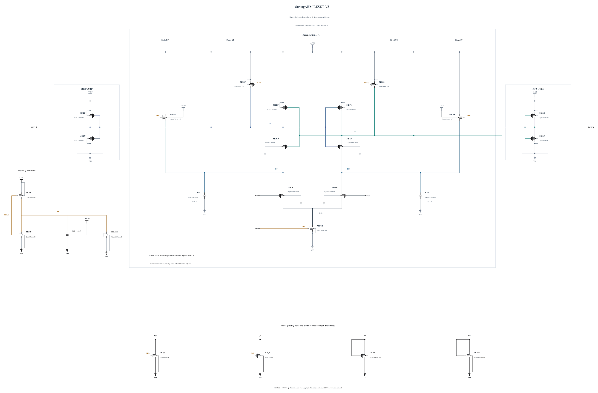

# RESET-V8: enable Q shunt loads only during reset

V7 passes full-trace stress at four key corners, but its persistent Q loads cause losing-output peaks above 30 percent of VDD. This experiment changes only the Q-load control mechanism: each N1 um shunt gate is driven by a physical inverted clock CKB, so the current should turn off during evaluation. The input-drain diode loads remain. A P2/N2 inverter generates CKB, with a 14.06 fF MOM and the previously validated weak N0.5 um / 500 nm clock load. Q precharge changes from P6 to P4 to offset the added external clock-gate load. The resulting reset speed and actual phase overlap require measurement.

This is real transistor control, with every device included in stress and energy. It adds no ideal timing source or external bias. The [independent source](RESET-V8.txt) contains 22 MOS and three MOM capacitors, all with previously validated geometries. Electrical SHA-256: `61c0cc313cf8ac00cfda7e84f0371d8d50ed76e57faef057001ccc8c380bd71a`. Full RNL on its byte-identical Spectre mirror passes core 0.5.2 with 0 errors, 0 warnings and 0 hints.

The first screen checks TT, FF high cold/hot and SS low/hot, all 66 terminal pairs over the entire trace, actual decisions/output validity, delay, reset and exact AVDD energy. Clock charge is monitored separately and cannot substitute for official CMP-14. No performance pass is claimed at source freeze.
