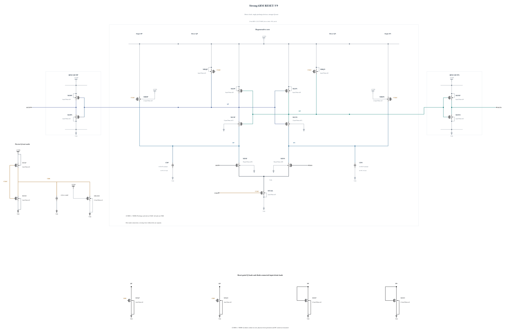

# RESET-V9: increase conductance of the reset-gated Q shunts

V8 recovers valid outputs and timing at all four screened corners, and only cold FF retains terminal stress. At its 1.00737 V reset peak, CKB is already 0.506 V while the opposite Q is 0.290 V. This experiment doubles only each Q shunt from N1/nf1 to N2/nf2 with the complete validated geometry and parasitics. Clock generation, Q precharge, input loads and all other electrical connections remain V8.

The stronger shunts may absorb more of the measured reset charge, but their extra clock capacitance and DC current can slow reset or alter initial conditions. Those effects must be measured on this source. The [independent source](RESET-V9.txt) has 22 MOS and three MOM capacitors. Electrical SHA-256: `0342611e100bfc38b994734e0038c985cc57cf503e55be09e18c468106f8c21c`. Full RNL on a byte-identical Spectre mirror passes core 0.5.2 with 0 errors, 0 warnings and 0 hints.

The first screen uses TT, FF high cold/hot and SS low/hot, with all 66 terminal pairs over the entire trace, actual decisions and CMP-15, delay, reset, and exact AVDD energy. It makes no inherited performance claim.
