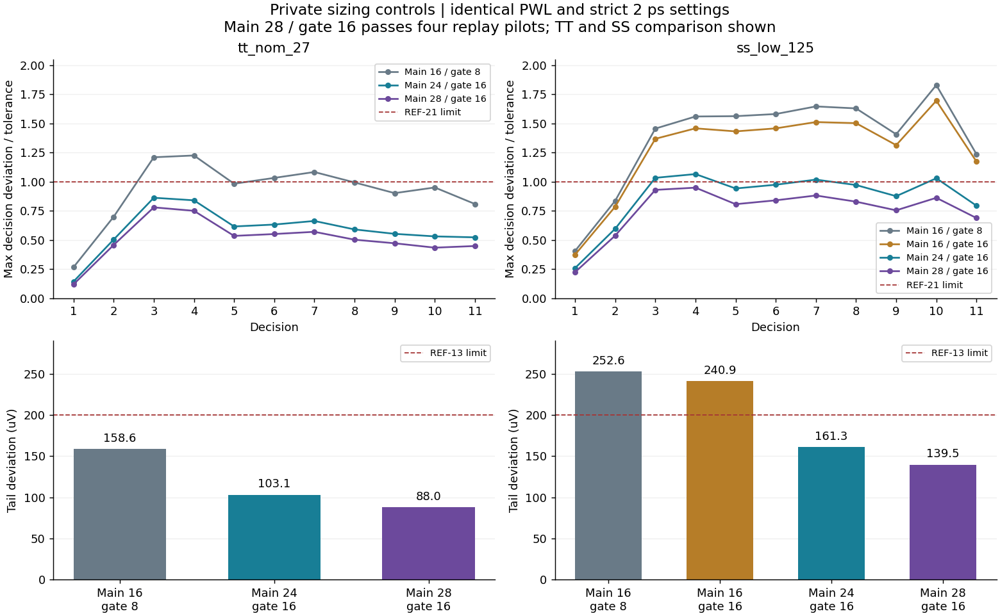
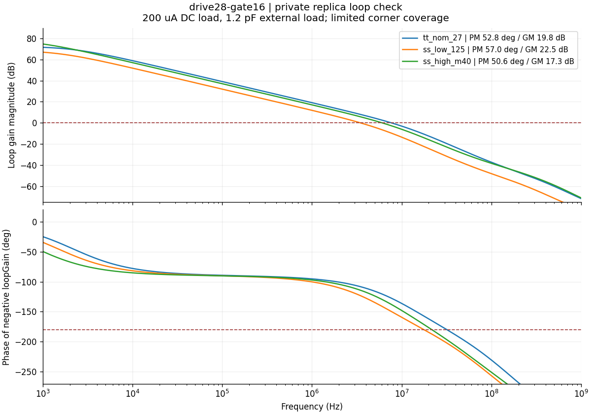

# REF-21 numerical and sizing diagnosis

> Historical record before source promotion. The main28/gate16 source is now
> ready for candidate review; current coverage and remaining integration work are tracked in
> [REF21-validation.md](REF21-validation.md). The baseline and this report are
> preserved at tag `archive/adc-ref-ref21-baseline-604a61a`.

The committed candidate is still **wip** at electrical hash
`380f10b05b0af622`. The official evidence remains **91 fresh/pass, 4 fresh/fail
and 41 stale**. This report describes separate private diagnostics from clean
commit `8a609639e8a723671e4190475c34ce4ed20df734`. Modified variants are
substituted only in staged decks, with their own frozen source hashes below;
they are not the source in that commit. None replaces an official failure.
The remaining 41 replay corners have not been expanded.

## Numerical convergence of the unchanged circuit

TT nominal/27 C and SS low/125 C used the exact audited PWL inputs from
[the retest](REF21-retest.md), N=1024 after 32 warmup conversions, normal charge
scale and no extra DC load. Both were run with APS, requested `reltol=1e-6`,
`vabstol=1e-8`, conservative, trap-only and maximum steps of 2 ps, then 1 ps.
The actual logged relative tolerance was `1e-7`, absolute voltage tolerance
`1e-8` V, `lteratio=10`, and the requested maximum step. The conservative
preset tightened the requested relative tolerance.

| Corner | Official REF-21 | Strict 2 ps REF-21 | Official REF-13 (uV) | Strict 2 ps REF-13 (uV) |
|---|---:|---:|---:|---:|
| tt_nom_27 | 1.220239888 | 1.224688650 | 153.466465 | 158.604718 |
| ss_low_125 | 1.797049059 | 1.828853070 | 247.534969 | 252.565627 |

The default-to-strict numerical sensitivity was reported to the coordinator
for verification-process assessment. It does not change pass/fail, and the
formal testbench/settings were not edited. Halving the strict maximum step
changes REF-21 by at most `1.774e-6` and REF-13 by at most `0.002409 uV` across
these two corners. The failure is stable under this refinement.

Every run retains 15,840 finite, contiguous sampled events. Trigger alignment
is within 5 fs. Additional node saves contain 27,822 requested instants: all
trigger centers and four dense 3 ns windows with 1 ps saved spacing. Saved-time
alignment is within 0.665 fs. The large gaps between selected output strobes
are not solver time steps. Uploaded inputs and fetched raw/log files were
SHA-256 verified; all original raw data remains local, and only each verified
run's own remote directory was removed.

## Controlled sizing comparisons

All variants use the same new PWL and strict 2 ps settings. Changed device
multipliers were checked by the configured parameter callback runtime before
simulation, with no callback warnings. The replica devices, bias gates,
startup clamp, output MOM units and servo compensation remain unchanged.

| Variant | Electrical hash | Main driver / sink / divider multipliers | Gate MOM multiplier |
|---|---|---|---:|
| committed baseline | `380f10b05b0af622` | 16 / 4 / 8 | 8 |
| gate16 | `f117bdbc34f4d046` | 16 / 4 / 8 | 16 |
| drive24-gate16 | `854973747fc0e6ca` | 24 / 6 / 12 | 16 |
| drive28-gate16 | `2b1163f0eb481376` | 28 / 7 / 14 | 16 |

The main/replica ratios remain matched. Divider multiplier applies to both
the upper and lower VCM devices.

| Variant / corner | REF-21 (<= 1) | Worst decision | REF-13 (uV, <= 200) | REF-14 (uV, <= 100) |
|---|---:|---:|---:|---:|
| baseline TT | 1.224688650 FAIL | 4 | 158.604718 | 32.025460 |
| baseline SS low/hot | 1.828853070 FAIL | 10 | 252.565627 FAIL | 54.148787 |
| gate16 SS low/hot | 1.694731391 FAIL | 10 | 240.915540 FAIL | 33.814681 |
| drive24-gate16 TT | 0.861722396 | 3 | 103.072405 | 24.827195 |
| drive24-gate16 SS low/hot | 1.065039291 FAIL | 4 | 161.271158 | 33.749912 |
| drive28-gate16 TT | 0.779194753 | 3 | 87.965503 | 24.739564 |
| drive28-gate16 SS low/hot | 0.948422378 | 4 | 139.542694 | 33.663212 |



REF-12 passes at all these points. Doubling gate capacitance alone is
insufficient. At the baseline worst SS decision 10, the replica deviation
falls from 90.85 to 52.14 uV, while the output-minus-replica deviation only
falls from 634.41 to 619.92 uV. These voltage differences add exactly to the
output error; they are not separately identified causal percentages.

Increasing matched main scale to 24 lowers that output-minus-replica deviation
to 362.72 uV. The largest remaining envelope error moves to decision 4. End-of-
replay operating-point data shows SS driver gm increasing from 69.23 to
103.84 mS, driver cgg from 3.594 to 5.391 pF, and driver css from 2.194 to
3.291 pF. The gate MOM changes from 14.707 to 29.414 pF at this corner
(TT: 11.680 to 23.360 pF). The two output MOM units remain about 3.677 pF
combined at SS, plus the separate bench load of 1.2 pF.

Consistent local exponential fits of output-minus-replica recovery after
decisions 9–11 give approximately 88–97 ps for the baseline, 86–93 ps for
gate16, and 68–72 ps for drive24-gate16. These fits describe selected quiet
segments of one saved SS conversion, with 2 ps guards after the pulse end and
before the next clock; they are not a global single-pole model.
Operating-point capacitances include coupling and must not simply be summed
as grounded capacitance. No extracted interconnect parasitics are included.

## Measured costs of drive24-gate16

These checks use the unchanged official DC/noise/startup benches, while staging
the frozen private variant; no formal records are written.

| DC corner, 200 uA load | Baseline power (mW) | drive24-gate16 power (mW) | DC limits |
|---|---:|---:|---|
| tt_nom_27 | 28.10870 | 40.73008 | pass |
| ss_low_125 | 17.72542 | 25.70906 | pass |
| ff_high_m40 | 47.76554 | 69.13506 | pass |

Power rises about 45%. TT integrated VREFP noise is 73.10166 uV rms
(baseline 76.11196 uV; limit 120 uV). The additional gate capacitance and
driver capacitance are real costs even though noise improves slightly.

Startup at SS low/hot, SS high/cold and FF low/hot passes all six applicable
limits, as do the corresponding official 0.1 ns Gear cross-checks. The normal
run uses 1 ns and trap-only. Across these checks, the highest VREFP is
0.9555276 V, highest VCM is 0.4777633 V, and largest ready error is 1.045760 mV.
The largest cross-check differences are 8.301 uV for the VREFP peak and
0.005034 mV for ready error. This is key-corner characterization, not all-corner
startup certification of the private variant.

There are no reported device-limit warnings in these checked jobs; this does
not constitute independent SOA signoff.

The private replica-loop check inserts a zero-volt current probe in feedback,
with the same 200 uA DC and 1.2 pF external load. The resulting DC points agree
with the direct DC bench where both were measured.

| drive24-gate16 corner | Phase margin (deg) | Gain margin (dB) | Unity-gain frequency (MHz) |
|---|---:|---:|---:|
| tt_nom_27 | 52.8881 | 19.7798 | 7.63119 |
| ss_low_125 | 57.1361 | 22.5369 | 3.44587 |
| ss_high_m40 | 50.6692 | 17.2901 | 6.01648 |

Independent interpolation of the saved complex loop-gain data reproduces the
logged margins within 0.001 degree and 0.0001 dB. These are characterization
results, not new acceptance limits or all-corner stability certification.
The measured MHz servo bandwidth, compared with the tens-of-ps pulse-to-clock
intervals, supports concentrating this iteration on the local follower and
gate storage rather than attempting to make the replica loop settle each
DAC pulse. Increasing output decap alone would reduce the initial excursion
while increasing the charge that the follower must restore; no unsupported
claim of improvement from that change is made.

## Next limited step

The main24 experiment still fails SS REF-21, so it is not promoted. Main28
retains gate multiplier 16 and scales the three matched main device groups
one further step. Its frozen file SHA-256 is
`bc0d215942f18c1900825ab6398fb87017e8db365cd68005f957e8429c95443f`.
These five lines are the complete electrical change relative to the committed
baseline; matching RNL size text is updated to the same multipliers:

```spectre
MDRV (AVDD18 VG VREFP VSS) nch_na18_mac w=64u l=800n nf=32 multi=28
MSINK (VREFP VREF_IN VSS VSS) nch_18_mac w=64u l=500n nf=32 multi=7
MCMH (VCM VCM VREFP VREFP) pch_lvt_mac w=8u l=120n nf=4 multi=14
MCML (VSS VSS VCM VCM) pch_lvt_mac w=8u l=120n nf=4 multi=14
CGATE (VG VSS) cfmom_2t w=50n s=50n nr=80 lr=40u stm=1 spm=5 multi=16
```

The first strict 2 ps SS run passes, with about 5.16% envelope margin. The
independent 1 ps refinement also passes: REF-21 `0.948427649`, REF-13
`139.544419 uV`. Relative to 2 ps, the changes are `+5.271e-6` and
`+0.0017255 uV`, respectively; REF-12 is identical and REF-14 differs by
`0.0001064 uV`. The largest raw sampled-voltage difference is `2.263 uV`,
with identical sampling times. RNL checking reports zero errors, warnings
and hints. All four original pilot corners now pass the strict 2 ps replay:

| drive28-gate16 corner | REF-12 loss (bit) | REF-13 (uV) | REF-14 (uV) | REF-21 | Worst decision |
|---|---:|---:|---:|---:|---:|
| tt_nom_27 | -0.012880253 | 87.965503 | 24.739564 | 0.779194753 | 3 |
| ss_low_125 | -0.017263224 | 139.542694 | 33.663212 | 0.948422378 | 4 |
| ff_high_125 | 0.034434346 | 90.335118 | 32.346828 | 0.827859457 | 3 |
| ff_low_m40 | 0.036110459 | 43.818860 | 12.138032 | 0.661112557 | 3 |

The SS point has the smallest measured envelope margin. These four private
results do not substitute for 45 fresh official replay records.

Main28's own three DC checks pass, with the following measured cost:

| Corner, 200 uA load | Baseline power (mW) | main24 power (mW) | main28 power (mW) |
|---|---:|---:|---:|
| tt_nom_27 | 28.10870 | 40.73008 | 47.04061 |
| ss_low_125 | 17.72542 | 25.70906 | 29.70012 |
| ff_high_m40 | 47.76554 | 69.13506 | 79.81969 |

This is approximately 67% above the committed baseline and 15.5% above
main24. At SS, main28's end-of-replay driver gm is 121.15 mS, cgg is 6.290 pF,
and css is 3.840 pF; the gate MOM stays 29.414 pF. The local recovery fits
shorten to approximately 63–67 ps. At TT, driver cgg is 6.391 pF and the gate
MOM is 23.360 pF. The increased capacitance and power accompany the measured
replay improvement.

Main28 TT VREFP noise is **72.91713 uV rms**, integrated over 10 kHz–100 GHz,
versus the 120 uV limit and baseline 76.11196 uV. Reported low-frequency
noise (1–10 kHz) is 21.50474 uV; total-band noise is 76.02211 uV.

Startup passes at SS low/hot, SS high/cold and FF low/hot, including all three
0.1 ns Gear cross-checks. Across those six jobs, VREFP peaks at 0.9555145 V,
VCM peaks at 0.4777570 V, and the largest ready error is 1.045268 mV. The
largest peak cross-check difference is 5.802 uV and the largest ready-error
difference is 0.0035993 mV. All six waveforms cover the complete 25.1 us run.
The final three loop checks give:

| main28 corner | Phase margin (deg) | Gain margin (dB) | Unity-gain frequency (MHz) |
|---|---:|---:|---:|
| tt_nom_27 | 52.7520 | 19.7802 | 7.61831 |
| ss_low_125 | 57.0089 | 22.5375 | 3.44106 |
| ss_high_m40 | 50.5887 | 17.2903 | 6.01029 |



The saved complex gain independently reproduces these margins. The limited
follow-up batch is complete, using at most one Spectre job at a time. All
106 fetched raw/log files of main28's four replay pilots, SS refinement and
key tradeoff checks were reverified by SHA-256. Their raw data is retained;
their owned remote directories have been removed. All 272 committed result
JSON/figure files remain byte-identical to the pre-diagnostic snapshot.

## Disposition

Main28/gate16 is a concrete next-source proposal with four passing replay
pilots and the limited tradeoff evidence above. It is not selected or promoted
by this documentation update. Its 67% power increase and doubled gate MOM
remain material costs; the smallest measured envelope margin is about 5.16%.

The committed circuit stays `380f10b05b0af622`, with 91 fresh/pass records,
four fresh/fail replay records and 41 stale replay records. The remaining
41 runs stay on hold under the coordinator's current plan. Promoting the
proposal changes the reached circuit input for every reference bench: the
91 baseline DC/startup/noise records cannot be rehashed into acceptance for
the changed circuit. A committed source revision needs refreshed formal
evidence, including all 45 replay corners, and separate updated mixed-top
verification. The archived SS-hot top failure is not resolved by these
module-only checks.
