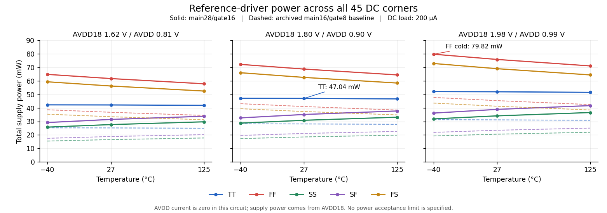

# Main28/gate16 formal validation

Status: **ready** for candidate review. Current main:
`33337c605ff670e04eee814c2178ed26eca7346d`; adc_ref specification 0.8.0.
The formal simulation series used the unmodified official flow on main
`fac0194179a4ae593438b022a0713d6e5b59663f`. Synchronizing main afterwards
changed no recorded circuit dependency, reference limit or reference
measurement function. All 136 records remain fresh without rehashing.
Notice #60 remains acknowledged; open reference notices and PR #31
comments/reviews were checked again before the final update.

## Source and preserved baseline

The promoted source exactly matches the frozen diagnostic proposal:
electrical hash `2b1163f0eb481376`, file SHA-256
`bc0d215942f18c1900825ab6398fb87017e8db365cd68005f957e8429c95443f`.
The electrical changes are MDRV multiplier 16 to 28, MSINK 4 to 7,
MCMH/MCML 8 to 14, and CGATE 8 to 16, with matching RNL annotations.
Ports, topology, other instance parameters and model names are unchanged.

The preceding source and all 136 records are preserved at
[604a61a](https://github.com/many-question/ADC-12b-100M/commit/604a61a144e54e7d6cfae2eaa162f202318c8ece),
tag `archive/adc-ref-ref21-baseline-604a61a`. That source has 91 fresh passes,
four fresh replay failures and 41 stale replay records. The changed circuit
invalidates all of them; old records are not rehashed into new acceptance.
Fresh runs replaced all 136 current records; history and raw evidence retain
their original provenance.

The complete formal series and every original simulation source commit remain
reachable at tag `archive/adc-ref-main28-formal-fbdd95d`, ending at
[fbdd95d](https://github.com/many-question/ADC-12b-100M/commit/fbdd95d7cbafd042faa042b90c018729d25718c3).
The rebase preserved the exact source bytes and all 272 result/figure files.

## Validation stages

Current committed-source evidence: **136 fresh passes / 0 fresh failures / 0 stale**. See the evidence snapshot below for current coverage.
All simulations used the official flow at their recorded commits, APS and one job at a time,
with a clean committed source frozen through staging, simulation and fetch.
Uploaded inputs and fetched raw files are SHA-256 checked. Only owned remote
run directories are removed after retrieval and audit.

1. Four official replay pilots passed: TT nominal/27 C, SS low/125 C,
   FF high/125 C and FF low/-40 C; compare with the converged diagnostic.
2. All 45 DC corners and TT noise passed, followed by 45 startup corners
   with four critical-corner cross-checks and all 45 replay corners.
3. The completed series has no failing module corner. All 15 required
   specifications pass at all 631 required spec/corner pairs.

The final audit checked 696 retrieved files by SHA-256, all 18 batch manifests,
the committed source bytes, complete replay samples and startup waveforms.
All owned remote run directories were removed after successful audit and all
simulation slots are released. The records remain self-reported; no lead
verification marker has been added.

Private strict-step diagnostics retain their actual settings and are not
relabeled as official bench conditions. The candidate changes no public
testbench, tool, load, timing or numeric setting.

## Four official replay pilots

All four pilots pass REF-12/13/14/21 on clean committed source
`2514708ac5419eef7b5b1066ebccf47880aa0c67`, using the official APS bench
without numeric or load overrides. All 15,840 samples per corner are present
and contiguous; independent raw-sample calculation reproduces REF-13/14/21.
All 20 fetched files match their remote SHA-256; device-limit warning count is zero.

| Corner | REF-12 (bit) | REF-13 (uV) | REF-14 (uV) | Official REF-21 | Strict 2 ps REF-21 |
|---|---:|---:|---:|---:|---:|
| tt_nom_27 | 0.00647509 | 84.413866 | 29.779911 | 0.775648167 | 0.779194753 |
| ss_low_125 | -0.02420498 | 136.131103 | 36.716586 | 0.945148039 | 0.948422378 |
| ff_high_125 | 0.03659651 | 86.534358 | 39.577543 | 0.824105773 | 0.827859457 |
| ff_low_m40 | 0.03610901 | 40.547451 | 20.028976 | 0.659818462 | 0.661112557 |

The official logged settings are reltol 0.001, voltage absolute tolerance 1 uV,
trap-only and moderate. The maximum-step setting is 211.6 ns; PWL breakpoints
drive much smaller accepted steps. The strict diagnostic uses its separately
reported 2 ps setting and tighter tolerance. The maximum absolute envelope
difference is 0.00375368, with all four pass/fail decisions unchanged.
SS refinement to 1 ps gives REF-21 0.948427649 and tail deviation 139.544419 uV;
the official SS values above are retained without substitution.

## Review status and remaining work

Candidate status is ready under CONTRIBUTING section 10.4: the specified module
validation is complete and available for review. Project selection has the
separate eligibility conditions in section 10.6. Lead verification, updated
mixed-top regression and dynamic VCM integration have not been completed.
No selection or signoff is claimed.

The archived SS low/125 C mixed-top ENOB failure, 10.4655729645 < 10.5 bit,
retains its original source and inputs. Passing the current module tests does
not resolve that historical failure. The new source has no updated top result.

The full formal DC table below replaces the preliminary private power estimate.
TT power is **47.04061 mW**, the 45-corner maximum is **79.81969 mW**, and the
matched-corner increase is **65.41% to 68.10%**. The specification has no power
limit; this substantial cost remains relevant to the power-first ranking.

<!-- formal evidence snapshot start -->
## Formal evidence snapshot

Current committed-source evidence: **136 fresh passes / 0 fresh failures / 0 stale**.

| Test | Fresh passing corners | Required corners |
|---|---:|---:|
| tb_ref_dc | 45 | 45 |
| tb_ref_noise | 1 | 1 |
| tb_ref_startup | 45 | 45 |
| tb_ref_replay | 45 | 45 |

All fresh records were generated by the official flow from a clean committed
tree at the promoted electrical hash. No old-circuit result was rehashed.
All evidence is self-reported. Lead verification, updated mixed-top and
dynamic VCM integration remain pending.

### Formal DC power and regulation

Fresh DC covers 45 corners. The largest observed total supply power is **79.81969 mW**
at `ff_high_m40`; AVDD18 contributes 79.81969 mW and AVDD 0.00000 mW.
TT nominal/27 C is **47.04061 mW** (AVDD18 47.04061 mW, AVDD 0.00000 mW).
Against the archived baseline at matched corners, power increases by 65.41% to 68.10%.

The specification has no power limit; this power cost remains explicit.

| Corner | AVDD18 / AVDD (V) | I18 (mA) | I09 (mA) | P18 (mW) | P09 (mW) | Total (mW) |
|---|---:|---:|---:|---:|---:|---:|
| ff_high_125 | 1.98 / 0.99 | 35.928763 | 0.000000 | 71.13895 | 0.00000 | 71.13895 |
| ff_high_27 | 1.98 / 0.99 | 38.349678 | 0.000000 | 75.93236 | 0.00000 | 75.93236 |
| ff_high_m40 | 1.98 / 0.99 | 40.312976 | 0.000000 | 79.81969 | 0.00000 | 79.81969 |
| ff_low_125 | 1.62 / 0.81 | 35.733922 | 0.000000 | 57.88895 | 0.00000 | 57.88895 |
| ff_low_27 | 1.62 / 0.81 | 38.119109 | 0.000000 | 61.75296 | 0.00000 | 61.75296 |
| ff_low_m40 | 1.62 / 0.81 | 40.041937 | 0.000000 | 64.86794 | 0.00000 | 64.86794 |
| ff_nom_125 | 1.80 / 0.90 | 35.818669 | 0.000000 | 64.47360 | 0.00000 | 64.47360 |
| ff_nom_27 | 1.80 / 0.90 | 38.218851 | 0.000000 | 68.79393 | 0.00000 | 68.79393 |
| ff_nom_m40 | 1.80 / 0.90 | 40.155227 | 0.000000 | 72.27941 | 0.00000 | 72.27941 |
| fs_high_125 | 1.98 / 0.99 | 32.559992 | 0.000000 | 64.46878 | 0.00000 | 64.46878 |
| fs_high_27 | 1.98 / 0.99 | 34.888824 | 0.000000 | 69.07987 | 0.00000 | 69.07987 |
| fs_high_m40 | 1.98 / 0.99 | 36.837494 | 0.000000 | 72.93824 | 0.00000 | 72.93824 |
| fs_low_125 | 1.62 / 0.81 | 32.413738 | 0.000000 | 52.51026 | 0.00000 | 52.51026 |
| fs_low_27 | 1.62 / 0.81 | 34.718148 | 0.000000 | 56.24340 | 0.00000 | 56.24340 |
| fs_low_m40 | 1.62 / 0.81 | 36.646197 | 0.000000 | 59.36684 | 0.00000 | 59.36684 |
| fs_nom_125 | 1.80 / 0.90 | 32.474125 | 0.000000 | 58.45342 | 0.00000 | 58.45342 |
| fs_nom_27 | 1.80 / 0.90 | 34.785815 | 0.000000 | 62.61447 | 0.00000 | 62.61447 |
| fs_nom_m40 | 1.80 / 0.90 | 36.717945 | 0.000000 | 66.09230 | 0.00000 | 66.09230 |
| sf_high_125 | 1.98 / 0.99 | 21.068529 | 0.000000 | 41.71569 | 0.00000 | 41.71569 |
| sf_high_27 | 1.98 / 0.99 | 19.651279 | 0.000000 | 38.90953 | 0.00000 | 38.90953 |
| sf_high_m40 | 1.98 / 0.99 | 18.269130 | 0.000000 | 36.17288 | 0.00000 | 36.17288 |
| sf_low_125 | 1.62 / 0.81 | 20.878185 | 0.000000 | 33.82266 | 0.00000 | 33.82266 |
| sf_low_27 | 1.62 / 0.81 | 19.424851 | 0.000000 | 31.46826 | 0.00000 | 31.46826 |
| sf_low_m40 | 1.62 / 0.81 | 18.007745 | 0.000000 | 29.17255 | 0.00000 | 29.17255 |
| sf_nom_125 | 1.80 / 0.90 | 20.960856 | 0.000000 | 37.72954 | 0.00000 | 37.72954 |
| sf_nom_27 | 1.80 / 0.90 | 19.520082 | 0.000000 | 35.13615 | 0.00000 | 35.13615 |
| sf_nom_m40 | 1.80 / 0.90 | 18.115909 | 0.000000 | 32.60864 | 0.00000 | 32.60864 |
| ss_high_125 | 1.98 / 0.99 | 18.476044 | 0.000000 | 36.58257 | 0.00000 | 36.58257 |
| ss_high_27 | 1.98 / 0.99 | 17.232605 | 0.000000 | 34.12056 | 0.00000 | 34.12056 |
| ss_high_m40 | 1.98 / 0.99 | 16.084789 | 0.000000 | 31.84788 | 0.00000 | 31.84788 |
| ss_low_125 | 1.62 / 0.81 | 18.333409 | 0.000000 | 29.70012 | 0.00000 | 29.70012 |
| ss_low_27 | 1.62 / 0.81 | 17.068488 | 0.000000 | 27.65095 | 0.00000 | 27.65095 |
| ss_low_m40 | 1.62 / 0.81 | 15.902773 | 0.000000 | 25.76249 | 0.00000 | 25.76249 |
| ss_nom_125 | 1.80 / 0.90 | 18.392282 | 0.000000 | 33.10611 | 0.00000 | 33.10611 |
| ss_nom_27 | 1.80 / 0.90 | 17.132940 | 0.000000 | 30.83929 | 0.00000 | 30.83929 |
| ss_nom_m40 | 1.80 / 0.90 | 15.969835 | 0.000000 | 28.74570 | 0.00000 | 28.74570 |
| tt_high_125 | 1.98 / 0.99 | 26.032534 | 0.000000 | 51.54442 | 0.00000 | 51.54442 |
| tt_high_27 | 1.98 / 0.99 | 26.250119 | 0.000000 | 51.97524 | 0.00000 | 51.97524 |
| tt_high_m40 | 1.98 / 0.99 | 26.316904 | 0.000000 | 52.10747 | 0.00000 | 52.10747 |
| tt_low_125 | 1.62 / 0.81 | 25.864576 | 0.000000 | 41.90061 | 0.00000 | 41.90061 |
| tt_low_27 | 1.62 / 0.81 | 26.052189 | 0.000000 | 42.20455 | 0.00000 | 42.20455 |
| tt_low_m40 | 1.62 / 0.81 | 26.091306 | 0.000000 | 42.26792 | 0.00000 | 42.26792 |
| tt_nom_125 | 1.80 / 0.90 | 25.935936 | 0.000000 | 46.68468 | 0.00000 | 46.68468 |
| tt_nom_27 | 1.80 / 0.90 | 26.133673 | 0.000000 | 47.04061 | 0.00000 | 47.04061 |
| tt_nom_m40 | 1.80 / 0.90 | 26.180620 | 0.000000 | 47.12512 | 0.00000 | 47.12512 |

Worst absolute VREFP error: 0.89480322 mV;
VCM range: 0.449552599 to 0.450047679 V;
worst line regulation: 0.46665588 mV/V.
Actual DC supply sweep points were independently checked as 1.62, 1.71, 1.80,
1.89 and 1.98 V in every audited corner.

### Formal TT noise

VREFP 10 kHz–100 GHz noise is **72.917127 uV rms**;
1–10 kHz noise is 21.504739 uV rms and total noise is 76.022110 uV rms.
VCM 10 kHz–100 GHz noise is 52.829671 uV rms.

### Formal startup

Fresh startup coverage: 45/45 corners.
Maximum VREFP / VCM: 0.955514506 / 0.477756953 V;
largest ready error: 1.04166921 mV.
Official 0.1 ns / gear2only cross-checks: `ff_low_125`, `fs_low_m40`, `sf_nom_m40`, `ss_high_m40`.
Largest VREFP peak difference: 9.612983 uV;
largest VCM peak difference: 13.269463 uV;
largest ready-error difference: 0.00359927 mV.

### Formal replay coverage

Fresh replay coverage: 45/45 corners.

- Worst REF-12 ENOB loss (bit): **0.045084564**, `tt_nom_m40`.
- Worst REF-13 tail deviation (uV): **136.131103100**, `ss_low_125`.
- Worst REF-14 start variation (uV): **46.506272900**, `ss_high_125`.
- Worst REF-21 envelope ratio: **0.945148039**, `ss_low_125`.

<!-- formal evidence snapshot end -->
