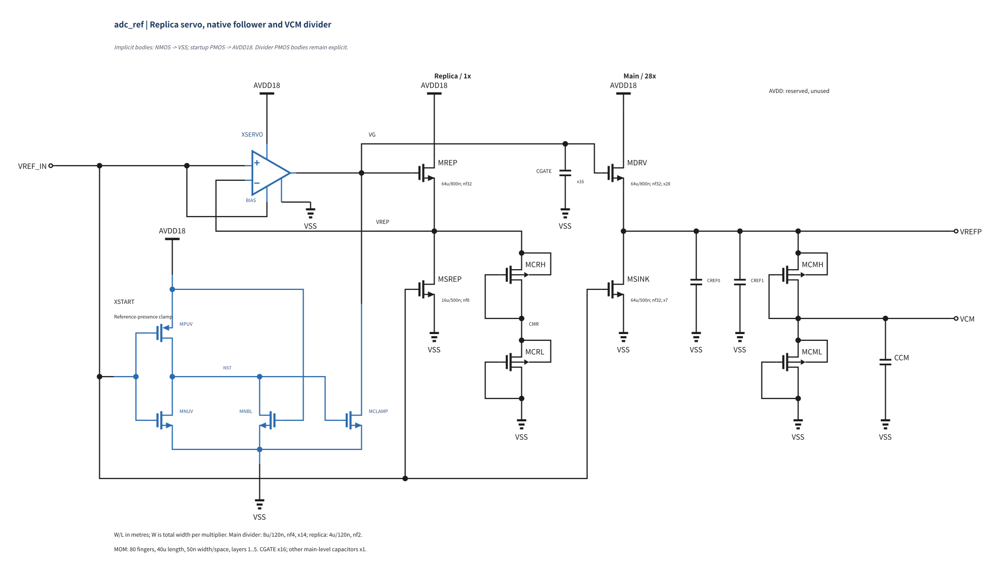
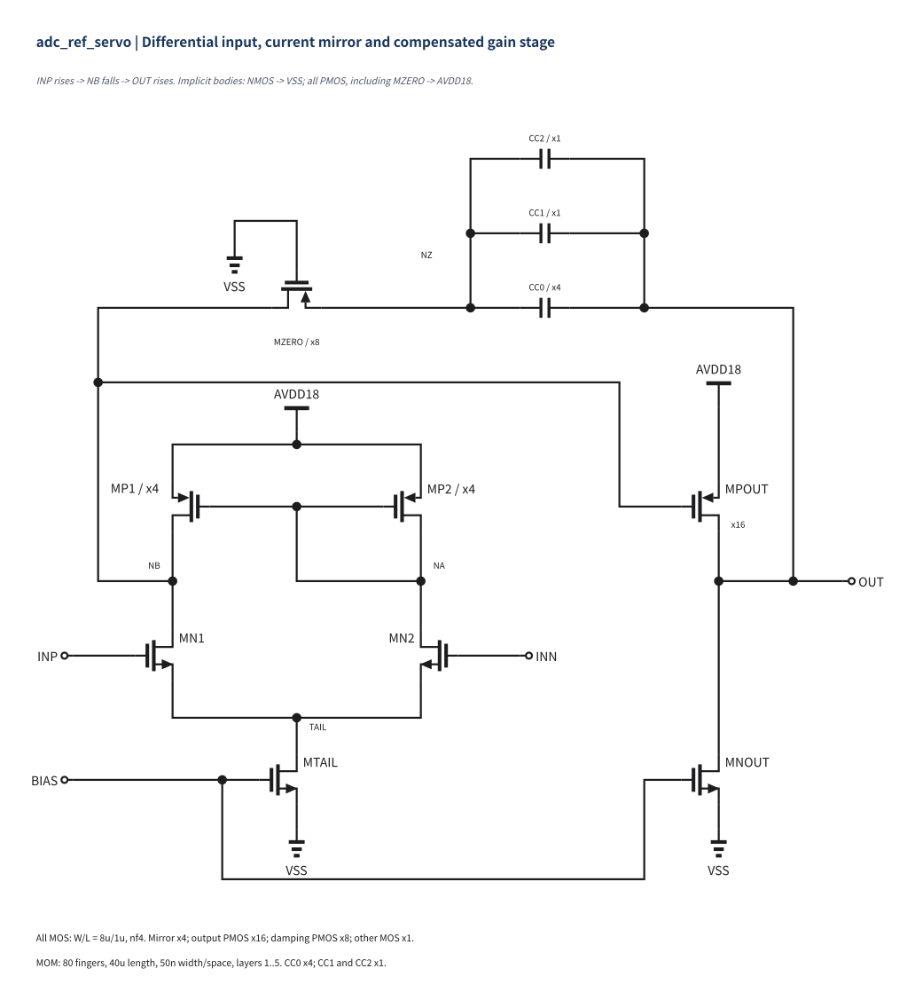
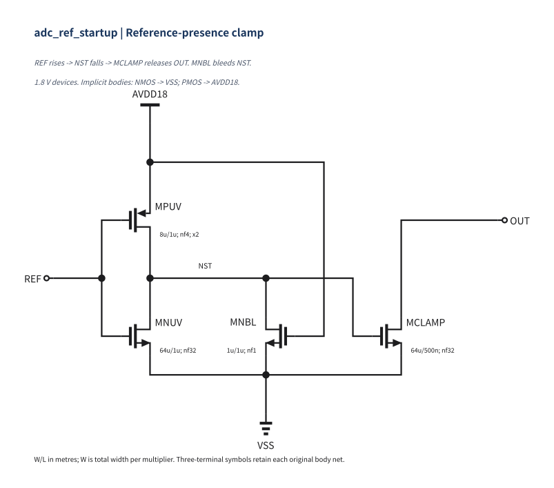

# Schematic presentation audit

This drawing revision changes only RNL records in `adc_ref.scs`. It retains
the main28/gate16 electrical design, candidate metadata, and all existing
simulation records. The previews below are rendered from the checked source
with RNL `core-v0.5.2`.

## Drawing conventions

The main page places the replica and main followers side by side, with the
replica feedback drawn back to the servo input. The servo uses the standard
`$OPAMP` geometry with the actual BIAS, AVDD18 and VSS pins added. Its separate
transistor page retains the differential pair, current-mirror and matching
semantics. The startup instance depicts its four actual MOS devices and
connections with standard symbols, without a surrounding block rectangle.
Its independent transistor page remains available.

The 16 MOS devices whose bodies connect to supply rails use standard
three-terminal symbols. Each page states the implicit body rails: NMOS bodies
connect to VSS; servo and startup PMOS bodies connect to AVDD18. This includes
MZERO, whose source is NZ and whose body remains AVDD18.

The four divider PMOS devices retain standard four-terminal symbols and
explicit body connections:

| Device | Source and body net |
| --- | --- |
| MCRH | VREP |
| MCRL | CMR |
| MCMH | VREFP |
| MCML | VCM |

The OPAMP input/output pins 1, 2 and 3 map to INP, INN and OUT. Added pins
map by name to BIAS, AVDD18 and VSS. The startup symbol maps by name to REF,
OUT, AVDD18 and VSS; its 12 visible MOS pins reproduce the child's five nets,
including internal NST. These drawing symbols do not change the subcircuit
hierarchy or establish additional electrical connections.

Junction dots mark only genuine three- or four-way branches. The 38 dots in
the three transistor drawing levels and the five dots within the startup
symbol were checked against their incident wire directions. Ordinary bends
and unconnected crossings have no dots. All 88 visible real-instance pins
were checked against their original net assignments; all 29 instances are
placed and no flylines remain.

## Electrical preservation

Baseline: `8797aa49fbbfd00648914185c0af53142a5324e6`.

| Check | Result |
| --- | --- |
| Non-RNL source bytes, including comments and whitespace | All 2,355 bytes identical |
| SHA256 of those bytes | `5525b97fc6dc69750c35d35670a2d19d890cbd30e4db65aaa4299e8c883bc827` |
| Electrical content hash, before and after | `2b1163f0eb481376` |
| Candidate metadata | Byte-identical; status remains `ready` |
| Existing result JSON and PNG files | All 272 per-file SHA256 values unchanged |
| Result freshness and verdicts | 136 fresh passing records; zero stale or failed |
| New simulation runs | 0 |
| RNL semantic/connectivity checks | 0 errors, 0 warnings, 0 hints |
| Project checks and strict result checks | Pass |
| Existing unit tests | 439 passed, 1 deselected |

The preservation comparison removes only complete RNL comment records,
retaining every other byte. Device declarations, instance order, ports,
connectivity, dimensions, multipliers and all non-RNL comments are identical
to the baseline. Stored results were neither edited nor rehashed.

## Main reference driver

## Replica servo

## Startup clamp

