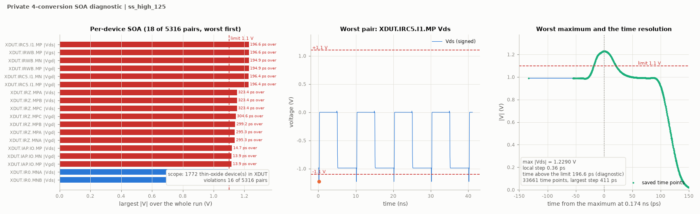

# SOA diagnostic: failed, not formal qualification

Date: 2026-11-02. Circuit hash: `237b05f50a71cbad`.
This is contributor self-reported diagnostic evidence, not independent
verification. The candidate remains **wip**. Timing-spec passes do not
establish safe device terminal voltages.

## Scope and conditions

The standard functional testbench was used in a private diagnostic deck,
with **4 conversions**, 100 MHz, the 45 ps comparator emulator, standard
port loads, and additional saves for all classified thin-oxide MOS terminal
nodes below `XDUT`. Neither the candidate netlist nor public specifications,
testbenches or measurement code were changed. Runs use **APS** and
**errpreset=conservative**. No diagnostic result is recorded as a standard
60- or 1000-conversion acceptance result.

The project SOA planner resolves **1772 thin-oxide device instances**, with
**5316 gs/gd/ds terminal pairs** and 839 non-ground terminal nodes. Thick-oxide
devices are outside this check. The saved waveforms cover the whole
transient, from **0 to 41.12 ns**, not just an edge window. Each corner
captures four correct words with fourteen logged decisions each, zero bit
errors and zero DAC-level errors. The testbench also starts an unfinished
fifth word before simulation stops; it is not counted as a completed word.

## Observations

| Corner | DVDD | Checked pairs | Pairs exceeding 1.1 V | Largest absolute terminal voltage | Saved time points |
|---|---:|---:|---:|---:|---:|
| `ff_high_m40` | 0.99 V | 5316 | **16** | **1.22751 V** | 37296 |
| `ss_high_125` | 0.99 V | 5316 | **16** | **1.22896 V** | 33661 |

The worst pair is `XDUT.IRC5.I1.MP` drain-to-source; the same node stresses
the gate of `XDUT.IRWB.MP`. For the slow/hot corner the offending nodes are:

| Internal node | Lowest saved voltage | Associated largest PMOS source-to-drain magnitude |
|---|---:|---:|
| `cv_resetwait` | -0.238959 V | 1.228959 V |
| `rz` | -0.161524 V | 1.151524 V |
| `abort` | -0.129091 V | 1.119091 V |

These are negative undershoots relative to VSS: for example,
`0.99 - (-0.238959) = 1.228959 V`. The worst pair exceeds the limit at
multiple edges, not only startup. Its accumulated above-limit duration is
146.325 ps at `ff_high_m40` and 196.570 ps at `ss_high_125` over this
diagnostic. Short duration does **not** waive the project peak-voltage limit.
The plotted worst-edge local step is 0.13 ps / 0.356 ps, respectively.

## Interpretation and next work

The three affected nodes have relatively weak local drivers feeding stronger
downstream logic. Capacitive feedthrough is a plausible cause of the
undershoots, but this is a hypothesis, not a demonstrated fix. A subsequent
driver/load rebalance must be checked for SOA, timing and functional effects;
in particular, the existing TT conversion-time margin is only 2.988 ps.
No electrical change is made while the current frozen-circuit formal
function and random runs finish.

The public SAR logic tests currently have **no `soa:` instrumentation or
SOA acceptance metric**. The absence of `soa_violations` in their JSONs must
not be read as zero violations. Reproducing this diagnostic requires a
separate deck: build the standard functional test with `nconv=4`, use
`adcflow.soa.plan` for `XDUT` with no external MOS devices, add its terminal
saves, run the stated corners with APS/conservative, and call
`adcflow.soa.check` on the complete saved transient. Running the ordinary
CLI test without these additional saves does not reproduce an SOA check.

Formal SOA test scope/instrumentation is raised in issue **#133** and must
be coordinated with the project lead before changing shared specs or tools.
These two failed diagnostic
corners are sufficient to withhold a SOA-pass claim; they do not establish
coverage of the other 43 corners, stuck-comparator or interrupted-conversion
operation. Mixed top-level qualification and independent verification also
remain incomplete.
