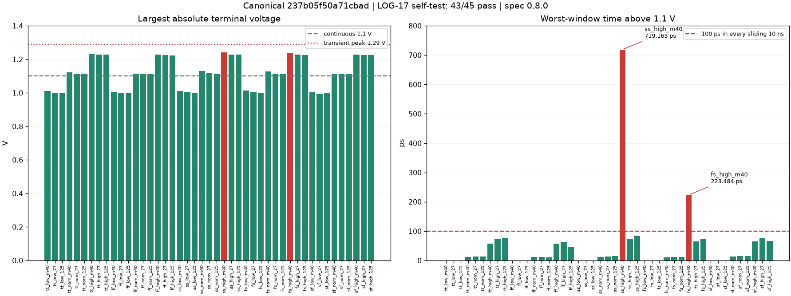

# Current validation: wip (specification 0.8.0)

Circuit hash: `237b05f50a71cbad`. Issues #130, #133 and #135 are acknowledged.
LOG-08 remains <=2.75 ns. The project, not this candidate, introduced the
SOA transient allowance: each pair passes at peak <=1.1 V, or at peak <=1.29 V
with time above 1.1 V <=100 ps in **every sliding 10 ns window**, startup
included. We have rebased onto current main; no shared spec/test/tool changes
are included in this candidate PR.

All results below are **self-reported**, not independent verification.
The canonical circuit is unchanged. Candidate status remains **wip**.

## Formal coverage of the canonical circuit

| Standard test / requirement | Evidence | Verdict |
|---|---|---|
| Ordinary function, LOG-06/07/10 all corners | 45 x 60 = **2700** complete 14-decision words; zero bit/DAC errors; all applicable requirements pass | pass at all 45 corners |
| TT bounded function requirements, including LOG-08/16 | maximum conversion 2.747012 ns; extra-wait error 14.456266% | pass at TT |
| Slow comparator, LOG-09 | 45 x 100 = **4500** complete words; zero errors; maximum 3.716304 ns <=4.1 | pass at all 45 corners |
| Timeout, LOG-11/12 | 45 x 40 = **1800** words, zero errors; corner-mean time 204.479-337.386 ps | pass at all 45 corners |
| Random, LOG-01 | **TT: 1000** complete 14-decision words, zero bit/DAC errors | pass at TT only; other 44 corners missing |
| SOA, LOG-17 | all 45 corners, standard 51.12 ns stimulus; 1772 thin-oxide devices / 5316 pairs per corner; five RDY captures per corner | **43/45 pass; two fail** |

Ordinary-function extrema (the exact metrics used by the specs):

- LOG-06 mean net slow wait: **70.142097-128.685096 ps**, limit >=70.
- LOG-07 mean start: **82.237839-145.293735 ps**, limits 80-160.
- LOG-10 minimum D setup: **103.330186 ps**, limit >=100.
- TT power **1059.473644 uW** is reported only. TT CONV/comparator input capacitance **2.533733/6.726849 fF** meets 40/7 fF.

Metrics not applicable outside TT are not judged there. In particular, a
non-TT raw LOG-08/16-style observation is not a failure of a TT-only spec.
The random test does not replace saved-waveform function timing coverage.
Existing unchanged-input jobs were reused only after dependency, sample-count
and complete-word audits; they were not rehashed from another circuit.

## The new SOA criterion still has two failing corners

| Corner | Largest absolute voltage | Worst 10 ns over-limit time | Violating pairs | LOG-17 |
|---|---:|---:|---:|---|
| `fs_high_m40` | 1.23865 V | 223.484 ps | 24 | fail |
| `ss_high_m40` | 1.24068 V | 719.163 ps | 25 | fail |



Neither failure is a peak above 1.29 V. The **time** above 1.1 V exceeds
100 ps. The dominant `ss_high_m40` pair is `IT0.I0.MNA` ds: a floating
intermediate NMOS stack node. DAC-output NOR PMOS intermediate `px` nodes
also cause failures at both corners around reset/interrupt events.

The representative failing corners have completed the specification's
crosscheck (`traponly`, maxstep 1 ps, reltol 1e-7, vabstol 1e-8). The tighter
runs still fail with **25 / 24 violating pairs** at `ss_high_m40` /
`fs_high_m40`; worst-window times are **730.935 / 230.593 ps**. The primary
results above retain their actual settings and carry the separate crosscheck
in metadata. Thus the two failures are not dismissed as numerical artifacts.

SOA reduction uses the unchanged upstream `soa_core.py` on the server.
The large result JSONs use compact formatting; a redundant constant `where:
dut` is omitted from per-pair rows if needed for the 1 MB limit. **Every
pair and every measured quantity is retained**; device scope and counts remain
explicit. No measurement, limit or numerical setting was altered.

## Private correction experiments, not canonical acceptance

Two alternatives have passed the two failing corners in **unrecorded**
standard-stimulus experiments. They are different circuits, not evidence for
canonical hash `237b05f50a71cbad`:

- MOS-capacitive stabilization, prototype `3fab1e8ad5fa9938`: extra gate load
  at output `px` and the first timer stack node. Worst-window times
  **73.906 / 53.978 ps** at `ss_high_m40` / `fs_high_m40`, zero violations.
  Its full 60-conversion TT experiment also has zero errors, conversion
  **2.746730 ns**, and extra-wait error **14.764328%**. Other corners and
  fast-corner timing are not qualified by those experiments.
- Gate ordering / first-tap simplification, prototype `49099ed265479435`:
  global CVB is placed on the upper DAC-output PMOS, local data on the lower
  one; the first timer NAND with two identical CLK inputs is replaced by a
  matched-drive inverter. This removes the first floating stack node without
  adding MOS devices. Worst-window times **71.459 / 54.806 ps**, zero
  violations. Its full 60-conversion TT experiment has zero errors, conversion
  **2.743852 ns**, extra-wait error **15.300309%**, and all applicable TT
  bounds pass. Standard 40-conversion timeout experiments at `ff_high_m40` and
  `ss_low_125` also have zero errors and mean times **204.879175 /
  336.917875 ps**. The new scheme still needs canonical full-corner
  validation before promotion/qualification.

A complete RNL preview of the second alternative reports zero errors,
warnings and hints. It is **not** the canonical netlist. Promoting an
electrical change would require fresh applicable standard results; none of
the current canonical data would be relabeled to a different circuit.

The older [strict-peak diagnostic](SOA_DIAGNOSTIC.md) is historical. Its
cumulative over-limit duration and red plot do not represent the new rule.

## Remaining qualification

LOG-17 failures must be resolved, LOG-01 still lacks 44 corners, mixed
top-level regression is absent, and all candidate results still require the
project lead's independent verification. Code/record checks do not make this
candidate fully qualified. No `verification/` data or verification flags are
written by this candidate.

## Standard reproduction

```text
python -m adcflow sim tb_sarlogic_func --view adc_sarlogic=xtor:many-question --corners all
python -m adcflow sim tb_sarlogic_func_slow --view adc_sarlogic=xtor:many-question --corners all
python -m adcflow sim tb_sarlogic_timeout --view adc_sarlogic=xtor:many-question --corners all
python -m adcflow sim tb_sarlogic_rand --view adc_sarlogic=xtor:many-question --corners typ
python -m adcflow sim tb_sarlogic_soa --view adc_sarlogic=xtor:many-question --corners all
python -m adcflow sim tb_sarlogic_soa --view adc_sarlogic=xtor:many-question --corners ss_high_m40,fs_high_m40 --crosscheck
```

All primary results use APS and errpreset=conservative with the original
test parameters. Only resource/runtime/serialization handling is private.

## Local code/record checks

`adcflow check all`: zero errors; two warnings are the actual canonical
LOG-17 failures, not stale or missing data. RNL: zero errors/warnings/hints.
Candidate path/author checks pass. Unit suite: **485 passed, 3 skipped,
1 deselected** (`pytest -q -m "not slow"`). These checks are not electrical
qualification or independent verification.
