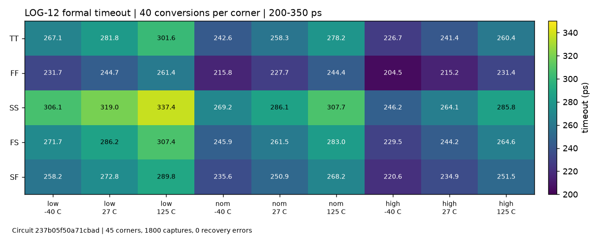

# Current validation: wip

Specification: adc_sarlogic 0.7.0. Circuit hash: `237b05f50a71cbad`.
Issue #130's maintainer decision is acknowledged: LOG-08 is still <= 2.75 ns;
2.90 ns is not an approved target. No ports, specifications, testbenches or
numerical settings were changed. Results are self-reported; independent
verification and selection have not been performed.

## Formal timing progress

| Requirement | Current evidence | Verdict |
|---|---|---|
| LOG-08: TT maximum conversion time <= 2.75 ns | 2.747012 ns, standard 60-conversion function test | pass at TT |
| LOG-09: slow comparator, all corners <= 4.1 ns | 2.704664-3.716304 ns, 45 x 100 conversions | pass at all 45 corners |
| LOG-11: stuck-comparator recovery errors = 0 | 45 x 40 conversions, zero errors | pass at all 45 corners |
| LOG-12: timeout 200-350 ps | corner means 204.479-337.386 ps | pass at all 45 corners |
| LOG-16: TT worst extra-wait error <= 20% | 14.46% | pass at TT |

The slow test captures 4500 complete words with zero bit,
DAC-level or decision-count errors. Every captured word has 14 emulator-logged decisions.
Its worst corner is `ss_low_125`. The timeout test captures
1800 words with zero recovery errors. All committed records
match this circuit and are not stale; APS and `errpreset=conservative` are
retained, with no sample-count overrides.

These passes do not make the whole candidate eligible: formal remaining
function-corner coverage, 1000-conversion random, mixed top-level regression
and independent verification remain pending. **Additional SOA diagnostics
have found violations**, as described below. Candidate status is `wip`.

## Ordinary function observations

The standard TT test captures 60 words with zero bit/DAC
errors; all applicable bounded TT observations pass. Values below use each
specification's unit (ps/ns/fF/percent or reported uW).

| TT spec | Measured | Requirement | TT verdict |
|---|---:|---|---|
| LOG-02 | 31.549660 ps | <= 40 | pass |
| LOG-03 | 30.721130 ps | <= 45 | pass |
| LOG-04 | 45.217264 ps | 35 .. 60 | pass |
| LOG-05 | 92.935631 ps | 70 .. 100 | pass |
| LOG-06 | 92.935631 ps | >= 70 | pass |
| LOG-07 | 107.257090 ps | 80 .. 160 | pass |
| LOG-08 | 2.747012 ns | <= 2.75 | pass |
| LOG-10 | 133.366494 ps | >= 100 | pass |
| LOG-13 | 1059.473644 uW | reported | info |
| LOG-14 | 2.533733 fF | <= 40 | pass |
| LOG-15 | 6.726849 fF | <= 7 | pass |
| LOG-16 | 14.456266 % | <= 20 | pass |

The standard fast-corner function test (`ff_high_m40`) also captures
60 words with zero errors. Its applicable LOG-06/07/10 pass:
mean slow wait 70.142097 ps, first clock 82.237839 ps,
D setup 103.330186 ps. These function requirements name all corners:
the two formally recorded corners do not substitute for all 45.

The current quick-set four-conversion diagnostic covers seven corners and
28 words with zero bit, DAC-level or decision-count errors. Its minimum
slow wait is about 70.38 ps, first clock 82.18 ps and D setup 103.37 ps.
It is diagnostic only. The older all-corner four-conversion diagnostic of
intermediate circuit `49ab94f9521d0865` does not qualify this circuit.

## Additional verification started on 2026-11-02

The remaining **43 ordinary-function corners**, each with the standard
60 conversions and saved waveforms, and the standard **1000-conversion TT
random test** are running on this unchanged circuit. They are not yet claimed
as completed or passing. The existing two fresh ordinary-function corners
are reused; slow/random `nowave=1` data cannot substitute for LOG-06/07/10
waveform coverage. LOG-01 still requires all 45 corners, not only TT.

A separate two-corner, four-conversion diagnostic saved all thin-oxide
terminal nodes and checked 1772 devices / 5316 terminal pairs. **SOA fails
in both diagnostic corners:** `ff_high_m40` has 16 violating pairs, maximum
1.22751 V; `ss_high_125` has 16 violating pairs, maximum 1.22896 V against
the unchanged 1.1 V project limit. Four completed words in each corner
are bit/DAC correct; this does not excuse the voltage violations.

See [SOA_DIAGNOSTIC.md](SOA_DIAGNOSTIC.md) for scope, full-transient evidence,
node undershoots and reproduction requirements; issue #133 requests the
project lead's decision on formal instrumentation. These diagnostics are not
standard acceptance results or independent verification. The public SAR
logic tests do not enable SOA, so their missing SOA fields are not a pass.
No netlist change was made; the circuit hash and existing formal timing
results remain unchanged.

## Design changes and retained limits

The earlier circuit `df50102541da9321` measured 2.860505 ns at TT. The current
maximum is 113.493 ps shorter without relaxing LOG-08.
Receiver, output/storage and request-tree drive are rebalanced using valid
device geometries and multiplicities. Direct comparator return-to-zero
feedback is retained in the four-input clock latch; the window/timeout
qualification is separate. A rejected fully buffered reset clipped small
extra waits and was not retained.

The slow-wait load preserves the 70 ps fast-corner floor, rather than blindly
lowering all slow waits to the TT behavioral nominal. TT extra waits after
decisions 3/4/5/6/9 are 8.55/
26.49/25.97/
27.23/26.19 ps, against the unchanged
10/30/30/30/25 ps design values and the unchanged 20 percent tolerance.
The 12-tap EHVT NMOS-only timeout load is retuned to `timer_load=5u` after
the clock-path change. It uses no extra reference, timing pin or ideal delay.



## Reproduction and checks

```text
python -m adcflow sim tb_sarlogic_func --view adc_sarlogic=xtor:many-question --corners typ
python -m adcflow sim tb_sarlogic_func --view adc_sarlogic=xtor:many-question --corners ff_high_m40
python -m adcflow sim tb_sarlogic_func_slow --view adc_sarlogic=xtor:many-question --corners all
python -m adcflow sim tb_sarlogic_timeout --view adc_sarlogic=xtor:many-question --corners all
```

The full-corner executions use the standard test parameters and numerical
settings. Only queue concurrency/resource wall-time limits were managed;
input hashes were checked against the staged circuit before recording.
Local checks pass without stale-result or failed-spec warnings. RNL reports
zero errors, warnings and hints. The unit suite reports 457 passed, 2 skipped
and 1 deselected with `pytest -q -m "not slow"`.
